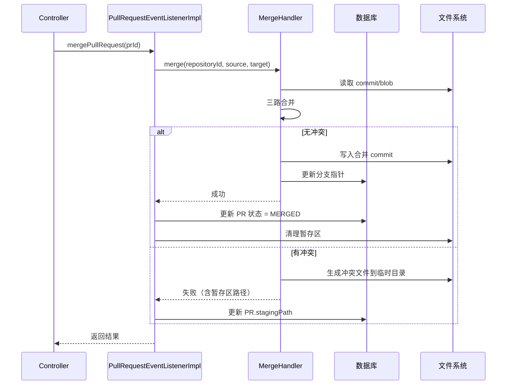
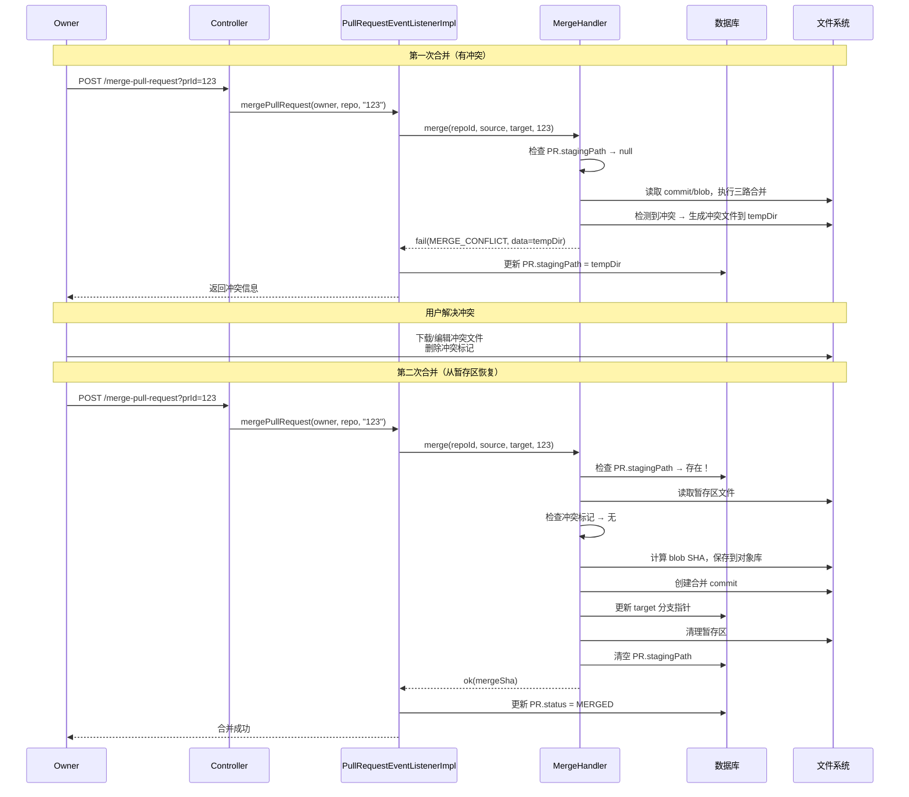
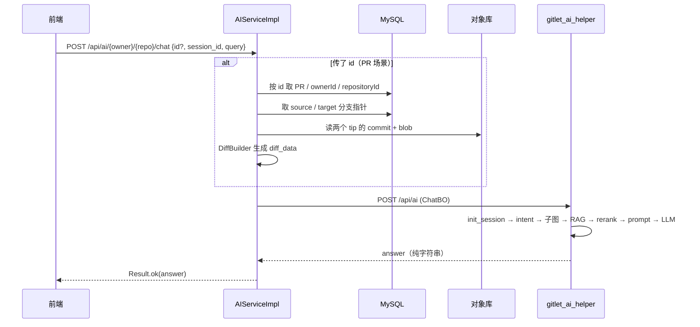

# gitlethub 设计文档

| | |
| --- | --- |
| 状态 | draft |
| Owner | 花火 |
| Reviewer | 待指派 |
| 最后更新 | 2026-10-19 |
| 接口冻结 | 未冻结（`docs/openapi.yaml` 定稿后填日期） |
| 取代 | `gitlethub 设计文档.md`（无状态草稿，保留作参考） |

> 2026-09-29 增补：新增 Web 前端 `gitlethub-frontend`，并补齐其所需的只读接口（见 §6、§13）。
> 这两项推翻了 §2 原来的两条非目标（「不做 Web UI」「不做 PR」），相关条目已就地更新。
> 本次改动**不含 `gitlet_core`**（见 §13.4）。
>
> 2026-09-30 增补：修复「PR 作者显示成 owner、协作者能合并自己的 PR」——
> 根因是 `remote-gitlet` **原先没有任何调用者身份概念**，所有写路径都把 URL 上的 `owner` 当操作者。
> 现新增 `JwtAuthFilter` 注入调用者身份、建 PR 记录真实创建者、合并仅限仓库 OWNER（见 §6「调用者身份」、D35–D37）。
> 本次同样**不含 `gitlet_core`**，也**未改动 `docs/openapi.yaml`**。
>
> 2026-10-01 整理：把散落在 `gitlethub遇到问题.md`、`Cloud-Gitlet 项目全程问题与解决方案汇总.md`
> 中的**设计决策与权衡**并入 §9、**运行期风险**并入 §10、**数据模型**并入 §7、**客户端契约与 PR 机制**并入 §8；
> 纯原理问答（BCrypt、RS256、H2、Flux/Mono 等）不适合留在设计文档，另见《设计附录-原理与概念澄清》。
> 同时按当前代码校正了几处过时描述（自动 PR 接口已收敛到仓库级、`pull_request` 表字段、测试基线）。
>
> 2026-10-12 增补：修改了ai服务的接口信息，新增`/api/ai/search-code`接口，增加说明字段
> （2026-10-19 核对：该独立搜索接口未在当前代码中落地，搜索由 `/api/ai` 的 `search` 意图承担）
>
> 2026-10-19 增补：AI 服务 `gitlet_ai_helper` 已落地（FastAPI + LangGraph + Milvus + RabbitMQ），
> `remote-gitlet` 新增 AI 代理入口与会话/PR diff 组装。本文按**实际代码**校正了 §4/§6/§7/§8，
> 并补充 §9 取舍、§10 联调阻塞项与 §13 前端 AI 助手。原理性内容见《设计附录-原理与概念澄清》§七。

---

## 1. 背景

gitlet 是一个类 Git 版本控制系统的子集（CMU-61B 风格），当前形态是单进程 CLI：

- 仓库状态全部落在工作目录下的 `.gitlet/` 目录，磁盘是唯一的跨命令状态载体。
- 执行模型是**一条命令一个 JVM 进程**（`java gitlet.Main <command>`）。进程内的对象随进程结束消失。
- 因此「当前操作哪个仓库」由**进程的工作目录**决定，而不是由参数决定。

现在要把它扩展成云端代码托管平台：一个服务进程同时服务多个用户、多个仓库，并提供 AI 辅助能力。

核心已做过一轮改造（M0），把「仓库」从进程级全局变成可多实例：

| 类 | 行数 | 职责 |
| --- | --- | --- |
| `repository/Repository.java` | 92 | 门面：`repoId` / `paths` / `objects` / 懒加载的 `stage` |
| `repository/RepositoryPaths.java` | 43 | 由 `(repoId, cwd)` 算出的 7 个磁盘路径 |
| `repository/ObjectStore.java` | 178 | object 读写、SHA-1 补全、commit 持久化 |
| `handler/CommandHandler.java` | 337 | init/add/commit/rm/log/global-log/find/checkout*/reset |
| `handler/MergeHandler.java` | 311 | merge / LCA / 三路合并 / 冲突生成 |
| `handler/StatusHandler.java` | 207 | status 及各类派生查询 |
| `handler/BranchManager.java` | 114 | 分支增删查 + HEAD 指针 |
| `Main.java` | 173 | CLI 入口，组装对象图 |
| `commit/Commit.java` | 45 | 纯数据对象（Lombok `@Data`） |
| `stag/Staging.java` | 52 | 暂存区：`stagingMap` + `removeSet` |
| `utils/Utils.java` | 231 | 序列化 / SHA-1 / 文件读写 |

服务端复用核心的入口就是这四个构造：

```java
Repository     repo     = new Repository(String repoId, File cwd);
RepositoryPaths paths   = repo.getPaths();     // getCwd/getGitletDir/getObject/getBranchDir/getHeadFile/getCommits/getStagingFile
ObjectStore    objects  = repo.getObjects();
CommandHandler commands = new CommandHandler(repo);   // 四个 Handler 均只依赖 Repository
```

`repoId` 目前**只作标识/诊断用，不参与路径计算**，路径一律由调用方传入的 `cwd` 决定。

---

## 2. 目标 / 非目标

`(临时)` 以下都是初稿建议。**同意的留着，不同意的直接删。** → D1

### 目标

- 一个仓库 = 一个独立实例，同一进程内多个仓库互不干扰。**（已完成）**
- 用户可以把本地 gitlet 仓库推送到云端、从云端拉取。
- 提供 AI 辅助：代码解释 / 代码审查 / 语义化代码搜索 / 代码考古（提交信息仅作为索引内容，不是独立接口）。
- **提供 Web 前端**：浏览仓库文件 / 提交 / 分支，管理 PR 与协作者。**（2026-09-29 新增，见 §13）**

### 非目标

- 不实现 Git 线协议（smart HTTP / packfile），不追求与真 git 互通。
- ~~不做 Web UI，交互一律走 CLI。~~ **2026-09-29 取消**：改为「Web 只读浏览 + PR/协作者管理」，
  写操作（push/pull/clone）仍走 CLI；PR 合并冲突已支持 Web 端在线编辑（见 §13.14）。
- 不做分布式部署，先单机单盘。
- 不做细粒度权限模型，先只区分 owner / 非 owner。
- 不做断点续传、增量打包等传输优化。
- ~~不做仓库可视化、issue、PR、CI 等，只做托管 + AI。~~ **2026-09-29 部分取消**：
  仓库可视化（文件/提交/分支）与 PR 已实现；issue、CI 仍不做。
- ~~Web 端不做冲突解决可视化编辑器~~ **2026-11-05 取消**：合并产生冲突后，仓库 OWNER 可在 PR 详情页
  在线编辑暂存区文件并重新合并（见 §13.14）；二进制文件仍需 CLI。

> 非目标比目标重要：它是防止范围蔓延的唯一手段。

---

## 3. 规模与约束

`(临时)` 数字全部是初稿建议，见 → D2、D3、D4。

| 约束 | 取值 `(临时)` | 超出时怎么办 |
| --- | --- | --- |
| 单仓库体积上限 | 100 MB | push 返回 413 |
| 单文件体积上限 | 10 MB | push 返回 413 |
| 单次 push 体积 / 超时 | 50 MB / 30 s | 返回 413 / 客户端分批 |
| 目标用户数 | 100 | — |
| 目标仓库数 | 1000 | — |
| 仓库落盘路径 | `$REPOS_ROOT/<owner>/<repo>` | → D3 |
| 部署形态 | 单机，非容器 | → D2 |

已定的技术约束：

- Java 17（`gitlet_core` 用 `maven.compiler.release=17`）。
- 父 pom `spring-boot-starter-parent:3.3.0`，依赖版本统一由它的 BOM 管理。
- `gitlet_core` 是**纯库**：除 Lombok（`provided`）外无任何依赖，不依赖 Spring。
- 目录命名 `(临时)`：现在是 `gitlet_core`（下划线），但同级的 `gateway-service` / `remote-gitlet` 都是连字符，Maven 惯例也是连字符。改名要动父 pom 的 `<modules>` 和 IDE 配置。→ D4

---

## 4. 架构

```
gitlethub (parent, packaging=pom)
├── gitlet_core/       纯库，无 Spring。CLI 与 remote-gitlet 依赖它
├── gateway-service/   Spring Cloud Gateway：路由 + 鉴权过滤 + 限流
├── user-service/      用户注册 / 登录 / 用户信息（端口 8081）
├── common-service/    共享 po / dto / vo / bo / enums / jwt / exception
└── remote-gitlet/     实现 /api/repos/**，依赖 gitlet_core（端口 8080）

gitlethub-frontend      Vue3 + Vite Web 前端，独立工程，在 D:\Job_project\gitlethub-frontend
gitlet_ai_helper        AI 服务，独立 project（FastAPI，默认 8000），不在本仓库 → D15
```

AI 服务内部（独立进程，不共享 Java 容器）：

```
POST /api/ai
   └─ ChatServiceImpl
        ├─ MemoryManager（Redis：会话元信息 / 分层记忆）
        └─ LangGraph
             ├─ intent 节点（当前用 LLM 小模型 + JSON 校验；计划换 SetFit）→ explain / review / archaeology / search
             ├─ RAG：Milvus 稠密 + 稀疏向量召回（BGE-M3）
             ├─ rerank：BGE reranker
             └─ prompt(Jinja2) → LLM(Qwen via LiteLLM) → answer

RabbitMQ  pr_merged_queue → 消费 → AST 切分（tree-sitter）→ 向量化 → Milvus
```

远程存储：

```tex
远程存储结构：

.gitlet/
└── {owner}/
    └── {repo}/
        ├── Objects/
        │   ├── commits/          ← type=COMMIT 的写这里
        │   │   ├── abc123...
        │   │   └── def456...
        │   ├── sha_a1            ← type=BLOB 的写这里
        │   └── sha_b2
```

**职责与依赖方向（单向，不可逆）**

| 模块 | 职责 | 依赖 `gitlet_core` |
| --- | --- | --- |
| `gitlet_core` | 仓库操作核心 + CLI（含 `api/GitletClient` 远程客户端） | — |
| `gateway-service` | 唯一入口。路由、鉴权、限流、日志过滤，**不含业务接口** | ❌ 不得依赖 |
| `remote-gitlet` | 仓库与对象传输的服务端实现 | ✅ |
| `gitlet_ai_helper` | AI 能力：代码解释、代码审查、语义化代码搜索、代码考古（按提交历史讲述设计原因）。独立 project，契约跟着那个项目走；知识图谱未做 | ❌ |

`gateway-service` 是**策略层不是业务层**：它不该出现任何 `/api/repos/**` 的 controller。
把业务 spec 生成到 gateway 是错的——生成目标是 `remote-gitlet`。

### 当前落地状态

| 模块 | 磁盘 | 已加入父 pom `<modules>` | 状态 |
| --- | --- | --- | --- |
| `gitlet_core` | ✅ | ✅ | 1802 行，21 个集成测试全绿 |
| `common-service` | ✅ | ✅ | 共享 po/dto/vo/bo/enums/jwt/exception |
| `gateway-service` | ✅ | ✅ | 4 个文件，`application.yaml` 无路由，**尚不可用**（见 §10） |
| `user-service` | ✅ | ✅ | 端口 8081，注册/登录/用户信息可用 |
| `remote-gitlet` | ✅ | ✅ | 端口 8080，push/pull/clone + PR + 只读接口 + AI 代理（见 §6、§13）+ 自验签的 `JwtAuthFilter`（只注入身份、不拦截，见 §6「调用者身份」） |
| `gitlethub-frontend` | ✅ | —（独立工程，非 Maven 模块） | Vue3 + Vite，见 §13 |
| `gitlet_ai_helper` | ✅ | —（Python 独立工程） | FastAPI + LangGraph + Milvus + RabbitMQ 消费者；四类意图已实现（见 §6、§8） |

父 pom `<modules>` 已注册 `gitlet_core`、`gateway-service`、`remote-gitlet`、`user-service`、`common-service` 五个模块
（§10 阻塞级 4 已解决）；`gateway-service` 虽已注册但内容仍是空壳。

### 进程与并发模型

- **CLI 路径**：一个进程服务一个仓库，`cwd` 即仓库位置。**（已完成）**
- **服务端路径**：一个进程服务多个仓库，需要处理：
  - `Repository` 把 `Staging` 缓存在内存里（懒加载），这只在「一仓库一实例 + 单线程」下正确。→ D12
  - 同一仓库被并发操作时，按 `repoId` 加锁还是每请求新建实例。→ D12
  - 服务端是否缓存 `Repository` 实例。→ D13

---

## 5. 核心契约

当前 `gitlet_core` 的仓库操作和 CLI 输出是**同一套代码**：

- `Main.java` 里有 4 处 `System.exit(0)`：空命令、空提交信息、`checkout` 格式错误、`.gitlet` 不存在。
- 输出全部直接写 `System.out.println`，集中在 `Repository.outputCommitLog()`、`StatusHandler.printSection()`、`CommandHandler.find()`。
- 错误信息通过 `Utils.message()` 打印，不抛异常、不返回状态。

**后果**：这套代码无法在服务进程里运行——一个 `System.exit` 就会杀掉整个服务。

建议的改造形状 `(临时)`：

```java
// 核心只返回结果对象，不打印、不退出；stdout 渲染属于 CLI 层
interface GitletApi {
    CommitResult commit(String repoId, String message);
    StatusView   status(String repoId);
    MergeResult  merge(String repoId, String branch);
}

// 渲染层：CLI 实现打到 stdout，服务端实现转成 DTO
interface Renderer {
    void commitLog(Commit c, String sha1);
    void message(String text);
}
```

服务端侧不实现 `Renderer`：`remote-gitlet` 的 controller 把结果对象包成 §6 的
`{code, message, data}` 信封，CLI 侧用 `Renderer` 打 stdout。**核心对两种渲染都不感知。**

| 决策 | ID |
| --- | --- |
| 错误表达方式：异常 vs `Result` 对象 | → D6 |
| `System.exit` 归谁（建议：只留在 `Main`） | → D7 |
| 渲染：接口注入 vs 直接返回字符串 | → D8 |

---

## 6. 接口

这份 spec 只描述 **`remote-gitlet`** 实现的 `/api/repos/**`。校验和生成：

```bash
npx @redocly/cli lint docs/openapi.yaml
openapi-generator generate -i docs/openapi.yaml -g spring -o remote-gitlet
```

**user-service:**

| 方法 | 路径                     | 用途                                 |
| ---- | ------------------------ | ------------------------------------ |
| POST | `/user/registration`     | 用户注册（BCrypt）                   |
| GET  | `/user/{user_id}`        | 获取用户资料（`UserProfileVO`，不返回密码） |
| POST | `/user/login`            | 用户登录                             |
| PUT  | `/user/profile`          | 修改当前登录用户资料：邮箱 / 头像 + 可选改密码（改密码需原密码；身份取自 `Authorization`） |
| GET  | `/api/oss/presigned-url?fileName=&contentType=` | 获取 OSS 直传预签名地址，返回 `uploadUrl`、`accessUrl` 与参与签名的 `contentType`（浏览器 PUT 时必须发送同一个值）；网关路由到 user-service |
| POST | `/user/logout`           | 用户登出（Token 加入黑名单）         |
| GET  | `/user/search?username=` | 搜索用户（添加协作者时需要）         |
| POST | `/user/avatar`           | 上传/更换头像(可选)                  |

**实现方 `remote-gitlet`**

注：owenr为用户名，repo为仓库名

| 方法 | 路径 | 用途 |
| --- | --- | --- |
| POST | `/api/repos/{owner}/{repo}/refs/{branch}` | push 第一步：更新分支（乐观锁） |
| POST | `/api/repos/{owner}/{repo}/refs/{branch}/force` | push 第一步（特殊）：强制更新分支（乐观锁） |
| POST | `/api/repos/{owner}/{repo}/objects` | push 第二步：上传对象 |
| GET | `/api/repos/{owner}/{repo}/objects?since=` | pull 拉取对象 |
| GET | `/api/repos/{owner}/{repo}/refs/{branch}` | 读取分支指向 |
| POST | `/api/repos` | 创建仓库（**不在 `openapi.yaml` 里，是手写端点** `RepositoryController`；owner/repo 走 body 的 `RepositoryCreateDTO`。建仓的唯一入口 → D27） |
| GET | `/api/repos/{owner}/{repo}/clone` | clone 拉取对象 |
| POST | `/api/repos/{owner}/{repo}/pull-request` | 手动创建PR。**作者 = 调用者身份**（无身份时回退 owner）→ D35 |
| POST | `/api/repos/{owner}/{repo}/pull-request/{pullRequestId}` | 合并进入 target 分支。**仅仓库 OWNER 可合并**，否则 `code 20002` → D37 |
| PUT | `/api/repos/{owner}/{repo}/collaborators?auto_create_pr=` | 更新**当前仓库内**某协作者的自动 PR 开关（仓库级生效，见 §8） |

**前端只读接口（2026-09-29 新增，同样由 `remote-gitlet` 实现）**

前端需要读取仓库内容来渲染页面。实现时统一返回 `Result<T>`，
`owner/repo` 由路径传入，`repositoryId` 用 `remoteUserMapper.getUserId(owner)` +
`remoteRepositoryMapper.getRepositoryId(ownerId, repo)` 解析。

| 方法 | 路径 | 返回 | 说明 |
| --- | --- | --- | --- |
| GET | `/api/repos/{owner}/{repo}` | `RepositoryVO` | 按 owner/repo 取仓库信息 |
| GET | `/api/repos/{owner}/{repo}/branches` | `List<BranchPointer>` | 分支列表（复用 PO） |
| GET | `/api/repos/{owner}/{repo}/commits?branch=&page=&size=` | `List<CommitVO>` | 提交历史（父链遍历，内存分页） |
| GET | `/api/repos/{owner}/{repo}/commits/{sha}` | `CommitVO` | 含 `trackedFiles` / `mergeFiles` |
| GET | `/api/repos/{owner}/{repo}/commits/{sha}/diff` | `List<FileChangeVO>` | 与第一父提交比 |
| GET | `/api/repos/{owner}/{repo}/tree?ref=` | `List<FileEntryVO>` | `trackedFiles` 是**扁平** `path→blobSha` |
| GET | `/api/repos/{owner}/{repo}/blob?ref=&path=` | `BlobVO` | 按字节读；`isBinary` 按是否含 `\0` 判断 |
| GET | `/api/repos/{owner}/{repo}/pull-requests?status=&page=&size=` | `List<PullRequestVO>` | status：0 open / 1 closed / 2 merged，空=全部 |
| GET | `/api/repos/{owner}/{repo}/pull-request/{id}` | `PullRequestVO` | 单个 PR 详情 |
| GET | `/api/repos/{owner}/{repo}/pull-request/{id}/diff` | `List<PrDiffFileVO>` | PR 源分支 vs 目标分支的结构化差异；每行含 `type`(context/add/del)、`oldLine`、`newLine`，二进制与超长截断有标记（2026-10-25 新增，供前端行级评论定位） |
| POST | `/api/repos/{owner}/{repo}/pull-request/{id}/close` | `String` | 关闭 PR（status=CLOSED） |
| GET | `/api/repos/{owner}/{repo}/stage?pullRequestId=` | `List<BlobVO>` | 合并冲突暂存区；`path` 为**相对仓库的路径**，二进制文件 `isBinary=true` 且不返回 `content`（§13.14） |
| PUT | `/api/repos/{owner}/{repo}/modify/stage?pullRequestId=` | `String` | body `List<BlobVO>{path,content,isDeleted}`；**仅仓库 OWNER**，只能改暂存区内已存在的冲突文件；`isDeleted=true` 表示合并时删除该文件（§13.14） |
| GET | `/api/repos/{owner}/{repo}/collaborators` | `List<CollaboratorVO>` | join 用户名 |
| POST | `/api/repos/{owner}/{repo}/collaborators` | `String` | body `CollaboratorCreateDTO{username,level}`，仅 owner |
| DELETE | `/api/repos/{owner}/{repo}/collaborators/{userId}` | `String` | 逻辑删除 |
| GET | `/api/pull-requests/open?owner=&limit=` | `List<PullRequestVO>` | 获取当前用户全部仓库的pr信息 |

约定（前端依赖，改动前请同步前端）：

- **枚举序列化成枚举名**（`"OPEN"` / `"OWNER"`），不是数字；但**请求参数用数字码**（status 0/1/2，level 2/1/0）。
- `BlobVO.isBinary` 的 JSON 键就是 `isBinary`（Lombok 对 `Boolean` 字段生成 `getIsBinary()`）。
- 提交历史**以 commit 对象的 `parent`/`secondParent` 为准**遍历，不依赖 `commit_parent` 表
  （`pushWrite` 每次推送只写一条边，批量推送的中间提交没有记录，DB 不可靠）。
- 作者信息多数为 `null`（`submission_record` 通常只有 tip 有记录），前端按 null 优雅降级。
- **空分支返回空树而不是报错**：建库时会初始化 `master`，此时分支指针对应行存在但 `commitSha` 为空。
  `tree?ref=` 对该 ref 返回 `Result.ok([])`（不是 30004 分支不存在）；前端也据此短路请求，
  显示「该分支还没有任何提交」。只有 ref 既不是有效提交 SHA、也没有对应分支指针时才返回 30004。

**仓库可见性（2026-10-01 补充）**

`visibility = 0`（私有）的仓库只对 **owner 与协作者（OWNER / CONTRIBUTOR）** 可见，且**由后端强制**（前端隐藏只是体验，不构成授权）：

- 列表接口把可见性条件下推到 SQL（`selectVisibleByOwner` 的 `EXISTS` 子查询），分页与 `total` 才准确，也避免逐行查协作者表。
- 详情与所有子资源（分支 / 提交 / 文件 / PR / 协作者）由 MVC 拦截器 `RepoVisibilityInterceptor` 统一兜底：
  非可见者一律返回 **`code 30001`（按「仓库不存在」处理，而非 `20002`）**，避免泄露私有仓库的存在。
  拦截器**只拦 GET**；写路径的鉴权仍在 service 层按调用者身份判定。

### PR 评论 / 评审、Tag、AI 审查接口（2026-10-22 新增，已实现）

四组接口都由 `remote-gitlet` 实现，统一返回 `Result<T>`。GET 路径沿用
`/api/repos/**`，自动受 `RepoVisibilityInterceptor` 保护；写路径从
`@RequestAttribute("userId")` 取调用者身份，`actorId == null` 时直接拒绝。
响应中的枚举按枚举名序列化（`"INLINE"` / `"APPROVED"` / `"SUCCESS"`），请求 DTO 里用数字码。

> 这些接口尚未写入 `openapi.yaml`。该文件是 `remote-gitlet` 的生成源，落地前必须同步，
> 否则下次 `openapi-generator` 会把新增 Controller 覆盖掉。

**PR 评论**（`pr_comment`）

| 方法 | 路径 | 返回 | 说明 |
| --- | --- | --- | --- |
| GET | `/api/repos/{owner}/{repo}/pull-request/{id}/comments?comment_type=, page_num=, page_size=` | `IPage<PrCommentVO>` | 按 `create_time` 升序；`comment_type` 可选，1 整体 / 2 行级；**只对顶级评论分页**，回复一次性挂在 `replies` 上 |
| POST | `/api/repos/{owner}/{repo}/pull-request/{id}/comments` | `String` | body `PrCommentCreateDTO`；登录用户且为仓库 OWNER/CONTRIBUTOR |
| PUT | `/api/repos/{owner}/{repo}/pull-request/{id}/comments/{commentId}` | `PrCommentVO` | body `{body}`；仅评论作者可编辑 |
| DELETE | `/api/repos/{owner}/{repo}/pull-request/{id}/comments/{commentId}` | `String` | 评论作者或仓库 OWNER；逻辑删除 |

`PrCommentCreateDTO`：

```json
{
  "body": "这段需要判空，否则会 NPE",
  "commentType": 2,
  "filePath": "src/OrderService.java",
  "lineNumber": 42,
  "diffSide": 1,
  "commitSha": "a1b2c3...",
  "replyToId": null
}
```

- `commentType=2` 时 `filePath`、`lineNumber`、`diffSide` 必填；`commentType=1` 时忽略这三个字段。
- `replyToId` 必须指向同一个 PR 的评论；`reviewId` 由服务端在评论随评审提交时回填，前端不传。
- `PrCommentVO` 在 PO 字段外补充 `userName`（join 用户名），便于列表直接渲染。

**PR 评审**（`pr_review`）

| 方法 | 路径 | 返回 | 说明 |
| --- | --- | --- | --- |
| GET | `/api/repos/{owner}/{repo}/pull-request/{id}/reviews` | `List<PrReviewVO>` | 按 `create_time` 升序，含历史记录 |
| POST | `/api/repos/{owner}/{repo}/pull-request/{id}/reviews` | `PrReviewVO` | body `PrReviewCreateDTO`；OWNER/CONTRIBUTOR，且不能评审自己创建的 PR |

`PrReviewCreateDTO`：

```json
{
  "state": 1,
  "body": "逻辑没问题，补充一个并发测试",
  "commitSha": "a1b2c3..."
}
```

- `state`：0 COMMENTED / 1 APPROVED / 2 CHANGES_REQUESTED；响应里是枚举名。
- 同一评审人可多次提交，判定时**取每人最新一条**：
  存在 `CHANGES_REQUESTED` 即视为请求修改；至少一条 `APPROVED` 才算通过。
- **合并门禁**：目标分支 `is_protected=1` 时，合并前检查上述汇总结果。
  未满足时拒绝合并：存在 `CHANGES_REQUESTED` 返回 `20004`（评审未通过），
  一条 `APPROVED` 都没有返回 `20005`（缺少批准）。`20003` 已被 `BRANCH_PROTECTED` 占用，勿复用。
  非保护分支不受影响。
- **OWNER 自建 PR 豁免门禁**（2026-10-25 补充）：PR 作者本人是仓库 OWNER 时跳过评审门禁，
  但**仍不允许评审自己的 PR**（`CANNOT_REVIEW_OWN_PR`）。理由：§9 已定「OWNER 可绕过保护分支直推」，
  若自建 PR 还强制他人批准，单人仓库 / 多仓库场景下会无法合并。协作者提交的 PR 仍受门禁约束，
  「评审 = 他人复核」的语义只对 OWNER 自建 PR 放宽。

**Tag / Release**（`tag`）

| 方法 | 路径 | 返回 | 说明 |
| --- | --- | --- | --- |
| GET | `/api/repos/{owner}/{repo}/tags` | `List<TagVO>` | 按 `create_time` 倒序 |
| GET | `/api/repos/{owner}/{repo}/tags/{tagName}` | `TagVO` | 单个标签详情 |
| POST | `/api/repos/{owner}/{repo}/tags` | `TagVO` | body `TagCreateDTO`；OWNER/CONTRIBUTOR |
| DELETE | `/api/repos/{owner}/{repo}/tags/{tagName}` | `String` | OWNER/CONTRIBUTOR；逻辑删除 |

- `TagCreateDTO`：`{tagName, commitSha, description}`。
- `tagName` 需满足 Git ref 命名规则，且在**未删除**的标签中唯一；`commitSha` 必须存在，
  服务端校验后落 `tag` 表，`user_id` 取调用者身份。
- `tagName` 出现在路径里时前端/网关需做 URL 编码（如 `v1.0.0+build.1` 的 `+`）。
- `TagVO` 补充 `userName`，供前端展示创建者。

**AI 审查记录**（`ai_review_record`）

| 方法 | 路径 | 返回 | 说明 |
| --- | --- | --- | --- |
| POST | `/api/repos/{owner}/{repo}/ai-reviews` | `AiReviewRecordVO` | body `{pullRequestId}` 或 `{commitSha}`，二选一；OWNER/CONTRIBUTOR |
| GET | `/api/repos/{owner}/{repo}/ai-reviews?pullRequestId=&commitSha=&page=&size=` | `List<AiReviewRecordVO>` | 按 `create_time` 倒序，条件可组合 |
| GET | `/api/repos/{owner}/{repo}/ai-reviews/{recordId}` | `AiReviewRecordVO` | 轮询状态 / 读取结论 |

- 创建时服务端先落一条 `status=RUNNING` 的记录并返回 `id`，再由 `AiReviewWorker` 异步调用
  `/api/ai`；完成回写 `SUCCESS` + `conclusion`，异常回写 `FAILED` + `errorMessage`。
  `CANCELLED` 为预留状态，当前没有取消入口。
- `diffSha256`、`durationMs` 由服务端计算，`model` 取配置 `ai.review.model`，前端不传。
- `diffSha256` 命中同仓库历史 `SUCCESS` 记录时可直接复用结论，避免重复消耗模型额度。
- 该接口只负责“留痕 + 查询”，不替代 `/api/ai/{owner}/{repo}/chat`；后者仍是对话/流式入口。

### AI 对话接口（2026-10-19 按实际代码更新）

链路是**两跳**：前端 → `remote-gitlet`（代理 + 补全上下文）→ `gitlet_ai_helper`。

| 方法 | 路径 | 实现方 | 说明 |
| --- | --- | --- | --- |
| POST | `/api/ai/{owner}/{repo}/chat` | `remote-gitlet`（手写 `AIController` + `AIServiceImpl`） | 前端唯一入口，返回 `Result<String>` |
| POST | `/api/ai` | `gitlet_ai_helper`（FastAPI `chat_router`） | 内部契约，只允许 Java 服务调用 |

**前端请求体**（`ChatDTO`）：

```json
{
  "id": 123,                       // 可选，PR 场景传 PR 主键；JSON 键是 id，不是 pr_id
  "session_id": "uuid",           // 前端生成，同一会话复用
  "query": "解释一下这段改动"
}
```

- `ChatDTO.pr_id` 用 `@JsonProperty("id")` 映射：**前端必须发 `id`**，发 `pr_id` 会反序列化成 `null`（见 §10-25）。
- 不传 `id` 时是普通问答 / 搜索 / 考古；传了才进入 PR 审查场景。

**Java → Python 的 `ChatBO`**：

```json
{
  "session_id": "uuid",
  "query": "解释一下这段改动",
  "owner": 1,                      // 用户主键，不是用户名
  "repo": 100,                     // 仓库主键
  "context": {
    "pr_id": 123,
    "diff_data": [
      {
        "file_path": "src/OrderService.java",
        "old_content": "...",
        "new_content": "...",
        "diff": "--- a/... +++ b/... @@ ..."
      }
    ]
  }
}
```

- **PR 场景由服务端组装 diff，前端只传 `id`**：`AIServiceImpl` 用 PR 的 `source_branch` / `target_branch`
  找到两个分支 tip 的 `trackedFiles`，交给 `DiffBuilder` 逐文件比较，从对象库读出 blob 并生成 unified diff。
  `DiffBuilder` 的边界：上下文 3 行、单文件 diff 上限 50,000 字符、二进制文件只回 `(binary file, diff omitted)`；
  分支或 commit 缺失时返回空列表，AI 仍可用 `query` 继续回答。
- 非 PR 场景 `diff_data` 为空，代码片段由调用方直接放进 `query`（前端快捷提问就是这么拼的）。
- Python 侧 `ChatServiceImpl` 先用 `session_id` 初始化会话元信息（`user_id`、`repository_id`、
  第一个 diff 的 `file_path`；`commit_sha` / `branch_name` 留空，`init_session` 幂等），
  再执行 LangGraph。**响应是纯字符串 `answer`**，没有流式、没有结构化引用列表；
  Java 侧包成 `Result.ok(answer)`，即 `{code:0, message:"ok", data:"<answer>"}`。
- **AI 路由必须返回 `PlainTextResponse`（`text/plain`）**，不能直接用 FastAPI 默认的 `JSONResponse`：
  默认行为会把字符串再 JSON 编码一层（`"answer\n..."`），Java 的 `StringHttpMessageConverter`
  会原样读到字面量 `\n` 和外层引号，前端 Markdown 渲染器就看不到真正的换行。

**四类意图**（由 LangGraph 的 intent 节点识别后路由到子图）：

| 意图 | 场景 | 关键行为 |
| --- | --- | --- |
| `explain` | 解释一段代码 / 改动 | 内部再跑一次「debug 模式」审查，回答含问题与影响 |
| `review` | 审查 PR diff | 三路并行 RAG：影响范围、历史教训、仓库规范一致性 |
| `archaeology` | 这段代码为什么变成现在这样 | 按文件历史 + 语义相似提交讲述设计原因 |
| `search` | 找代码 | 语义化检索仓库内容 |

意图不明确时进入澄清节点（`intent_clarify`），不会硬猜。

**RabbitMQ（2026-10-13 修改, 2026-10-14 二次修改, 2026-10-19 校正）**：

拓扑：`gitlet.pr.exchange`（TopicExchange）→ 路由键 `pr.merged` → `pr_merged_queue`
→ 死信走默认交换机 + 路由键 `pr_merged_dlq` → `pr_merged_dlq`。
声明方（`remote-gitlet/RabbitMQConfig`）与消费端（`gitlet_ai_helper/client/mq_consumer.py`）
**必须声明完全一致的队列参数**，否则 `PRECONDITION_FAILED`（原理见附录 §7.1）。
生产端已在 `PullRequestEventListenerImpl.sendMessage()` 接入：
合并成功后向 `gitlet.pr.exchange` / `pr.merged` 发送 `MessageQueueRequest`
（`snake_case` 序列化，见 `MessageConverterConfig`）。

message格式：

```json
{
  "user_id": 0,       // 用户id 
  "repository_id": 0, // 仓库id
  "branch_name": "",  // 合并的分支名字
  "pr_info": {},      // PR信息
}

```

示例：

```json
{
    "user_id": 10001,
    "repository_id": 20005,
    "branch_name": "main",
    "pr_info": {
        "pr_name": "增加支付超时重试",
        "author": "zhangsan",
        "commits": [	
            {
                "commit_sha": "a1b2c3",
                "message": "feat: 新增支付重试方法",
                "time": "2026-10-14T10:00:00Z",
                "merge_files": [file1Name, file2Name],
                "tracked_files": [
                    {
                        "file_path": "src/OrderService.java",
                        "status": "MODIFIED"
                    },
                    {
                        "file_path": "src/PaymentUtil.java",
                        "status": "ADDED"
                    }
                ]
            },
            {
                "commit_sha": "d4e5f6",
                "message": "fix: 修复并发竞态",
                "time": "2026-10-14T11:00:00Z",
                "merge_files": [],
                "tracked_files": [
                    {
                        "file_path": "src/OrderService.java",
                        "status": "MODIFIED"
                    }
                ]
            }
        ]
    }
}
```

消息语义：

- `tracked_files[].file_path` 必须是 **AI 服务所在机器可读的绝对路径**：消费者用 `os.path.exists()`
  直接读文件做 AST 切分，不是从对象库取内容。这是两个进程共享文件系统时的临时约定，
  部署到不同机器前必须改成「按 commit_sha + 相对路径取对象」。
- `merge_files` 会进入提交信息模板，`tracked_files[].status` 目前只作上下文，不参与去重。
- 消费者对每个文件先查 Redis 去重键（`HMAC-SHA256(file_path)`），已处理过则跳过；
  同一消息内用 `asyncio.Semaphore(10)` 限制并发，避免一次性打满嵌入模型。

**统一响应结构**：所有响应（含错误）都是 `{code, message, data}`。`code` 是**业务码段**，
与 HTTP 状态码解耦；HTTP 状态码仍保留语义给网关和通用中间件用，但**客户端判断分支只看 `code`**。

码段划分（完整注册表在 `openapi.yaml` 的 `ApiResponse`）：

| 段 | 范围 | 用途 |
| --- | --- | --- |
| — | `0` | 成功 |
| 请求与内容 | `1xxxx` | 格式非法、内容校验失败、超限、限流 |
| 认证授权 | `2xxxx` | 未认证、无权限 |
| 仓库与分支 | `3xxxx` | 提交的文件不能为空、分支不存在 |
| 并发冲突 | `5xxxx` | 乐观锁失败 |
| 系统 | `9xxxx` | 服务端错误 |

错误详情放 `data`：`50001` 带 `currentSha`，`10003` 带 `missingSha`。

**gateway 承担的策略**（不在 spec 里，因为不产生业务 controller）：

| 策略 | 行为 | 现状 |
| --- | --- | --- |
| 鉴权过滤 | 校验 Bearer JWT，失败直接返回 `401` + `code 20001`，不透传到后端 | **未实现**（gateway 仍是空壳，见 §10-8） |
| 限流 | 超阈值返回 `429` + `code 10005` | 未实现 |
| 日志过滤 | 记录 method / path / 耗时 / 状态码 | 未实现 |

### 调用者身份（2026-09-30 新增）

**背景**：`remote-gitlet` 原先**没有任何调用者身份概念**——controller 不读 `Authorization`，
所有写路径（建 PR / 合并 / 建协作者）一律把 URL 上的 `owner` 当成操作者。于是出现了
「协作者 huahuo 提的 PR 显示作者为 owner alice，且他能合并自己的 PR」这个 bug。

**现状（gateway 未就绪期间，`remote-gitlet` 自行验签）**：

- `org.openapitools.filter.JwtAuthFilter`（`OncePerRequestFilter`）解析 `Authorization: Bearer <JWT>`：
  签名校验 → 过期校验 → Redis 黑名单（`jwt:blacklist:<token>`，user-service 登出时写入），
  然后把 `request.setAttribute("userId", <Long>)`。密钥对复用 `common-service` 的 `jwt.KeyPairManager`
  （RSA256，公私钥存共享 Redis）。
- **只注入身份、不拦截**：无 token / 非法 / 过期 / 已登出 / Redis 异常一律**匿名放行**，
  由 service 层按需判权。这样公开读接口和 CLI 的无 token push/clone 不受影响；
  代价是**无效 token 返回 200 而非 401**（与 `openapi.yaml` 里「由 gateway 拦截」的注释不一致，见 §10-14）。
- controller 用 `@RequestAttribute(name = "userId", required = false) Long actorId` 读身份，作为参数传给 service。
- 行为：**建 PR 作者 = actorId**（无身份回退 owner）；**合并 = 仅 `level=OWNER` 的协作者**，否则 `20002`。
- 这是 **§6「gateway 承担的策略」的临时替代**：等 gateway 修好、统一验签落地后，
  `remote-gitlet` 的这套过滤应退回为「信任网关透传的身份」，或按 D36 的取舍保留。

| 约定 | 值 |
| --- | --- |
| 身份载体 | `HttpServletRequest` attribute（**不用 ThreadLocal**：线程池复用会拿到脏数据、且有内存泄漏风险）→ D36 |
| attribute key | `userId` |
| 类型 | `Long`（claim 里可能是 Integer，过滤器内做转换） |
| 缺失身份 | 匿名（`actorId == null`），由 service 决定是回退还是拒绝 |

| 决策 | ID |
| --- | --- |
| 鉴权：JWT 怎么签发、密钥放哪 | → D9 |
| 限流阈值与维度（按 IP / 按用户 / 按仓库） | → D19 |
| AI 服务：独立进程、非流式、PR 场景由服务端喂结构化 diff（2026-10-19 落地） | → D15 |
| PR 作者归属、身份接缝、合并权限 | → D35、D36、D37 |

---

## 7. 数据模型

`(临时)` 见 → D10、D11。

| 数据 | 存放位置 `(临时)` | 说明 |
| --- | --- | --- |
| object 内容（blob + commit） | 磁盘 `.gitlet/Objects/` | 本地与远端一致；远端根路径 → D3 |
| 分支引用（refs）/ HEAD | 数据库（可变对象；磁盘只存不变对象） | → D10，已定 |
| 用户 / 仓库名 / owner | 数据库（r2dbc） | → D11 |
| 权限 | 数据库 | → D11 |
| 每个 remote 的同步进度 | 数据库 | push 增量计算依赖它 |
| AI 调用记录 / 配额 | 暂不落库 | → D11 |

> `Commit` 是 Java 序列化对象（`serialVersionUID = 1L`），不是文本。服务端**必须原样落盘**，不能反序列化再重新序列化，否则 SHA-1 会变、所有引用失效。

> **序列化兼容（2026-09-29 修正）**：CLI 把 commit 序列化成 `gitlet.commit.Commit`（Java 原生序列化），
> 而 `remote-gitlet` 原来用重复类 `org.openapitools.model.Commit` 反序列化 → `ClassNotFoundException`，
> 导致提交历史 / 文件浏览 / 合并路径在真实数据上都跑不通。修法：把服务端的重复类**移到与 CLI 相同的包名**
> （`remote-gitlet/src/main/java/gitlet/commit/Commit.java`）。必须同名同包（而非「读时重映射」），
> 因为**写**方向也得输出 `gitlet.commit.Commit` 类名，否则服务端合并产生的 commit 客户端读不了。
> 同时给 `Utils.readObject` 加了 JEP-290 `ObjectInputFilter` 白名单——`pushObject` 落盘的是客户端原始字节，
> 只读接口会去反序列化它们，这是新引入的攻击面。

> **存储分界（2026-10-01 补充）**：判据是「可变性」，而不是「是不是 Git 的东西」。
> **不可变、大体积、按 SHA 寻址**的对象（blob / commit）落磁盘 `.gitlet/Objects/`；
> **高频可变、需要原子操作与复杂查询**的元数据（用户、仓库、分支指针、权限、PR、同步进度）落数据库。
> 因此 `refs/heads/*` 与 `HEAD` **不入磁盘**——它们是可变引用，在云端由 `branch_pointer` 表承担；
> 云端也没有「当前工作目录」，`HEAD` 退化为「默认分支」，只在 clone 时才决定 checkout 哪个分支。

#### 数据库表设计

MySQL：

| 表名                          | 字段                                                         | 备注                                                         |
| ----------------------------- | ------------------------------------------------------------ | ------------------------------------------------------------ |
| 用户信息表（user）            | id, username, password, email, avatar, create_time, update_time, is_deleted(逻辑删除) | 用户密码使用`BCrypt`加密存储；`avatar` 保存 OSS 直传后的访问地址 |
| 仓库列表（repository_list）   | id, owner_id(属于哪个用户), name, visibility(可见性，0私有, 1公开),  description(仓库信息), create_time, update_time, default_branch(默认分支), is_deleted(逻辑删除) | 这里的 `user_id` 其实是 `owner_id`（仓库拥有者）             |
| 分支指针（branch_pointer）    | id, branch_name, commit_sha(分支指针指向的commit的SHA1值), repository_id(属于哪个仓库), is_protected(是否为保护分支), version(版本号用于乐观锁), update_time, is_deleted(逻辑删除) |                                                              |
| 协作者权限（collaborator）    | id, level(权限等级), user_id(协作者的用户id), repository_id(属于哪个仓库), create_time, is_deleted(逻辑删除), auto_create_pr(该协作者的自动PR开关) | 注意列名是 `auto_create_pr`，与仓库级的 `repository.allow_auto_pr` 不同 |
| 提交记录（submission_record） | id, submit_time, commit_sha1(关联对象存储中真实的 SHA-1), user_id(提交的用户id), repository_id(仓库id), branch_name(提交到了哪个分支) | 在 Git 的世界里，没有 `branch_id` 这个概念，用branch_name更合理 |
| 提交图谱索引(commit_parent)   | id, repository_id, commit_sha, parent_sha                    | 记录 commit 之间的父子关系。**注意：目前不可靠**——`pushWrite` 每次推送只写一条边（parent 指向推送前的分支 tip），批量推送的中间提交没有记录。遍历历史一律以 commit 对象内的 `parent`/`secondParent` 为准 |
| 标签（tag）                   | id, repository_id, tag_name, commit_sha, user_id, description, create_time, is_deleted | 标签 / Release notes。同一仓库内标签名唯一（软删除后允许重建，由服务层校验） |
| PR机制表（pull_request）      | id, repository_id, title, description, source_branch, target_branch, status, author_id, create_time, update_time, `staging_path`(冲突暂存区路径), `staging_path_tracked`(已自动合并的文件映射序列化路径), is_deleted | PR 机制（合并请求）。**自动 PR 开关不在本表**——仓库级在 `repository.allow_auto_pr`、用户级在 `collaborator.auto_create_pr`。`staging_path` 只在合并冲突时写入；`staging_path_tracked` 保存三路合并中**已自动合并好的文件映射**，恢复合并时以它为基准，避免非冲突改动丢失（见 §8） |
| PR 评论（pr_comment）         | id, repository_id, pull_request_id, user_id, body, comment_type(1 整体/2 行级), file_path, line_number, diff_side(0 旧行/1 新行), commit_sha, reply_to_id, review_id, create_time, update_time, is_deleted | 整体评论与行级评论共用一张表；行级评论用 `file_path + line_number + diff_side + commit_sha` 定位 diff 行，`reply_to_id` 支持盖楼 |
| PR 评审（pr_review）          | id, repository_id, pull_request_id, reviewer_id, state(0 COMMENTED/1 APPROVED/2 CHANGES_REQUESTED), body, commit_sha, create_time, update_time, is_deleted | 同一评审人可多次提交，合并门禁取每人最新一条：存在 `CHANGES_REQUESTED` 时不可合并；保护分支至少需要一条 `APPROVED` |
| AI 审查记录（ai_review_record） | id, repository_id, pull_request_id, commit_sha, diff_sha256, model, status(0 RUNNING/1 SUCCESS/2 FAILED/3 CANCELLED), conclusion, error_message, duration_ms, trigger_user_id, create_time, update_time, is_deleted | 沉淀 AI 审查结论；`diff_sha256` 为「仓库 + 目标 + diff 内容」摘要，相同输入可复用上次结论 |

> 新增表（`tag` / `pr_comment` / `pr_review` / `ai_review_record`）的建表脚本见
> [`gitlethub-schema.sql`](./gitlethub-schema.sql)，均为 `CREATE TABLE IF NOT EXISTS`，可重复执行。
> 表间不建物理外键，关联关系由服务层维护，与现有表保持一致。对应接口尚未实现，
> 落地时沿用 `PullRequestController` 现有的身份注入与权限校验方式。

Milvus：

| 字段名          | 类型                | 是否用于 `expr` 过滤 | 决策                 | 说明                          |
| :-------------- | :------------------ | :------------------- | :------------------- | :---------------------------- |
| `id`            | INT64               | ❌                    | 主键，`auto_id=True` | Milvus 自增                   |
| `user_id`       | INT64               | ✅                    | 独立列               | 多租户隔离，与 MySQL 主键对齐 |
| `repository_id` | INT64               | ✅                    | 独立列               | 多租户隔离，与 MySQL 主键对齐 |
| `file_path`     | VARCHAR(512)        | ✅                    | 独立列               | 按文件过滤                    |
| `commit_sha`    | VARCHAR(40)         | ✅                    | 独立列               | 按提交过滤                    |
| `branch_name`   | VARCHAR(128)        | ✅                    | 独立列               | 按分支过滤                    |
| `language`      | VARCHAR(32)         | ✅                    | 独立列               | java / python / md 等         |
| `text`          | VARCHAR(65535)      | ❌                    | 独立列               | 原始代码 / 文本块             |
| `dense_vector`  | FLOAT_VECTOR(1024)  | —                    | 向量                 | BGE-M3 稠密向量               |
| `sparse_vector` | SPARSE_FLOAT_VECTOR | —                    | 向量                 | BGE-M3 稀疏向量               |
| `metadata`      | JSON                | ❌                    | JSON 字段            | 低频透传字段（代码块才有）    |
| `content_type`  | VARCHAR(32)         | ✅                    | 独立列               | `code` / `commit_message` / 文档类型，用于检索时过滤 |

索引（`config.yaml` 的 `index_params`）：`dense_vector` 用 HNSW + L2，`sparse_vector` 用
`SPARSE_INVERTED_INDEX` + IP；其余标量字段用于 `expr` 过滤。检索一律带
`user_id` + `repository_id` 两个租户条件，缺一不可。

`metadata` 只对 `content_type=code` 的块生成；`commit_message` 与文档块的该列为 `null`。

`metadata` JSON 字段内容

| JSON Key      | 类型             | 用途                         |
| :------------ | :--------------- | :--------------------------- |
| `method_name` | string           | 方法名，前端回显、透传给 LLM |
| `start_line`  | int              | 代码块起始行，前端定位       |
| `end_line`    | int              | 代码块结束行，前端定位       |
| `chunk_index` | int              | 分块序号，大文件分块时回显   |
| `author`      | string           | 提交作者，代码考古问答       |
| `commit_time` | string (ISO8601) | 提交时间，代码考古问答       |

Redis：

ai-helper:

`HMAC-SHA256` 加密 file_path -> `(key, file_path)`（已索引文件的去重标记）

另有会话记忆（按 `session_id`）与 Milvus 客户端连接，键名由 `MemoryManager` 维护；
不要与 `remote-gitlet` 的 JWT 黑名单 / 密钥共用 db。

remote-gitlet:

`(jwt::keys:private: private_key)`

`(jwt::keys:public: public_key)`

litellm网关：

```dockerfile
docker run -d --name litellm -p 4000:4000 \
  -v /root/litellm_config.yaml:/app/config.yaml \
  -e LITELLM_MASTER_KEY=***REMOVED*** \
  -e SILICONFLOW_API_KEY_1=***REMOVED*** \
  -e SILICONFLOW_API_KEY_2=***REMOVED*** \
  -e SILICONFLOW_API_KEY_3=***REMOVED*** \
  -e SILICONFLOW_API_KEY_4=***REMOVED*** \
  -e SILICONFLOW_API_KEY_5=***REMOVED*** \
  -e SILICONFLOW_API_KEY_6=***REMOVED*** \
  -e SILICONFLOW_API_KEY_7=***REMOVED*** \
  -e SILICONFLOW_API_KEY_8=***REMOVED*** \
  -e DEEPSEEK_API_KEY_1=***REMOVED*** \
  -e DEEPSEEK_API_KEY_2=***REMOVED*** \
  ghcr.io/berriai/litellm:main-latest \
  --config /app/config.yaml --port 4000
```

## 8. 关键流程

PR:








**PR 链路机制要点（2026-10-01 补充）**

- **触发方式 = Spring 内部事件，不是 Webhook**：push 成功后发布 `PushEvent`，`PullRequestEventListenerImpl.onPush()`
  以 `@Async` 消费，异步建 PR，不阻塞、不影响 push 结果。将来接真 Webhook 只需新增监听器，不改现有代码。
- **协作模型 = 单仓库 + 分支保护 + 同仓库 PR**（不做 fork）：协作者本就是仓库成员，直接推 `feature` 分支、提同仓库 PR；
  受保护分支（如 `master`）只有 OWNER 能直推。
- **自动建 PR 是「仓库级 + 用户级」两级开关**：`repository.allow_auto_pr` 与 `collaborator.auto_create_pr` **都开**才自动建，
  任一为 `null` 视为「允许」（兼容老数据、避免 NPE）。
- **冲突暂存区一并持久化「已自动合并结果」**：有冲突时把三路合并中已自动合并好的 `mergedTrackedFiles` 序列化到
  `staging_path_tracked`，恢复合并（`mergeFromStaging`）时以它为基准再叠加用户改好的冲突文件，
  否则非冲突的 source 改动会在恢复阶段丢失（这是 §9「暂存区策略」的落地细节）。
- **LCA 以 commit 对象的 `parent`/`secondParent` 为准**（对象库解析），不查 `commit_parent` 表（见 §7、§9）。

### AI 问答链路（2026-10-19 新增）



要点：

- **上下文补全在 Java 侧**：前端拿不到对象库，也不该自己算 diff；只传 PR 主键即可。
- **`owner` / `repo` 在 `ChatBO` 里必须是数字主键**（Python schema 声明为 `int`），
  而 URL 路径上是用户名 / 仓库名，所以 Java 必须先解析成 id。当前实现对路径变量直接
  `Long.valueOf()`，见 §10-19。
- **会话是无状态的**：Java 不保存对话历史，`session_id` 由前端生成并复用；
  记忆由 Python 侧 `MemoryManager` 落 Redis。
- **同步、非流式**：一次请求等到完整答案，前端需设置更长超时并展示 loading。

### 代码索引链路（PR 合并后）

```
PR 合并成功
  → remote-gitlet 发 MQ（exchange=gitlet.pr.exchange, routingKey=pr.merged）
  → gitlet_ai_helper 消费 pr_merged_queue
  → 逐 commit / 逐 tracked_file 判重（Redis）
  → 按扩展名分流：代码(AST) / Markdown / PDF / Word
  → 代码：tree-sitter 取语义节点 → 按节点切块 → BGE-M3 稠密+稀疏向量
  → 另生成一条 commit_message 向量（Jinja2 模板）
  → 写入 Milvus（带 user_id / repository_id / commit_sha / branch_name / content_type）
```

- 行号来自 AST 节点的 `start_point` / `end_point`（0-based，入库时 +1），**与 commit_sha 绑定**；
  后续提交导致代码位移后，旧行号只对旧快照有意义。
- 同一文件重复合并时，Redis 键相同会跳过；因此**增量更新目前不会替换旧向量**，
  需要重建索引时必须显式清理（见 §10-22）。

### 客户端 CLI 远程命令

`gitlet_core/Main.java` 的 switch 现在只有 13 个命令，全是本地操作：
`init` / `add` / `commit` / `rm` / `log` / `global-log` / `find` / `status` /
`checkout` / `branch` / `rm-branch` / `reset` / `merge`/`remote add`。
按 D5，其中只有下面 3 个走远程，其余全部本地；

| 命令 | 参数语法 | 对应接口 | 本地状态 |
| --- | --- | --- | --- |
| `push` | → D23 | `POST /refs/{branch}` → `POST /objects` | → D24 |
| `pull` | → D23 | `GET /refs/{branch}` → `GET /objects?since=` | → D24 |
| `clone` | → D23 | `GET /clone` | → D24 |

- 本地 remote 地址、上次同步的 sha 记在哪（push 第 1 步要用）→ D24
- CLI 调 HTTP 的 client 放哪：`gitlet_core` 是纯库、除 Lombok 无依赖（§3）→ D25
- 失败与 `50001` 冲突在 CLI 侧怎么表现（退出码、是否自动 pull 重试）→ D26

### push

```
1. 客户端对比 remote 记录的 sha 与本地 refs，算出服务端缺失的 object 集合
2. POST /refs/{branch}      → 带 expectedOldSha 做乐观锁；分支不存在则新建
3. POST /objects            → 幂等；把对象写入磁盘
```

- 顺序是**先更新分支引用、再把对象落盘**（与 `remote-gitlet` 的实现一致；§6 的接口表也是 refs 排在前）。
- `POST /objects` 要求仓库已存在，否则返回 `30001`。**没有自动建仓**：
  仓库只能由用户手动调 `POST /api/repos` 建立，push 的两步都不建仓、失败也不补建 → D27，已定
- 第 2 步成功、第 3 步失败的处理 → D14
- 建仓的滥用风险（任何认证用户都能无限建仓）→ D21
- 建仓要**同时写数据库（仓库元数据）和磁盘目录**，中间失败会留半状态 → D22

**客户端 ↔ 服务端契约要点（2026-10-01 补充，均为踩坑所得）**

- **判定成功必须读业务 `code`，不能只看 HTTP 状态码**：服务端一律用 `ResponseEntity.ok(...)` 包装，
  业务失败（如 `10002`）的 HTTP 状态码仍是 `200`。客户端若只看 `statusCode == 200`，会把失败当成功写坏本地 tracking。
- **远程跟踪指针的路径 key 要统一**：push 与 pull 读写 `.gitlet/refs/remotes/{remote}/{branch}` 时 key 必须一致，
  统一用**远程别名**（对齐 Git 的 `refs/remotes/...` 约定）。用 owner 名写、别名读会让 `expectedOldSha` 停在上一次的值，
  正常快进被误判成非快进。
- **首次推送省略 `expectedOldSha`**：没有 tracking（远程分支仍指向 null）时不要发空串，直接省略该字段，
  让服务端 `JsonNullable` 处于 undefined → 非快进校验自动放行。
- **收集待推送提交按「提交自身 SHA」终止、且双父入栈**：循环条件是「当前 commit 的 SHA == tracking 才停」，
  不能拿 `commit.getParent()` 比（首推 / 刚拉取后一次都不进循环）；合并提交要走第一父 + 第二父，否则漏侧链。
- **路径与字段名严格对齐**：客户端 URL 与 JSON 字段必须与 Controller / VO 逐字一致（如 `RefView` 用 `@JsonProperty("sha")`），
  否则 404 会直接跳过全部业务逻辑，表现为「值为 null」而不是报错。

### pull / clone

```
1. GET /refs/{branch}                 → 拿到远端最新 sha
2. GET /objects?since=<本地最新 sha>   → 拉缺失的 object，落盘
3. 更新本地 remote 记录，checkout
```

**`pull origin <branch>` 的语义（2026-11-05 补充，均为踩坑所得）**

- **`since` 取「被拉取分支」的本地位置，不能取当前 HEAD 分支**。服务端 `/objects?since=` 没有 branch 参数，
  它靠 `submission_record.commit_sha = since` 反查分支名，再从该分支 tip 回溯到 since。客户端若在 `newBranch`
  上 `pull origin master` 却把 `newBranch` 的 tip 当 since，服务端反查到的就是 `newBranch`，回溯立刻停在 since 上，
  返回 0 个对象并报 `30005`。取值优先级：远程跟踪指针 `refs/remotes/{remote}/{branch}` > 本地 `refs/heads/{branch}`。
  - 长期修法应在 `/objects` 增加 `branch` 参数，届时可去掉对 `submission_record` 的反查（仍未实现）。
- **`pull` 在非当前分支上只做 fetch**：更新 `refs/remotes/{remote}/{branch}`，不动本地分支指针、不 checkout；
  只有 `currentBranch == pullBranch` 才交给 `mergeBySha`（快进走 reset，分叉生成合并提交）。
- **增量失败自动退回全量**：本地 since 不在服务端历史里（典型是 `init` 产生的空提交）时，服务端会拒绝增量
  （`3009` 拒绝合并无关历史）。客户端在拿不到远程 tip 对象时改用 `since=null` 全量重试一次。
- **本地只有 init 空提交时按 clone 语义接管**：`pull` 当前分支且本地 tip 是无父、无追踪文件的首个提交，
  说明它和远程历史无关，直接 `reset` 到远程 tip，而不是走 `mergeBySha`（否则 LCA 为 null 会拒绝合并）。
  判定条件：无 parent 且 `trackedFiles` 为空。
- **判定拉取成功必须读业务 `code`**：错误响应是 `{code,message,data:null}`，没有 `objects` 字段；
  只看 `objects` 是否存在会把它当成「远程仓库为空」并误报成功。

### 并发

| 场景 | 处理方式 | ID |
| --- | --- | --- |
| 两个客户端同时 push 同一分支 | 乐观锁（`expectedOldSha`），`50001` 后 pull 重试 | — |
| 同一仓库的并发读写 | 按 `repoId` 加锁，省掉反复合并仓库的开销 | → D12，已定 |
| 服务端 `Repository` 实例是否复用 | 可缓存，但**只缓存磁盘对象访问能力**，不缓存分支 sha 状态 | → D13，已定 |

---

## 9. 被否决的方案

| 方案 | 否决理由 |
| --- | --- |
| 用 JGit / libgit2 取代自研核心 | 能直接白嫖 Git 协议和生态，但项目的核心价值就是「自己实现一个 git」，换掉等于没有作品。而且 JGit 是标准 Git 格式，和这里自研的 `.gitlet` 格式不兼容，等于换掉整个数据层。 |
| objects 打包成 packfile 上传 | 能把 push 的往返次数从 N 降到 1，但需要实现增量压缩和索引，复杂度远超当前规模所能受益。等单仓库真的到 GB 级再说。 |
| objects 存对象存储（S3 / MinIO） | 更易扩容、天然多副本，但本地调试要先起 MinIO，且 `ObjectStore` 现在全是本地文件 API，抽象一层要动整个核心。单机磁盘够用。 |
| 把 refs 也放进数据库 | 查询方便，但会让远端和本地的存储结构分叉，同一个核心代码要维护两种 refs 读取路径。放磁盘能直接复用 `BranchManager`。 |
| 用 REST 之外的自定义二进制协议 | 省流量，但丢掉 OpenAPI 带来的代码生成、文档、调试（curl / Postman）全部便利。 |
| 用户服务用 HS256 | 密钥的对称性，如果泄露会被伪造 |
| 远程仓库的HEAD放入磁盘 | HEAD是可变的，磁盘放入不变的对象，基于“读写与数据生米周期”进行判断。详细见D13附 |
| 创建仓库的时候生成一份init空提交，保证分支存在至少一份存在 | 如果远程创建的时候存在init commit在本地push的时候会出现冲突，需要先pull下来marge在合并，体验会差 |
| 检验提交不能为空时，任意一方为空则为空仓库 | 可能有commit但是没有blob（创建commit的时候会init一个空提交），但是不可能有blob但是没有commit，Blob是只增不删 |
| 服务间用 OpenFeign 访问 | 改用JDK11+的HttpClient访问，CLI不应该被Spring容器管理，保证服务启动的速度 |
| 存储远程链接信息的话我是序列化一个hashMap对象好还是用远程别名命名文件好？ | 选用别名命名文件。序列化 HashMap：实现简单二进制不可读、难调试、Java 专用、结构变更会兼容性问题。别名命名文件（文本）：可读、易调试、符合 Git 惯例、可手动编辑，稍微多写几行解析代码 |
| push两步，先更新分支再先上传对象，因为更新分支是数据库操作可以回滚性能开销比回滚IO开销小 | 「DB 优先 IO 优先」原则适用于单个事务内部，不适用于跨 HTTP 请求。应该先 IO 后 DB，对象文件在磁盘上，但是孤立的无害，如果说相同文件再推送只会跳过这些文件新建立commit，而不同文件推送也只是新的SHA值之前的不影响，但是如果说先DB再IO如果说就会出现远程 master 指向一个不存在的 commit |
| 为什么不用Seata做回滚保证事务一致性？ | 不用 Seata，理由：<br/>失败后果可接受：推送失败最多产生几个孤立对象文件，像 Git 的 dangling object，下次 GC 清理就行<br/>Git 本身也不保证原子性：真实 Git 推送时也是先传对象再更新引用，中间失败会留下孤立对象<br/>复杂度不值得：Seata 的基础设施成本远高于这个场景的需求<br/>如果将来业务变复杂（比如推送要计费、要触发 CI/CD 流水线），再考虑 Seata 不迟。而且 Seata 不知道怎么回滚文件写入。你需要自己实现 TCC 模式（Try-Confirm-Cancel） |
| JSON使用Jackson转化 | 采用手写Jackson的形式，对象中不存在转义，选择手写 JSON 字符串，保证轻量纯库 |
| 校验是网关做还是服务做？ | 优先放在网关层做验签；业务服务只做兜底校验，或者业务层不做校验。详见附录 |
| PR两版处理方法：无条件自动建 PR, 纯手动建 PR | 第一版<br/>无条件自动建 PR<br/>用户没控制权<br/>第二版<br/>纯手动建 PR<br/>多一步操作<br/>第三版（你的）<br/>可配置的自动建 PR<br/>兼顾便利和控制 |
| PR 合并采用哪种策略？1.直接改远程仓库中的文件，2.生成暂存区拷贝文件，3.暂存区只存对应的冲突文件。4.暂存区只存对应的冲突文件，以及允许合并的文件 | 暂存区只存对应的冲突文件，以及允许合并的文件。直接改仓库中的文件会污染远程仓库，生成暂存区拷贝文件IO开销+储存消耗过大。所以采用只在暂存区存对应的冲突文件，但是如果只存冲突文件会导致之前通过并且允许合并的文件遗失，所以一并存入暂存区 |
| 新建的Commit由于和客服端序列化不同，采用读取时重定向 | Java 原生序列化有一个死板的规则：**它只认“包名 + 类名”这个字符串。只要字符串完全一样，它才不管这个类具体是什么内容，就能反序列化。**在远程服务建立一个相同的包即可 |
| LCA的检查用数据库的commit_parent表 | 应该解析对象库中的Commit对象。commit_parent 表不可信，因为它只在服务端事件发生时写"投影边"，而对象库里才是完整 DAG |
| 用 GitHub fork 模型做协作 | 需要 fork 到自己账号、跨仓库 PR、fork 同步，复杂度高。Cloud-Gitlet 定位轻量，协作者本就是仓库成员 → 单仓库 + 分支保护 + 同仓库 PR 即可 |
| PR 用 HTTP Webhook 触发 | 要暴露回调地址、处理重试与鉴权。当前用进程内 `@EventListener` + `@Async` 解耦已足够，将来接真 Webhook 只需新增监听器 |
| PR 创建时就把 source/target/LCA 复制进暂存区 | 浪费存储。改为合并时才**按需创建**，且只写冲突（+ 可自动合并）文件，三路合并在**内存**完成 |
| 为冲突解决新增独立的 resolve 接口 | 需新增 API/DTO/Service 和状态机。复用 merge 接口 + 冲突标记校验，天然幂等（类似 `git merge`），WebUI 只需一个「合并」按钮 |
| PR 拒绝后立即删除其 commit/blob | 会误删仍被 feature 分支 / 标签引用的对象。遵循 Git 的 GC 语义：PR 拒绝只逻辑删除 PR 记录，悬空对象交给 GC |
| 一开始就上增量传输 | 增量遍历是 bug 重灾区（父链 / 合并侧链 / `since` 锚点）。先全量跑通、验证语义，再引入增量，定位面更小 |
| push/pull 异步化（任务队列 + 轮询状态） | 调试复杂、要引入状态机。当前单用户 / 低并发场景下同步实现天然强一致、错误反馈及时；出现大对象上传阻塞请求线程时再演进 |
| 核心 `gitlet/` 用 Spring IoC 管理 Repository/Handler | Repository 按运行时参数现造，容器管不到；Handler 做成单例就回到「进程级共享状态串仓库」的坑；CLI 每条命令起容器慢约 200 倍。核心保持**无容器纯库**，只在网关边缘用 IoC |
| 核心全 static / 全实例一刀切 | 全 static 会把空对象在类加载时固定死（`init` 后与磁盘不一致、且跨仓库串状态）；全实例又要把 CLI 调用点全改。取中：`Main` 保持 static 门面，内部 `Repository` 改实例方法 + `stage` **懒加载** |
| 放弃 JWT、改用 Redis Session | 会丢掉 JWT 自包含、网关可独立验签、跨服务共享；且把「每请求查存储」的代价请回来。保持无状态 JWT + Redis 黑名单补主动失效，黑名单 TTL = token 剩余有效期 |
| 黑名单 key 用明文 token / 用 jti | 明文会把可重放凭据落进 Redis；`jti` 更标准但要改签发与校验。改用 `jwt:blacklist:` + `SHA-256(token)`：脱敏、定长、改动最小 |
| 受保护分支对所有人都强制走 PR | 个人 / 小团队场景里属主要能快速自救。改为 OWNER 可绕过直推、非 OWNER 必须走 PR；且判权必须基于**调用者身份**（早期用错人时该绕过形同虚设，见 §6「调用者身份」） |
| OWNER 自建 PR 也强制他人评审 | 与「OWNER 可绕过保护分支直推」不一致：OWNER 既能直推，却被自己 PR 的门禁卡死，单人仓库下永远合不了。改为 PR 作者是 OWNER 时跳过评审门禁，但仍禁止自审（见 §6「PR 评审」） |
| 引入 JLine 做 CLI 密码掩码输入 | 为一次性掩码输入引依赖是过度设计。用 `System.console().readPassword()`，IDE 下返回 null 时降级 `Scanner`（回显，提示到真实终端跑） |
| AI 服务作为独立 Python 进程，而不是塞进 Java | LangGraph / sentence-transformers / Milvus SDK 都在 Python 生态；独立进程可按 GPU/模型单独扩缩容。代价是跨进程契约和联调成本（见 §10-19） |
| 意图识别计划改用 SetFit 小模型（当前仍是 LLM） | LLM 路由会让「理解用户意图」本身依赖它要调用的模型，形成循环依赖且多一次延迟；SetFit 微调后在本项目的四类意图上足够稳。**现状**：`IntentClarifier` 仍走 `init_chat_model` + JsonOutputParser，属待替换项（见 §10-26） |
| AI 回答非流式 | 前端实现简单、Java 代理无需处理 SSE；代价是长回答首字延迟高、超时风险大。若要流式，需同时改 FastAPI、Java 代理与前端三处 |
| PR diff 由 Java 服务端生成 | 前端没有对象库访问能力，客户端生成会重复实现 blob 读取与 diff 算法；放服务端还能统一截断、二进制处理与权限校验 |
| 行级回复只做无限树状缩进 | 回复层数一深，右侧缩进会持续挤压 diff 的可用宽度；「限制最大缩进 / 加引导线 / 深层视觉降级」只能缓解，不能解决对话流的阅读顺序。改为树状（默认）+ 平铺双视图，见 §13.7 |
| 深层回复用抽屉 / 弹窗查看完整对话 | 会打断「评论 ↔ 代码行」的对照上下文，且需要维护两套渲染容器；线程折叠 + 同层平铺已能把规模压住，未采用 |
| Milvus 与 MySQL 分库存储 | 向量检索与事务型元数据查询的索引结构完全不同；Milvus 只存「可检索副本」，权威数据仍在 MySQL/对象库，允许重建 |
| commit_message 也入 Milvus | 代码考古需要「按变更描述找相似历史」，只有代码块无法回答；用 `content_type` 区分，检索时按场景过滤 |
| 用 RabbitMQ 解耦索引 | 合并请求不应等待 AST 切分 + 向量化（可能数十秒）；异步失败可进死信重放。代价是索引有延迟、需要幂等与去重 |
| 每个 chunk 单条调 embedding 接口 | 一个文件几十到几百个 chunk 会产生同等数量的 HTTP 往返。统一走 `to_vector(List[Document])` 批量接口，服务端再按 `EMBED_BATCH_SIZE`（默认 32）切批，文件内只有约 `chunk 数 / 32` 次请求 |
| 给 embedding / rerank 加 Redis 缓存 | 写入侧文本唯一且长，精确匹配命中率≈0；查询侧只有一次短文本调用，相比 2~10s 的整条 RAG 链路收益 1~5%，用户不可感知。内存成本不低（1024 维 float32 约 4KB/条，10 万条≈400MB），且多一套 key 设计与「换模型后缓存里还是旧维度向量」的一致性风险。此外 LiteLLM 的 Redis cache 默认已覆盖 embedding（不含 rerank），再叠加一层自建缓存更无必要 |
| embedding 做动态 batching（跨请求合并） | 动态 batching 的主场是本地模型推理（省 kernel launch 等固定开销）；这里是远程 HTTP，并发下 RTT 已经重叠，合并的收益主要出现在「上游按 RPM 限流」的场景。查询侧做 micro-batching 会给每次提问增加等待，与首字延迟冲突；写入侧已按文件批量，跨文件合并的收益低于「攒批窗口 + Future 映射 + 错误传播」约百行的复杂度。先调大 `EMBED_BATCH_SIZE`（32→64/128，受上游单请求上限约束）拿到主要收益 |

---

## 10. 风险 / 未决问题

### 阻塞级（不解决就做不下去）

| # | 问题 | 影响 |
| --- | --- | --- |
| 1 | `gitlet_core` 用 `System.exit` + `System.out` 渲染，无法跑在服务端 | 服务端无法复用核心，只能重写逻辑。见 §5 |
| 2 | `gateway-service` 同时引入 `spring-boot-starter-web`（Servlet）和 `spring-cloud-starter-gateway`（WebFlux） | 二者互斥，Spring Cloud Gateway 要求 classpath 上没有 Spring MVC，启动即失败 |
| 3 | `gateway-service` 的两个 spring-cloud 依赖没有 BOM 管版本 | 父 pom 只继承了 `spring-boot-starter-parent`，缺 `spring-cloud-dependencies` 和 Alibaba 的 BOM，依赖无法解析 |
| 4 | ~~`gateway-service` / `remote-gitlet` 未注册进父 pom `<modules>`~~ | **已解决**：父 pom 现已注册五个模块（见 §4 落地状态） |

> 2 和 3 怎么解 → D16

### 待解决

| # | 问题 | 影响 |
| --- | --- | --- |
| 5 | `HealthController.healthCheck()` 没有方法级 `@RequestMapping`，且用 `@Controller` 返回 String（会被当视图名）；`import javax.xml.transform.Result` 是误导入 | 健康检查打不通 |
| 6 | `gateway-service` 的 `application.yaml` 空的，一条路由都没配 | 所有请求无处转发 |
| 7 | `gateway-service` 用包名 `com.hanabi`，与父 groupId `com.huahuo` 不一致 | 坐标混乱 |
| 8 | gateway 的鉴权 / 限流 / 日志过滤都还没实现 | 安全 → D9、D19。**期间 `remote-gitlet` 用 `JwtAuthFilter` 自行验签兜底**（只注入身份、不拦截，见 §6「调用者身份」） |
| 9 | 建仓是显式接口（手动建仓，push 不建仓 → D27），但任何认证用户仍能无限建仓，配额 / 频率限制没定 | 滥用风险 → D21 |
| 10 | ~~`remote-gitlet` 只有 pom，`/api/repos/**` 一个接口都没实现~~ | **已解决**：push/pull/clone + PR + 只读接口见 §6 |
| 11 | `Repository` 的 `Staging` 内存缓存只在单线程下成立 | 并发正确性 → D12，已定（按 `repoId` 加锁后该缓存受锁保护） |
| 12 | 模块命名 `gitlet_core` vs `gitlet-core` 未统一 | 可读性 → D4 |
| 13 | `gitlet/dump/`（`DumpObj`、`Dumpable`）疑似死代码 | 待确认后删除 |
| 14 | `remote-gitlet` 自行验签是 gateway 未就绪期的临时方案，与 §6「gateway 承担的策略」的最终形态（网关统一验签）不一致；且无效 token 走**匿名放行**（返回 `200` 而非 `401`），与 `openapi.yaml` 中 `Unauthorized` 的「由 gateway 拦截」注释矛盾 | 待 gateway 修好后收敛 → D36 |
| 15 | ~~`closePullRequest` 无权限校验~~ **已解决**：现仅 PR 作者或仓库 OWNER 可关闭；push 仍把操作者记成 `owner`（`submission_record` 的作者归属） | 作者归属错误 → D35 |
| 16 | `PullRequestEventListenerImpl.createBranch` 已无调用点（rejected 路径已改为直接 return） | 死代码，与 §10-13 同类，待清理 |
| 17 | 暂存区路径命名不统一：代码用 `basePath/temp/merge-{timestamp}`，设计描述是 `.gitlet/pr-staging/{prId}/` | 便于追踪与清理，建议按 prId 命名 |
| 18 | 可观测性未做：访问日志、关键接口耗时打点、dashboard 均缺失 | 出事难定位（见 §6「gateway 承担的策略」） |
| 19 | ~~`AIServiceImpl` 对路径变量直接 `Long.valueOf(owner)` / `Long.valueOf(repo)`~~ | **已解决**：改为 `getUserId(owner)` + `getRepositoryId(ownerId, repo)`，`ChatBO.owner/repo` 现在传数字主键 |
| 20 | ~~Java 转发地址写死、路径与 Python 不一致、缺 `RestTemplate` Bean~~ | **已解决**：`RestTemplateConfig` 提供 Bean；地址改为 `${ai.service.url:http://localhost:8000}`，转发到 `/api/ai` |
| 21 | ~~`ChatBO` 无 getter；`AIController` 非 `@RestController`~~ | **已解决**：`ChatBO` 加 `@Data`；controller 改为 `@RestController` + `@PostMapping`，`Result<String>` 正常序列化 |
| 22 | 索引去重键只基于 `file_path`，重复合并时直接跳过 | 文件内容更新后不会替换旧向量，旧快照持续被召回；需改为 `file_path + commit_sha` 或入库前按路径删除旧块 |
| 23 | MQ 消息里的 `file_path` 是 AI 服务机器上的**绝对路径** | Java 与 Python 不在同一台机器 / 工作目录时 `os.path.exists()` 必失败。需要改成「commit_sha + 相对路径 → 从对象库取内容」，或保证共享挂载 |
| 24 | `POST /api/ai` 没有服务间鉴权；Java 代理也未校验调用者是否有权访问该仓库 | 知道地址即可消耗模型与向量库资源；代理层应复用 `RepoVisibilityInterceptor` / 调用者身份做授权 |
| 25 | `ChatDTO.pr_id` 的 JSON 名被 `@JsonProperty("id")` 改成 `id`，与 Python 侧 `context.pr_id` 不一致 | 前端发 `pr_id` 会静默变成 `null`（普通问答）；必须在接口文档/前端里固定用 `id` |
| 26 | 意图识别仍用 LLM（`IntentClarifier` + `JsonOutputParser`），尚未换成 SetFit | 多一次模型调用与延迟，且意图分类依赖生成模型；`snival/intent-router-zh-setfit-v2` 已选定但未接入 |
| 27 | ~~合并事件的生产代码未接入~~ | **已解决**：`PullRequestEventListenerImpl.sendMessage()` 已向 `gitlet.pr.exchange` / `pr.merged` 发送消息 |
| 28 | `sendMessage()` 构造 `TrackedFile` 时只填了 `status`，**没有填 `filePath`**（`PullRequestEventListenerImpl.java:312-314`） | 消息里的 `tracked_files[].file_path` 全是 `null`，Python 消费者 `path_to_redis_key(null)` / `os.path.exists(null)` 直接失败，索引链路仍然跑不通。需补 `.filePath(trackedFile)`（且路径要对 AI 服务可读，见 §10-23） |
| 29 | `AIServiceImpl.chat()` 在 `pr_id` 不为空时直接 `pullRequest.getTitle()`，未判空；随后又重复 `selectById` 一次 | 传入不存在的 PR id 会 NPE → 500；同一 PR 查两次。应先判空并复用同一个对象 |

---

## 11. 里程碑与验收标准

| 阶段 | 内容 | 状态 |
| --- | --- | --- |
| M0 | 核心静态 → 实例化，一个仓库一个实例 | **已完成** |
| M1 | 核心去 `System.out` / `System.exit`，暴露 §5 的契约 | 部分（服务端已能复用核心，见 §13.4） |
| M2 | 修好 `gateway-service`（依赖 + 路由 + 鉴权/限流），按 spec 生成 `remote-gitlet` 骨架并跑通 `/health` 和第一个真实接口 | `remote-gitlet` 已可用；gateway 仍未修 |
| M3 | push / pull 全链路 | **已完成**（CLI 侧 push/pull/clone 均已跑通） |
| M4 | AI 服务接入（独立 project） | **基本完成**：四类意图、Milvus 索引、MQ 消费、Java 代理已实现；仍开放的风险见 §10-22～26、28、29 |
| M5 | **Web 前端**：登录/注册/个人中心、仓库详情（文件/提交/分支）、PR 全流程、协作者/设置 | **已完成**（见 §13） |

> M3 验收标准里「两个客户端同 expectedOldSha 先后 push」的并发用例尚未端到端跑过
> （依赖 `192.168.12.168` 上的 Nacos/MySQL/Redis，见 §12）。

### M1 验收标准

- **Given** 一个已初始化的仓库，**When** 依次执行 `init` / `add` / `commit` / `rm` / `log` / `global-log` / `find` / `status` / `checkout` / `branch` / `rm-branch` / `reset` / `merge`，**Then** stdout 与改造前逐字节一致，且 `make check` 21/21 全绿。
- **Given** 服务端调用同一套核心，**When** 执行任意命令，**Then** 进程不退出（无 `System.exit`）。

### M2 验收标准

- **Given** `gateway-service` 启动（依赖修好、路由配好），**When** `GET /health`，**Then** 返回 `200`。
- **Given** 经 gateway 访问 `POST /api/repos/{owner}/{repo}/objects` 传空 `objects` 数组，
  **Then** 返回 `200 {code:0, message:"ok", data:{received:[], missing:[]}}` 而不是 500。
- **Given** 请求不带 token，**When** 打 `/api/repos/**`，**Then** gateway 直接返回 `401` / `code 20001`，且后端日志里看不到这次请求。
- **Given** 请求带合法 token 但访问别人的仓库，**Then** `403` 且 `code` 为 `20002`（由 remote-gitlet 判定）。
- **Given** 一个已认证用户，**When** `POST /api/repos` 建仓，**Then** 返回 `200`，数据库里有仓库 / `master` 分支指针 / owner 协作者三条记录，磁盘上有仓库目录。
- **Given** 一个不存在的 owner/repo，**When** 直接 `POST /objects`，**Then** `code 30001`，且**不会**顺手把仓库建出来（无自动建仓 → D27）。

### M3 验收标准

- **Given** 两个客户端持有同一分支的同一 `expectedOldSha`，**When** 先后 push，
  **Then** 第一个 `200`，第二个 `409` 且响应体是 `{code:50001, data:{currentSha:"..."}}`。
- **Given** 一个本地仓库，**When** push 到远端再 clone 到空目录，**Then** 两次 `log` 输出一致。

---

## 12. 验证基线

每个里程碑都必须保持（**已完成**）：

```bash
cd gitlet_core/src/test/gitlet_test
make compile     # 编译核心
make check       # 21/21 必须全绿
```

改动 Makefile 时不要破坏这两条环境依赖：

1. Windows 上 javac 的 `-cp` 分隔符是 `;`，且 classpath 必须用 Windows 形式路径（`cygpath -w`）。用 `:` 或 POSIX 路径会让 Lombok 静默失效，报出一堆 `找不到符号 getXxx()`，看起来像源码 bug。
2. `PYTHON = python3 -X utf8`。`.in` 测试文件是 UTF-8，但 Python 在这个中文 locale 下默认用 cp936 读，不加 `-X utf8` 会全部报 `FAILED (gbk)`。

服务端侧：

| 层次 | 方式 | 状态 |
| --- | --- | --- |
| 契约 | `npx @redocly/cli lint docs/openapi.yaml`（改接口后必跑） | — |
| 骨架 | `openapi-generator ... -o remote-gitlet`，生成物只当接口签名用，实现手写 | — |
| 单元/集成测试 | `remote-gitlet` 侧 Spring Boot Test + Mockito `@MockBean` + `@TempDir` 真实对象文件 | **已建**（见下） |
| 策略 | 鉴权 filter / 限流单独测：无 token、过期 token、超阈值 | gateway 侧**未开始**（未修）；`remote-gitlet` 侧 `JwtAuthFilterTest` 已覆盖鉴权 |
| 端到端 | 起 gateway + remote-gitlet，用真实 CLI 跑 init → push → clone → pull | **阻塞**：依赖 `192.168.12.168` 的 Nacos/MySQL/Redis |
| 并发 | 按 M3 的验收标准做双客户端冲突用例 | 未开始 |
| 前端 | `npm run dev` 浏览器走通「注册→登录→建仓→浏览→建 PR→合并→改设置」 | 构建/dev server 已验证；**真实数据交互未验证** |

### 后端测试工具链（2026-09-29 补充）

Windows 中文 locale 下必须显式指定 JDK 与 locale，否则 javac 用 GBK、测试输出乱码：

```bash
JAVA_HOME="/c/Program Files/Eclipse Adoptium/jdk-17.0.19.10-hotspot" \
mvn -B -Duser.language=en -Duser.country=US -pl common-service,remote-gitlet -am test
```

> 注意：`./mvnw` 在 Git Bash 下不可用；系统 Maven 默认 Java 11。必须用上面的 `JAVA_HOME`。

本次新增的测试类（`remote-gitlet/src/test/java/org/openapitools/`）：

| 测试类 | 类型 | 覆盖 |
| --- | --- | --- |
| `CommitSerializationCompatTest` | 单元 | commit 序列化往返、类名为 `gitlet.commit.Commit`、白名单拒绝非法类 |
| `CommitReadApiTest` | 单元（mock mapper） | 合并 DAG 历史遍历、分页、tree/blob、diff |
| `RepositoryReadApiTest` | 单元（mock mapper） | owner/repo 查仓、协作者增删改、权限校验 |
| `PullRequestReadApiTest` | 单元（mock mapper） | PR 详情/列表/关闭、跨仓拒绝；**作者=创建者、合并仅 OWNER、无身份/已移除 owner 被拒** |
| `ReadEndpointsMockMvcTest` | 集成（`@SpringBootTest @AutoConfigureMockMvc`） | HTTP 路径映射、参数绑定、Result 外层、前端依赖的 JSON 字段名；**携带 owner/协作者真实 JWT 的合并链路（`verifiesToken` mock + hutool 真实签出）** |
| `JwtAuthFilterTest` | 单元（mock `KeyPairManager` / `StringRedisTemplate`） | 有效 token 注入、Integer claim 转 Long、缺失/非 Bearer 头匿名、签名失败不查 Redis、过期、黑名单、Redis 故障不断链 |

`remote-gitlet` 全部 **75** 个用例**全绿**。早先 `FirstStepPushTest` / `PushForceUpdateBranchTest` /
`PushObjectTest` / `RemoteFlowIntegrationTest` 的失败已随 mapper 桩补全、真实序列化 `Commit` 对象落盘、
`repositoryObjectReader` 独立 `basePath` 等修复而消除（曾用 `git worktree` 对照确认为**改动前既有**、非回归）。

> 鉴权过滤的测试现在**落在 `remote-gitlet`**（`JwtAuthFilterTest` + `ReadEndpointsMockMvcTest` 的 E2E），
> 而非 §12 表格「策略」行原设想的 gateway——因为 gateway 尚未可用，验签实际在 `remote-gitlet` 内完成（见 §6「调用者身份」）。

---

## 13. Web 前端（2026-09-29 新增）

### 13.1 定位

一个 Vue3 + Vite 的**独立前端工程**，位于 `D:\Job_project\gitlethub-frontend`
（**不在 `gitlethub` 仓库内**，前后端分离开发）。

技术栈：Vue 3 + Vite + Vue Router 4 + Pinia + axios + Element Plus（全量引入）；
AI 回答渲染使用 `marked` + `DOMPurify`。

### 13.2 与后端如何连

- **零改动接入**：开发期用 Vite dev proxy 转发（页面与后端同源 → 无 CORS）。
  `gateway-service` 目前不可用，所以**不经网关，直连两个服务**：

  | 前端路径前缀 | 目标 | 对应服务 |
  | --- | --- | --- |
  | `/api` | `http://localhost:8080` | `remote-gitlet` |
  | `/user` | `http://localhost:8081` | `user-service` |

  目标地址可用 `.env.development` 的 `VITE_API_TARGET` / `VITE_USER_TARGET` 覆盖。
- axios 拦截器统一注入 `Authorization: Bearer <token>`，并解包 `Result`（`code === 0` → 返回 `data`）。
- `remote-gitlet` 的 `JwtAuthFilter` 现在会**解析这个 Bearer 头并注入调用者身份**（只注入、不拦截，见 §6「调用者身份」）：
  建 PR 作者、合并权限都据此判定。无 token / 无效 token 仍走匿名（后端按需降级或拒绝）。

### 13.3 目录结构

```
gitlethub-frontend/
├── vite.config.js        # 两个 proxy + build.commonjsOptions.exclude 修复（见下）
├── .env.development      # VITE_API_TARGET / VITE_USER_TARGET
├── index.html  package.json
└── src/
    ├── main.js  App.vue  styles.css
    ├── router/index.js   # 路由 + 登录守卫
    ├── stores/auth.js    # Pinia：token/userId/username，localStorage 持久化
    ├── api/{http.js,user.js,repo.js,pr.js,collab.js,ai.js}
    ├── utils/dict.js     # 枚举名/数字码双向归一（PR 状态、协作者等级）
    ├── views/            # Login/Register/Profile/RepoList/RepoDetail/CommitDetail/PRList/PRCreate/PRDetail
    └── components/       # RepoHeader/FileBrowser/CommitList/BranchList/PRList/CollaboratorPanel/RepoSettings/AIAssistant
```

> `vite.config.js` 的 `build.commonjsOptions.exclude: [/node_modules[\\/]@vueuse[\\/]/]` 是**必需**的：
> `@vueuse/*` 是纯 ESM（`type: module`，只是文件名用了 `.js`），但 commonjs 插件仍逐文件解析它，
> 在 Node 24 + rollup 4.63 上会 `Maximum call stack size exceeded`。排除后按 ESM 原生处理。

### 13.4 边界（明确不做）

- **不依赖、不修改 `gitlet_core`**：为保持本地 CLI 轻量，本次所有兼容性 / 只读接口工作
  **自包含在 `remote-gitlet`**（见 §7 的序列化兼容说明）。
- ~~不做冲突解决可视化编辑器~~ **2026-11-05 取消**：见 §13.14（仅文本文件，二进制仍走 CLI）。
- 不做标签、网关改造。
- AI 只做**对话式助手**：不做全局悬浮入口；对话已改为 SSE 流式输出（见 §13.6）。
- 回答按 **Markdown 渲染**（`marked` + `DOMPurify` 清洗，防 XSS），但不做代码语法高亮；
  代码块保留深色底和横向滚动，复杂代码建议到仓库文件页对照阅读。

### 13.5 验证状态

- ✅ 前端 `npm run build` 通过；Vite dev server 返回 HTTP 200；关键模块 transform 无错。
- ✅ 2026-10-19：新增 `AIAssistant` 与三处页面接入后重新 `npm run build` 通过。
- ✅ 后端新测试全绿（`remote-gitlet` 75 个用例全绿）。
- ✅ PR 合并入口前端已按身份收敛：`PRDetailView.vue` 仅当 `repoInfo.ownerId === auth.userId` 时才渲染「合并」按钮，
  非 owner 显示「只有仓库所有者可以合并该 PR」（**服务端仍做最终裁定**，前端只是不给出无效入口）。
- ❌ **未做真实端到端**：`192.168.12.168` 上的 Nacos/MySQL/Redis 不可达（TCP 超时），后端无法真正启动；
  且无浏览器自动化，**未验证任何真实数据下的 UI 交互**。修好环境后需按 §12 的「前端」行补跑。

### 13.6 AI 助手（2026-10-19 新增）

| 文件 | 作用 |
| --- | --- |
| `src/api/ai.js` | `chatWithAIStream(owner, repo, payload, { signal, onToken })` → `POST /api/ai/{owner}/{repo}/chat`，`Accept: text/event-stream`；POST 不能用 `EventSource`，改用 `fetch` + reader 手工切 SSE 帧，兼容旧版纯文本帧，`[DONE]` 结束 |
| `src/components/AIAssistant.vue` | 抽屉式对话：消息列表、loading、快捷提问、Enter 发送 / Shift+Enter 换行、新会话、`crypto.randomUUID()` 生成 `session_id`（无该 API 时降级）；助手回答用 `marked` 渲染 Markdown，再经 `DOMPurify.sanitize` 清洗后 `v-html` |
| `RepoDetailView.vue` | 「AI 助手」：仓库级问答 / 语义检索 / 考古；首轮可带页面上下文 |
| `PRDetailView.vue` | 「AI 审查」：把当前 PR 主键作为 `id` 传给后端，由服务端生成 diff |
| `CommitDetailView.vue` | 「AI 解读提交」：非 PR 场景服务端不组装 diff，前端把提交信息 + 前 3 个变更文件的新旧内容（各截断 4000 字符）拼进**首轮** query |

契约上的注意点：

- 请求体键是 `id`（不是 `pr_id`）；`session_id` 在整个会话内复用，切换仓库 / PR 时组件会重置。
- 响应是 SSE：`event: chunk` 的 `data` 是 JSON 字符串（保留换行），前端累积后交给 `marked`；
  旧版无 event 的纯文本帧仍兼容。停止生成通过 `AbortController` 中断 fetch。
- **停止生成（2026-11-04）**：生成中发送键替换为「停止」键，点击后 `AbortController.abort()`，
  前端立即把已收到的内容显示完并追加「（已停止生成）」，同时清掉 `streaming` 状态。
  后端 `AIServiceImpl` 在 `onCompletion` / `onError` 里 dispose 上游订阅，断开后不会继续生成。
- **匀速打字机（2026-11-04）**：SSE 每帧长度不一（2～10 字都可能），直接按帧刷新会整块跳字。
  收到的增量先进缓冲，前端每 ~30ms 取一拍（基础 2 字/拍，缓冲每多 60 字每拍多取 1 字，单拍上限 24 字）。
  这样短帧看起来匀速，长代码块等大块内容也能在 1～2 秒内追平，不会滞后几十秒。
  **代价**：显示进度落后于网络接收（稳态约 0.5～1 秒），换取视觉连续；停止 / 结束时会把剩余缓冲一次写完。
- 新增依赖：`marked`（Markdown → HTML）+ `dompurify`（白名单清洗）。**模型输出按不可信内容处理**，
  不要绕过 `DOMPurify.sanitize` 直接 `v-html`。
- 后端仍有开放风险（§10-22～26、28、29）；其中 28（`file_path` 未填）会直接阻断索引链路。

### 13.7 PR 评论展示：树状 / 平铺双模式（2026-10-25 新增）

行级评论挂在 `filePath + diffSide + lineNumber` 上；同一行的回复由后端按 `replyToId` 组装成 `replies` 树。
**树是关系模型，平铺只是视图变换**，因此两种展示都不需要改接口或表结构。

前端在讨论页与变更页的工具栏提供切换（默认树状，偏好写入 `localStorage` 的 `gitlethub.comment-display`）：

| 模式 | 呈现 | 优点 | 代价 |
| --- | --- | --- | --- |
| 树状（默认） | 按 `replies` 递归缩进；线程汇总栏可折叠，折叠后显示最新一条评论预览 | 父子关系直观 | 回复层数深时横向缩进挤压 diff 宽度 |
| 平铺 | 同一线程内所有回复同缩进，用「A 回复 @B」表达关系 | 宽度稳定、对话流连续，回复再多也不会逐层挤压 | 失去缩进的层级直观性 |

实现位置：

| 文件 | 作用 |
| --- | --- |
| `src/utils/commentMode.js` | 模块级共享 `ref` + `localStorage` 持久化，讨论页 / 变更页切换同步 |
| `src/utils/comments.js` | `flattenComments()`：DFS 展平 `replies` 树，并建立 `id → userName` 映射供「回复 @B」使用 |
| `src/components/CommentItem.vue` | 新增 `displayMode` / `replyToName`；`flat` 下不再递归渲染 `replies`，改由外层列表平铺 |
| `src/components/PRDiscussion.vue` | 讨论列表按模式选择原始树或展平结果，工具栏切换 |
| `src/components/PRDiffView.vue` | 每个行级线程独立展平；线程计数含所有嵌套回复，折叠/预览在两种模式下共用 |

取舍记录（讨论过但未采用的方案）：

- **限制最大缩进 / 引导线 / 深层视觉降级**：只缓解横向挤压，不解决深层对话的阅读顺序；保留为后续微调手段，不单独作为方案。
- **超过 N 层改用抽屉 / 弹窗展示完整对话**：打断对照代码的上下文，且要维护两套渲染容器；未采用。
- **取消后端树、只返回扁平列表**：前端仍需按 `replyToId` 重建父子关系才能生成「@被回复人」，还会让通知链、线程导出失去现成的层级结构，得不偿失。树保留在后端，平铺落在展示层。

### 13.8 视觉降噪（2026-10-25 新增）

首版深色玻璃拟态“元素过多”：全屏网格线、星点、多色光斑与光束和前景抢注意力，
且内容区过宽、标题渐变动画、表格竖线让页面更像套了深色模式的默认后台模板。
本版按「做减法、拉开层级、统一规范」收敛：

- **背景**：删除网格 / 星点 / 光束，只留右上主光与左下补光两块低透明度环境光（`AppBackground.vue`）；
  底色改用 `slate-900` 系 `#0f172a`，径向渐变直接写在 `body`，首屏不再白闪。
- **文本层级**：主标题纯白 `--text-0 #f8fafc`，正文 `--text-1 #e2e8f0`，
  次要信息统一 `--text-2 #94a3b8`（不用纯灰，避免深色下发脏）；页面标题不再做渐变动画。
- **表格**：去掉竖向边框与玻璃高光，只保留行分隔线和 hover 微亮；表头降为低对比底色；
  操作列从纯文本链接改为小按钮 + 箭头。
- **导航**：去掉胶囊按钮和顶部渐变光带，改为文字链接 + 当前项下划线；
  用户区与「退出」之间加分隔线，退出按钮带图标。
- **仓库列表**：所有者 / 关键词两个输入合并进一个带图标的搜索控件（`:focus-within` 统一聚焦环），
  「新建仓库」与搜索框同一行右对齐；仓库名用「所有者灰 + 仓库名白」拉开层级。
- **取舍**：不再全站叠加 `backdrop-filter` 与入场动画，玻璃面只留给 header / 卡片 / 抽屉 / 弹窗；
  强调色（indigo→cyan 渐变）只用于主按钮、选中态、链接等小面积元素。

### 13.9 空间分层与克制配色（2026-10-25 二次调整）

第二轮反馈集中在「界面太平、边框生硬、紫色过饱和」：

- **三层表面**：页面 `--bg-0 #0b0f19` → 卡片 / 表格 `--surface-1 #111827` → 输入框 / 代码块更暗。
  去掉卡片渐变描边、右上环境光和表格外边框，改用背景色差 + 极淡阴影区分层级。
- **主色降饱和**：`#6366f1` 改为 `#5b6ee1`，渐变收束为 `#5b6ee1 → #7a7ff2` 并停止循环动画；
  链接改用柔蓝 `#7aa2f7`。状态标签去掉描边，改为低透明度色块。
- **文本层级**：标题 `#fff`、正文 `#d1d5db`、次要 `#8b95a7`、表头 / 时间 `#6b7280`；
  全局启用 `tabular-nums`，数字列表对齐。
- **表格**：行高提到约 53px；表头与表体之间的线降到 `rgba(148,163,184,.06)`；hover 整行微亮。
- **仓库列表**：搜索合并为一个输入框（支持 `用户名/仓库名` 语法），回车触发，去掉查询按钮；
  「新建仓库」与搜索框同一行右对齐。
- **仓库详情**：头像改为渐变方块 + Branch 线性图标；仓库名纯白；Tab 激活条 3px 并平滑过渡；
  文件树去外框、行高加大，SHA 等宽并调暗。
- **AI 抽屉**：输入区改为 16px 圆角浮层，发送按钮内嵌右下角；预设问题统一为半透明 Pill。
- **PR 详情**：`el-descriptions` 换成软底分支 chip（源 → 目标），描述区去边框；
  合并 / 关闭按钮统一高度；默认空状态插画全站隐藏，改为极简 folder 线性图标 + 灰字。

### 13.10 信息架构调整：减少同屏功能堆叠（2026-10-25 三次调整）

第三轮反馈是「看着舒服了，但页面太空、功能糅杂」。根因不是配色，而是**一屏塞了太多平级入口，
又没有把仓库的关键状态呈现出来**。因此做三处结构调整，均为纯前端改动，不动接口。

**仓库列表：表格 → 卡片网格**

- `repeat(auto-fill, minmax(268px, 1fr))` 自适应网格，卡片承载名称、可见性、描述（2 行截断）、
  默认分支、更新时间；整卡可点，支持 `Enter` 打开。
- 后端列表接口不返回 `total`，因此放弃「猜总数」的分页器，改为「上一页 / 第 N 页 / 下一页」，
  本页未满时禁用下一页，避免页码暗示不存在的数据。

**仓库详情：新增概览页，标签并入设置**

- Tab 由「文件 / 提交 / 分支 / 标签 / PR / 设置」调整为「概览 / 文件 / 提交 / 分支 / PR / 设置」，
  默认落在概览。概览聚合：最近 5 条提交、最近 5 个 PR、仓库信息、协作者、分支，
  各自带「全部」跳转到对应 Tab。
- 概览的四路请求用 `Promise.allSettled` 并发，单项失败只让对应卡片为空，不阻塞整页；
  空分支仓库拉提交失败时也不会影响其他卡片。
- 标签是低频操作，从一级 Tab 移除，嵌入设置页（`RepoSettings` 内直接复用 `TagPanel`）。
  旧链接 `?tab=tags` 自动映射到 `settings`，其余未知 tab 回落到 `overview`。

**PR 详情：单栏 → 左内容 + 右概览**

- 左侧为主内容：描述卡 + 「讨论 / 变更 / 评审 / AI 审查」Tabs；右侧为 300px 粘性概要栏。
- 概要栏集中放原先散在页面上的元信息与操作：源 → 目标分支 chip、作者、创建/更新时间、
  合并/关闭按钮（等宽同高）、权限提示、冲突处理提示。状态 Tag 留在标题行。
- ≤960px 时收为单栏并取消 sticky；`PRDiffView` 自身横向滚动，变窄后仍可用。

**Why:** 用户认为功能平铺导致「糅杂」，同时主界面信息密度不足显得空。
把高频内容（概览）上提、低频操作（标签）下收、操作与元信息集中到侧栏，
既减少入口数量，也让单屏内容更有主次。

**How to apply:** 后续新增能力先判断频率：高频进概览或主 Tab，低频沉到设置或侧栏；
不要靠继续加 Tab 或加卡片来消化新功能。

### 13.11 仓库列表工作台与用户名搜索（2026-10-25 四次调整）

仓库列表页卡片化后仍显空旷，且搜索按所有者查询必须写 `用户名/`，不直观。本次补充两块内容并修正搜索语义。

**顶部工作台**

- 位置在搜索工具栏与仓库卡片网格之间，只在「当前页仓库全部属于登录用户」时展示；
  搜索他人仓库时不展示，也不发聚合请求。
- **待处理 PR 卡**：没有全局 PR 聚合接口，因此对当前页每个仓库并行调用
  `GET /api/repos/{owner}/{repo}/pull-requests?status=0`，用 `Promise.allSettled` 合并；
  单个仓库失败只跳过。每仓库最多取 20 条，任一仓库返回满 20 条时计数显示 `N+`，
  **不伪造后端不存在的总数**。合并后按创建时间倒序，最多展示 5 条，行内标注来源
  `owner/repo`，点击直达 PR 详情。
- 状态区分：聚合中 / 有数据 / 无待办 / 全部失败（提供重试）/ 部分失败（底部提示未加载仓库数）。
- 列表请求与聚合请求各自带递增序号；新查询发起时立即清空旧聚合结果，迟到的响应直接丢弃，
  避免翻页或快速搜索时混入上一页仓库的 PR。
- **AI 助手卡**：复用 `AIAssistant`，通过 `repo-options` 传入当前页仓库；抽屉顶部提供仓库下拉，
  默认选中第一个，切换仓库会中止旧流并重建会话。没有传 `repo-options` 的旧调用
  （仓库详情 / PR 详情 / 提交详情）行为不变。

**搜索语义**

无斜杠输入按以下顺序判定：

1. 等于自己的用户名（大小写不敏感）→ 直接列出自己的仓库，不请求用户服务。
2. 其他输入 → 调 `GET /user/username/list?username=` 取候选，在前端做精确匹配；
   命中则以接口返回的规范用户名按所有者搜索。
3. 未命中或接口失败 → 回退为「在自己的仓库里按关键字搜索」。

含 `/` 的 `用户名/仓库名` 语法始终优先，用于消解「某个用户名恰好也是仓库名」的歧义；
`用户名/` 等价于列出该用户全部可访问仓库。

**Why:** 用户认为页面太空，且搜索要求记语法不符合直觉。工作台把「当前页仓库的待办」这个
真实但分散的信息集中呈现；用户名自动识别则把「记语法」降级为「直接输入名字」。
批量 PR 请求与用户名探测通过 axios 的 `silent` 配置抑制全局错误提示，避免失败时提示刷屏，
401 登出逻辑不受影响。

**How to apply:** 涉及跨仓库聚合时先确认后端有无现成接口；没有就对当前页做有界并发，
并明确展示「当前页 / N+」口径，不要用前端推断冒充全量数据。

### 13.12 仓库列表视觉收敛（2026-10-25 五次调整）

针对「边距过大、重心不稳、卡片贴底」的反馈做一轮纯视觉调整，不改数据与交互逻辑。

- **主体宽度**：`--app-max-width` 从固定 `1200px` 改为 `min(1680px, 92vw)`。大屏下内容区约占
  视口 85%–90%，同时上限防止超宽屏行长失控；页头与页面共用同一变量，保证左右基线一致。
- **卡片补满但列数有上限**：仓库网格使用 `auto-fit` + `minmax(320px, 1fr)`。仓库少时
  （1/2/3 个）自动撑满整行，不留右侧空白；宽屏最多 4 列，仓库继续增加时卡片不再被压小。
- **分页口径**：每页 12 个（宽屏 4 列 × 3 行）。后端列表接口本身按 `page/size` 分页，
  但只返回当前页数组、没有 total；前端额外请求 `size + 1` 条，只展示前 `size` 条，
  用多出的那条判断 `hasNext`，避免「刚好满页」时点下一页得到空列表。
- **工作台对齐**：左右两卡由 grid 拉伸为等高；AI 卡的说明区在剩余高度内垂直居中、按钮贴底，
  避免左侧 PR 列表把右侧拉出大片空白。
- **层级与悬浮**：卡片使用极淡外描边（`0 0 0 1px rgba(148,163,184,.06)`）+ 更深的投影从
  背景浮起；卡片底部元信息改用两端渐隐的细线，放弃生硬的整条边框。
- **分页与图标**：分页居中对齐卡片区；PR 行的时间、箭头统一垂直居中；AI 卡改用与抽屉触发
  按钮相同的线性图标 `ChatDotRound`，与 `Bell` 保持同一套线性风格。
- **视觉焦点**：「新建仓库」与 AI 入口使用深紫到深蓝的低饱和渐变，只给两个主操作上色，
  页面其余部分保持灰阶，避免多点彩色。

**Why:** 原布局在大屏上内容集中在中间、少量卡片靠左，视觉重心明显偏斜；卡片之间与卡片内部
缺少层次。调整后把宽度交给视口、把剩余空间交给卡片自身，主色只保留给主动作。

**How to apply:** 后续新增列表页时直接复用 `.page` 与 `auto-fit` 网格；只有主操作使用渐变，
不要在卡片、Tag、图标上分散使用强调色。

### 13.13 明暗双主题（2026-10-26 新增）

在原有深色主题之外增加浅色主题，两者共用一套语义 token，不再按主题复制组件样式。

- **token 分层**：`:root` 定义浅色值作为默认，`html.dark` 覆盖为深色值；Element Plus 的
  `--el-*` 变量在两处分别映射，组件只引用 `--surface-*`、`--text-*`、`--line`、`--card-shadow`
  等语义变量。深色下 `color-scheme: dark`，浅色下 `color-scheme: light`，让原生滚动条、
  表单控件跟随。
- **新增的语义 token**：`--card-shadow(-hover)`、`--hover-1/2`、`--ring-soft`、`--panel-gradient`、
  `--panel-inset`、`--code-bg/text/inline-text`、`--field-shadow(-focus)`、`--header-bg/shadow`、
  `--overlay-bg`、`--loading-mask`、`--drawer-shadow`、`--glow-*`、`--tag-*`。原先散落在
  组件 scoped 样式里的 `rgba(255,255,255,.04)`、`rgba(2,6,23,.72)` 等深色常量全部收敛到
  这些 token，避免浅色下出现“黑卡片/看不见的描边”。
- **持久化与首屏**：选择写入 `localStorage["gitlethub-theme"]`（`dark` / `light`）。`index.html`
  里用一段同步内联脚本在样式表之前读取并给 `<html>` 加 `dark` 类、设置底色与
  `theme-color`，避免浅色用户先闪一下深色；`main.js` 挂载前再调用一次 `initTheme()` 兜底。
  默认值保持 `dark`，不改变现有视觉身份。
- **切换入口**：登录后放在页头导航最左侧（`Sunny` / `Moon` 图标，带 `title`/`aria-label`）；
  登录/注册页没有页头，改用右上角悬浮圆形按钮。切换只改 `<html>` 上的类和持久化值，
  不触发路由或数据请求。
- **保持不变的部分**：代码 diff 的增删底色、头像上的半透明遮罩（压在图片上）、登录页的
  装饰星点仍是固定色值——它们依赖的是内容语义而非主题表面，强行 token 化反而会降低可读性。

**Why:** 深色是默认审美，但并非所有场景都适合；双主题如果靠复制一份深色样式会迅速失控。
把“表面/文字/描边/阴影”抽成语义 token 后，浅色只是另一组取值，组件代码无需分叉。

**How to apply:** 新增组件时只使用语义 token，禁止写死深色背景或白色微光；确需固定色
（如图片遮罩、diff 底色）时，在注释里说明它为何不随主题变化。验证时两种主题都要过一遍
卡片、抽屉、弹窗、表格、空状态和表单控件。

### 13.14 PR 合并冲突在线解决（2026-11-05 新增）

合并冲突不再只能走 CLI：仓库 OWNER 在 PR 详情页直接编辑暂存区里的冲突文件，保存后重新合并。

**数据来源**：冲突文件在 `pull_request.staging_path` 指向的**目录**里（`staging_path_tracked` 是
序列化的追踪表文件，不是目录，**不能**当暂存区读）。`getStage` 递归遍历该目录，`path` 由
`root.relativize(file)` 得到并统一成正斜杠，绝不返回服务器绝对路径。

**接口契约**

- `GET /stage?pullRequestId=`：只读。PR 不存在/不属于该仓库 → `PULL_REQUEST_NOT_FOUND`；
  `stagingPath` 为空（无冲突）→ 空列表。每个 `BlobVO` 的 `sha1` 由文件字节计算；
  前 8KB 含 `\0` 判定为二进制，此时 `isBinary=true`、`content` 为空。
- `PUT /modify/stage?pullRequestId=`：body 是 `List<BlobVO>{path, content, isDeleted}`。校验顺序为
  仓库 → PR → `actorId` 非空 → `collaborator.isOwner()` → `stagingPath` 非空 → 列表非空。
  每项路径 `resolve` 后 `normalize`，必须严格位于暂存区根目录内（`target.startsWith(root)`
  且 `target != root`，非法则 `BAD_REQUEST`），且目标必须是**已存在的普通文件**——
  因此该接口只能改冲突文件，无法新建或写到仓库其他位置。`content` 为 `null` 表示不改内容
  （给二进制文件撤销删除时用）。

**删除语义（2026-11-05 追加）**

- 删除用**显式墓碑**表达，不靠「暂存区目录里缺文件」推断：暂存区根目录下维护明文清单
  `.gitlet-deletions`（一行一个相对路径）。用户标记删除时**不物理删除文件**，只写清单——
  撤销删除就是删掉一行，也不需要回读对象库。
- `getStage` 跳过清单文件本身，并给命中路径回填 `isDeleted=true`；`modifyStage` 按标记增删清单；
  `mergeFromStaging` 在 `putAll(resolvedFileShas)` 之后执行 `keySet().removeAll(deletedPaths)`，
  并让 `collectResolvedFiles` 跳过墓碑路径（否则「删掉一个还带冲突标记的文件」会被卡住）。
- 清单在暂存区目录内，合并成功后的 `cleanupStaging` 递归删除暂存区时会一并清理，无额外回收逻辑。

**前端**：`PRDetailView` 打开且仅当 `OPEN + OWNER` 时拉暂存区；合并失败后自动刷新暂存区并切到
「冲突解决 (n)」页签。编辑器检测 `<<<<<<<` / `=======` / `>>>>>>>` 标记，未清空时禁止再次合并。
「保存并重新合并」= `PUT /modify/stage` 成功后调用 `POST /pull-request/{id}`。
二进制文件只展示提示，仍需用 CLI 解决。

**已知限制**（不在这版范围内）

- **暂存区生成后 source 的新提交不参与重算**：重新合并走 `mergeFromStaging`，基准是生成冲突时的
  `staging_path_tracked`，source 分支此后的改动会被忽略（需先关闭再重建 PR）。
- 冲突文件较大的仓库可能超出 Web 编辑器舒适区，仍建议 CLI。
- 删除不回收磁盘：被删文件的旧 blob 仍被历史提交引用，且仓库目前没有 GC。

**Why:** 复用现有合并接口 + 冲突标记校验，天然幂等（类似 `git merge` 重试），不需要新增状态机；
把「写哪里」收敛到「暂存区内已存在的文件」后，即使前端传任意路径也写不到仓库其他位置。

**How to apply:** 新增暂存区能力时继续走 `staging_path` 目录，保持相对路径与二进制跳过约定；
不要暴露绝对路径，也不要放松 OWNER 校验。

### 13.15 视觉改版：应用外壳 + 列表表格化 + 去卡片化（2026-11-05 新增，同日多轮调整）

前端外观从「宣传落地页」改回「日常使用的后台」：灰底 + 左侧白色导航 + 白色主内容底板，
信息用带边框的列表卡片承载，消失的入口做了合并。

**应用外壳（`App.vue`）**

- 背景：页面底为浅灰 `--bg-0`，侧栏和主内容底板为 `--board-bg`（浅色纯白 / 深色面板色），靠 1px 线分层。
- 顶栏 56px：左侧品牌（与侧栏同宽 232px 对齐）、中间全局搜索（回车跳 `/` 并带 `?q=`）、右侧主题切换 + 头像 + 退出。
- 左侧导航 232px：概览 / 仓库 / 待处理 PR / Issues / 个人资料 / 设置。
  Issues、设置没有后端能力，做成 `is-disabled` + 「即将」标记，**不加死链**。
  仓库、待处理 PR 通过 hash（`#repos` / `#pulls`）切换视图，`scrollBehavior` 支持 `to.hash`。
- `<960px` 隐藏侧栏，改为顶栏下的横向滚动导航条；`<560px` 隐藏顶栏搜索，仓库页出现页面内搜索框。
- **搜索只保留一份**：桌面端用顶栏全局搜索，`RepoListView` 消费 `?q=`；页面内搜索只在窄屏显示，
  避免两套输入框同时出现。

**仓库工作台（`RepoListView`）** —— 按侧栏拆成三个视图

- `view = overview | repos | pulls`，由 `route.hash` 决定；带 `?q=` 时强制进入 `repos` 结果页。
- **概览**：顶部 AI 入口卡 + 「最近 5 条待处理 PR」+ 「最近 5 个仓库」，两张卡各带「查看全部」跳转到对应视图。
  概览不再铺完整列表，避免与侧栏导航重复。
- **仓库 / 待处理 PR**：各自只显示完整列表 + 分页/聚合状态。
- 主内容底板 `.page`：`max-width: 1240px` 居中、白底、1px 边框、12px 圆角、28/32px 内边距
  （第六轮起改为透明，直接铺在统一底色上）。
- 列表卡片 `.list-card`：白底 + 极轻投影 + 10px 圆角；表头浅灰、带计数；
  行 1px 分隔线、hover 变浅灰，最后一行不画线（第六轮起改为无卡片、细线分割）。
- 仓库行：名称加粗变深（`--text-0/650`），描述与时间用小号浅灰（12px `--text-3`）；
  页头标题/统计靠左，「新建仓库」靠右。
- **AI 入口只保留一个形态**：内容区顶部的浅色渐变卡（图标 + 文案 + 「开始对话」按钮），
  删掉了右下角悬浮球和侧栏「AI 助手」入口；PR/提交详情页原有的 AI 按钮不变。
  （第八轮把概览入口改成了内联提问条。）

**材质与色彩**

- 浅色页面底 `oklch(0.966 0.004 258)`，深色底 `oklch(0.155 0.011 265)`；
  已删除 `AppBackground`（极光/网格/噪点），`--page-bg` 直接等于 `--bg-0`。
- 面板用 `--board-bg` + `--card-shadow`（0/1px 描边 + 2px 短投影），不用大范围模糊和悬浮阴影；
  圆角收敛到 `--r-sm 7 / --r-md 10 / --r-lg 12 / --r-xl 14`。
- 强调色仍是品牌蓝 `--accent-1: oklch(0.58 0.17 262)`；渐变只留给主按钮和 AI 入口卡。
- 字体层级：页标题 22px/650，卡片标题 13.5px/650，行内容 13px，辅助信息 11.5–12px 且用 `--text-3`。

**第四轮微调（同日，四个界面）**

- **仓库概览**：右栏「关于 / 协作者 / 分支」三张卡合并为一张「仓库信息」卡，`.side-block` 用
  18px 上间距 + 1px 分隔线分段；提交/PR 行改为 `padding: 12px 16px`（左右负 margin 抵消卡片内边距），
  标题 13.5px/500 用 `--text-0`，SHA 改成浅灰底圆角小标签（11px），时间保持 12px `--text-3`。
- **仓库列表**：`.list-card` 去掉外描边，改为「1px 2px 短投影 + 20px 弥散」的极轻阴影，圆角升到 `--r-md`；
  页头、AI 卡、列表卡统一 18px 纵向节奏；表头浅灰底保留，行间只留 1px 分隔线，hover 用 `--bg-0` + `cursor: pointer`。
- **AI 抽屉**：开场白不再渲染成第一条气泡，改为空态居中块（54px 渐变机器人图标 + 标题 + 说明 + 居中提示词）；
  占位消息带 `intro: true` 标记，`renderedMessages` 过滤掉它。输入区改为白底 + `--line-strong` 描边 +
  2px 短投影，聚焦时品牌蓝描边 + 3px 光晕；placeholder 用 `--text-3`。
- **文件列表**：从「名称靠左、SHA 靠右」的 flex 改为四列网格（缩进/图标/名称+目录/SHA1），
  表头与行共用 `grid-template-columns`，列严格对齐；行高 46px，文件名 `--text-0/500`、文件图标用品牌蓝，
  SHA1 变成浅灰胶囊；容器补 1px 描边 + 极轻投影。窄屏隐藏 SHA 列，只保留名称。
- **代码查看弹窗**：文件名从对话框标题移到自定义 header（文件图标 + 等宽路径 + 语言/行数/大小胶囊）；
  正文改为浅灰 `--code-bg` 容器，左侧行号槽 `position: sticky; left: 0` 与代码同步横向滚动；
  引入 `highlight.js` core，按需注册 ~20 种语言，`.hljs-*` 配色收敛到 `--syntax-*` token
  （关键字蓝、函数/数字紫、字符串绿，浅深主题各一套）。超过 200,000 字符或未知扩展名时退回转义纯文本，
  避免大数据文件卡顿。

**第五轮：列表表格化（同日，参考 Tailscale 控制台）**

- **侧栏改浅灰**：`.app-side` 背景从 `--board-bg` 换成 `--bg-0`，与白色主内容底板形成区隔；
  选中项仍是 `--hover-2` 高亮 + 品牌蓝图标。
- **仓库 / PR 列表改表格**：`.table-head` 与 `.repo-row` / `.pr-row` 共用
  `grid-template-columns`，表头浅灰底、11.5px/600 小字；行只留 1px 分隔线，hover 变 `--bg-0`；
  容器回到「1px 边框包裹」，去掉外阴影。仓库列为 名称 / 可见性 / 默认分支 / 最近更新，
  PR 列为 编号 / 标题 / 仓库 / 创建时间。
- **状态可视化**：仓库可见性不再用 `el-tag`，改为 7px 圆点 + 文字（公开绿点、私有灰点），
  降低彩色标签的噪声。
- **文件列表**：删掉右侧孤立的 SHA1 长串，改为 名称 / 类型 / 目录 / 操作 四列；
  类型由扩展名推导（`fileTypeLabel`），完整 blob sha 放进行 `title` 悬浮提示；
  「查看 / 展开」操作列只在行 hover 或键盘聚焦时出现。
- **数据约束**：tree 接口只返回 `path + blobSha`（`FileEntryVO`），没有文件大小和单文件修改时间，
  因此不虚构这两列；需要时再扩后端接口。

**第六轮：沉浸式去卡片化（同日，Tailscale 式全屏）**

- **统一底色**：`.app-shell`、侧栏、顶栏都落在 `--bg-0`（浅灰）；顶栏 `--header-bg` 改为同色半透明，
  侧栏只用 1px `border-right` 与内容区分。`.page` 去背景、去边框、去圆角，内容直接铺在页面上。
- **模块用细线分隔**：`.list-card` 透明、无边框、无投影；只有 AI 横幅之后或两个列表之间
  才画 `1px solid var(--line)` 的顶线，避免与页头线叠成双线。
- **表格更平**：表头去掉浅灰底，与数据行共用网格并去掉左右内边距，文字左缘与页面对齐；
  行线改用新增的 `--line-soft`（比模块分割线更淡），hover 整行 `--hover-1`。
- **AI 横幅**：删除蓝色描边，改为无边框的淡蓝→透明渐变横幅；图标仍为品牌蓝方块。
- **文件表格同步**：`FileBrowser` 的容器边框、表头底色一并去掉，行线同样用 `--line-soft`。

**Why:** 白色大底板 + 白卡片叠在灰底上会产生「补丁感」，模块边界靠多个矩形边框表达，
视线被切得很碎。统一底色后，页面只剩两种线：模块级 `--line` 和行级 `--line-soft`，
信息密度和通透感都更高，也更接近专业控制台的观感。

**How to apply:** 新页面不要再套白色大底板或卡片容器；模块之间用 `--line` 顶部/底部分割线，
表格行用 `--line-soft`。需要强调的模块用留白和标题层级，不要靠边框、阴影或彩色背景。

**第七轮：收宽度 + 表头「面」+ 深色 AI 横幅（同日）**

- **内容宽度**：`--app-max-width` 先收到 1120，实际观感左右留白过大，随后回放到 1320。
  超宽屏下页面仍居中，但不至于把内容挤在中间、两侧空出一大片。
- **表头加面**：`.table-head` / `.file-tree-head` 背景改为 `--bg-1`（浅色主题下比页面底色略深，
  深色主题下略浅），并统一用 `margin: 0 -12px; padding: 8px 12px` 让色带横向撑开而不破坏列对齐；
  数据行用 `width: calc(100% + 24px); margin: 0 -12px; padding: 12px` 保持文本同源、hover 范围与色带一致。
- **排版层级**：页标题 26px/700；次级信息（描述、时间、编号）保持 12px `--text-3`；
  时间列的表头和数据都靠右对齐。
- **AI 横幅改为深色**：深蓝 → 微亮靛蓝的渐变底、白字、白色实心按钮，成为页面的视觉锚点，
  不再是浅蓝描边提示框。
- **顶栏搜索**：最大宽度 420 → 520，并靠右贴近操作区。

**第八轮：概览 AI 改为内联提问条（同日）**

- 概览顶部的深色横幅和「开始对话」抽屉按钮整体移除，改为一条内联提问条：
  最前面是小箭头仓库下拉（文件夹图标 + `owner/repo` 全名，可搜索），中间是无边框输入框，
  右侧是发送按钮；整条容器获得焦点时用品牌蓝 1px 描边 + 3px 光晕。
- 首次发送后对话区在输入条上方展开，输入条被自然推到下方（容器 `grid-template-rows: 0fr → 1fr`
  过渡，不写死高度）。消息区最高 340px 内滚动；流式输出只在用户停留在底部时自动跟随，
  向上翻看历史时不会被重新拽回底部。
- 用户消息右对齐、浅灰气泡；AI 回答复用 `MarkdownBlock`（Markdown / 代码块 / 表格），
  生成中显示闪烁光标，发送键切换为停止键；「新会话」清空并收起，切换仓库同样重置会话。
- 仓库选项来自当前页 `repos`，列表加载后自动选中第一项；翻页/搜索后若旧选择已不在列表里，
  落回第一项，避免对着不存在的仓库发问。

**Why:** 横幅 + 抽屉把「提问」拆成了两步（先点按钮，再等抽屉出现、再找输入框），
而概览页最高频的动作就是直接问。仓库选择、输入、发送压到一行后，从产生问题到发出请求只差一次输入；
发送后就地展开对话，既保证上下文可见，也不会像抽屉那样遮住整个页面。

**How to apply:** 概览的 AI 入口保持内联提问条形态，不要再加横幅、入口卡或悬浮球；
PR/提交详情页仍用 `AIAssistant` 抽屉——那里的问题是针对「当前 PR / 提交」的，
入口按钮本身就带有上下文，抽屉形态更合适。

**第九轮：紧凑输入条 + 表头分层（同日）**

- **输入条收窄**：固定高度 52px、圆角 16px，输入框从多行 textarea 改回单行 input；
  仓库下拉、竖分割线、输入区、发送键在同一行内垂直居中。容器改用
  `1px solid var(--float-border)` + `var(--float-shadow)`（`0 4px 12px` 极弱投影），
  在灰底上呈现轻微悬浮感；聚焦时保留品牌蓝描边 + 3px 光晕。
- **分割线**：仓库选择与输入区之间固定一段 22px 高的 `--line` 竖线，明确左右职责。
- **发送键**：从 10px 圆角方块改为 34px 圆形品牌蓝按钮 + 白色图标 + 短投影；
  生成中切换为红色描边的圆形停止键。
- **表头加面**：新增 `--table-head-bg`（浅色 #F9FAFB 附近、深色比页面底色略亮），
  `.table-head` / `.file-tree-head` 统一使用，表头文字从 `--text-2` 降到 `--text-3`。
- **行距与 hover**：列表行 `padding: 16px 12px`；行 hover 从 `--hover-1` 提升到 `--hover-2`，
  鼠标移入时的灰底更明确。时间、仓库描述、PR 所属仓库改用新增的 `--text-muted`（≈#9CA3AF）
  与 11.5px，进一步退到次要层级。
- **内容宽度**：`--app-max-width` 从 1320 收到 1100，让一行文字和表格回到更舒适的阅读长度，
  超宽屏下保持居中。

**Why:** 多行输入框 + 44px 级高度会让入口看起来像「表单」，而不是随手可用的搜索框；
单行 + 52px 固定高度 + 大圆角更接近 Notion AI / Raycast 的提问条。表头如果没有底色，
数据行会直接贴在页面背景上、层级只剩下字号差；极浅灰底色把表头变成一条「面」，
行 hover 则给整张表补上软件感。次要信息再退一档后，标题与元信息的对比也更干净。

**How to apply:** 输入条高度固定在 48–56px，不要用 autosize 撑高（第十轮起概览入口
放大为多行输入 + 底部工具栏）；表头统一用 `--table-head-bg` + `--text-3`，不要再让表头透明；
表格行 `padding: 16px 12px`、hover 用 `--hover-2`。时间/描述等次要文本用
`--text-muted` + 11.5px，不要和主标题同色号。

**第十轮：提问模式 + 更大的内联对话框（同日）**

- **放大输入区**：概览入口从单行搜索框改回多行 textarea（2–6 行自适应），保留 16px 圆角、
  极弱描边和悬浮投影；发送按钮固定为右下角圆形蓝色按钮。
- **底部工具栏**：仓库下拉从输入区上方移到输入框内部左下角；仓库选择与模式选择之间用
  20px 高的 `--line` 竖线分隔，两者并排，发送键靠右。
- **五种模式**：自由 / 代码审查 / 语义化搜索 / 代码考古 / 代码解释，默认「自由」。
  自由模式不改变 query；其余四种在发送前由前端拼成
  `这是一个${模式}\n\n${用户输入}`，界面上的输入内容保持原文。
- **消息标记**：用户消息保存发送时的 `modeLabel`；非自由模式在气泡上方渲染一枚模式胶囊
  （品牌蓝描边 + 8% 底），历史消息的模式不会随之后切换下拉而改变。

**Why:** 四种能力如果只靠用户自己描述，很难稳定触发；把它们做成显式模式，
用户只需要选择一次，之后每句话都带明确意图。前缀放在前端而不是新增接口字段，
不需要改后端聊天契约（`query` 仍是纯文本），也不会破坏现有会话上下文。

**How to apply:** 新增能力时在 `MODES` 数组加一项即可；模式只在发送时拼入 query，
不要改写输入框内容和历史消息。若后端将来需要结构化模式，再新增独立字段并同步本组件，
不要在正文里塞 JSON。

**第十一轮：AI 指挥中心 + 表格信息层级（同日）**

- **问候**：对话框上方显示「你好，{用户名}！」，组件挂载时按 80ms/字逐字输出（打字机），
  用户名变化后重播；`prefers-reduced-motion` 下直接显示全文。
- **位置调整**：概览页的标题行（概览 / 统计 / 新建仓库）移到 AI 对话框下方；
  其他视图没有 AI 入口，标题行仍在顶部。
- **对话框**：`max-width: 800px` 居中，输入区放大为 3–8 行自适应；容器用
  `--grad-ai-soft` 的蓝→紫极浅渐变，发送键改为「✨ 发送」胶囊按钮（`--grad-ai-action`
  蓝紫渐变 + 白字），聚焦时 3px 蓝色外发光。仓库 / 模式下拉去掉原生边框，做成 hover 出灰底的
  标签样式。
- **表头**：12px、`text-transform: uppercase`、`--text-2`、加粗，底色沿用 `--table-head-bg`
  （≈#F9FAFB），底边线保留 `--line`；时间列的表头和数据都右对齐。
- **栅格**：仓库表按 名称 40% / 可见性 15% / 默认分支 15% / 最近更新 30% 分配
  （`4fr 1.5fr 1.5fr 3fr`），消除列间「太平洋」。
- **点缀**：仓库名前的小文件夹改为暖黄色（`--accent-warn`），页面不再只有黑白灰；
  顶栏补 1px 底边 + `--header-shadow` 极弱投影，与内容区分离。

**Why:** 入口需要「指挥中心」的确定感：按钮写清楚动作、下拉收敛成标签、容器有微光和渐变，
用户一眼知道这里是 AI 而不是普通表单。问候用打字机输出，是页面上唯一有「AI 在说话」体感的动效。
表格则相反——要克制，表头用底色和字号建立层级，列宽按内容权重分配，时间固定右对齐，
眼睛才能沿列扫描。

**How to apply:** 概览的问候只出现一次，不要在会话里重复；AI 容器的渐变保持极浅，
不要变成彩色卡片。表头统一 12px / `--text-2` / 大写，数值与时间列右对齐；仓库列宽比例
如需调整，改 `grid-template-columns` 的 fr 值，不要回到固定像素。

**第十二轮：完整输入卡片 + 左右对话气泡（同日）**

- **输入卡片**：外层回到纯白 `--board-bg`，只有 1px 中性细边框 + 弱投影；聚焦时不再把整圈
  边框染成蓝色，只叠一层 3px / 6% 的淡蓝外晕。输入框和底部工具条同处一张 16px 圆角卡片，
  输入区无独立背景。
- **胶囊工具**：仓库与模式下拉改为 999px 浅灰胶囊（`--hover-1`，hover 加深到 `--hover-2`），
  去掉两者之间的竖线；发送键改为实心品牌蓝 `--accent-1` + 白字「✨ 发送」。
- **用户气泡**：右侧浅灰底，圆角放大到 `16px 16px 4px 16px`，`padding: 9px 14px`。
- **AI 气泡**：左侧新增 26px 渐变 ✨ 头像；回复不再裸铺，统一放进
  `--ai-bubble-bg`（浅色约 #F3F4F6 的蓝灰）气泡，圆角 `4px 16px 16px 16px`；
  思考中的占位同样在气泡里。
- **会话头部**：底边从 `--line-soft` 换成 `--line`，与消息区明确分隔；
  顶部问候放大为 28px/700，作为页面大标题（当前不是全屏聊天，保持左对齐）。

**Why:** 输入区和工具条如果各有各的背景，会碎成「输入框 + 一排按钮」；
统一进一张白卡片后，视觉上只有一个主操作区域。对话部分同理：AI 回复裸铺文字会让左右
失去对应关系，加上头像和气泡后，用户在滚动时能马上分清「谁在说话」。

**How to apply:** 输入卡片只允许一层边框 + 一层短投影；聚焦高亮放在外晕，不要在内层再画蓝框。
对话气泡必须成对出现：用户右侧浅灰、AI 左侧蓝灰 + 渐变图标；Markdown 内容只能放气泡内部，
不要再把 `.md-body` 直接铺在消息列表里。

**Why:** 去掉卡片后线条成了唯一的结构，但细线没有「面」的支撑会显得悬空；
给表头加一层极浅底色后，列的意义由色块承担，行线只负责分隔，两者各司其职。
深色横幅把注意力拉回 AI 入口，同时避免浅蓝描边被误读成警告。

**Why:** 前几轮虽然对齐了卡片，但文件名与 SHA1 分居两端、中间靠 `1fr` 硬撑，
视觉焦点被拉断；没有表头也让列表像散落的行。Tailscale 的做法是把所有元信息变成
等宽列 + 浅灰表头 + 细线分隔，行 hover 提供反馈，颜色只留给主按钮和在线状态。
第一版把「待处理 PR」「统计」「AI」做成大卡片，信息密度极低，更像宣传页；
第二版去掉卡片后又让列表直接铺在灰底上，界面对内容没有「托底」，显得散。最终采用
「灰底 + 白色主底板 + 白色列表卡片」三段层次：底板给出内容边界，列表卡片给出可点击范围，
行 hover 提供交互反馈。概览与完整列表拆开后，侧栏导航和页面内容不再互相重复。
Issues/设置没有接口，因此只做禁用占位，避免制造打不开的入口。

**How to apply:** 新增页面直接复用 `.page` 白底板；列表用 `.list-card` + `.list-row` 的密度和 hover，
不要每行紧贴分隔线。搜索入口只保留顶栏一份（窄屏除外），AI 入口只保留概览的内联提问条
与详情页按钮，不要再加悬浮球或侧栏重复项。导航项必须对应真实路由；没有能力的入口用 `disabled` + 说明。
强调色只用 `--accent-1/--accent-2`，渐变只出现在主操作和 AI 入口上。
代码展示统一走 `src/utils/highlight.js`，不要再引入第三方主题 CSS；新增语言在 utility 里注册，
颜色通过 `--syntax-*` 扩展，保证浅深主题同步。表格类列表统一用 `.table-head` + 行级 grid 模板，
表头和行必须共用同一组列宽；元信息不够时宁可少一列，不要用空格或假数据撑满。

---

## 14. 中间件部署编排（2026-10-26 新增）

基础存储与中间件拆成两个 compose 文件，并分别部署在两台服务器上，不共享 Docker 网络：

| 文件 | 部署位置 | 内容 |
| --- | --- | --- |
| `docker-compose.yml` | 基础存储服务器 | MySQL / Redis / RabbitMQ / PostgreSQL（Postgres 建 `litellm` 库） |
| `docker-compose-middleware.yml` | 中间件服务器 | Nacos、Sentinel Dashboard、Milvus（etcd + MinIO）、LiteLLM |

- **跨机访问**：中间件 compose 使用本机默认网络，Nacos/Milvus 内部仍按容器名互访；
  LiteLLM 的 `DATABASE_URL` 通过 `.env` 的 `POSTGRES_HOST` 指向基础存储服务器，
  `litellm_config.yaml` 的 Redis 地址也必须填那台服务器的 IP。安全组只放行中间件
  服务器的内网 IP 到 5432 / 6379，不能对公网开放（Redis 目前无密码）。
- **Nacos**：单机模式 + 内置 Derby，配置与日志落在命名卷；默认不鉴权，生产需开启
  `NACOS_AUTH_ENABLE` 并给各服务补 `username/password`。除 8848 外必须放行 9848，
  这是 2.x 客户端 gRPC 端口，只开 8848 会导致注册/配置推送失败。
- **Sentinel Dashboard**：镜像默认监听 8858，映射到宿主机 8090，与网关
  `application.yaml` 里的 `dashboard: http://localhost:8090` 对齐。限流规则仍从
  Nacos 的 `gitelethub-gateway-flow-rules.json` 读取，Dashboard 只做展示与编辑，
  所以它挂掉不影响规则生效。
- **Milvus**：standalone + etcd + MinIO，服务端版本与 `pymilvus 2.6.x` 对齐。
  `gitlet_ai_helper/config.yaml` 里的 `milvus.host` 填中间件服务器 IP（AI 服务不在
  这个 compose 里，不能用容器名）；collection 与索引仍由 AI 服务启动时自建。
- **LiteLLM**：只挂载 `litellm_config.yaml`，其中的 key 全部是 `os.environ/`
  引用，真实值由 `.env` 注入；`DATABASE_URL` 由 `POSTGRES_HOST` 拼出，指向基础
  存储服务器的 `litellm` 库。Redis 的 `cache_params.host` 与
  `router_settings.redis_host` 同样要填基础存储服务器 IP。
- **不纳入编排**：阿里云 OSS 是外部 SaaS，无法容器化；BGE-M3 的
  embedding/reranker 是项目自建推理服务（`gitlet_ai_inference`），不算中间件；
  Seata 只在 `shared-configs` 里被引用，后端没有任何 Seata 依赖，暂不部署。

**Why:** 两台服务器职责分离，中间件重建不会影响数据库；反过来数据库重启也不拖累
Nacos/Milvus。跨机通信用显式 IP + 安全组，虽然不如同机容器名优雅，但拓扑清晰，
也不会因为某个 compose 文件单独启动而引用到不存在的网络。

**How to apply:** 新增中间件继续放进 middleware 文件，本机组件用容器名；凡是要连
基础存储服务器的一律从 `.env` 读 IP，不在 compose 里写死地址。所有密钥只通过
`.env` 注入；对外暴露端口前先确认是否真的需要公网访问，Nacos 8848/9848、MinIO
9000/9001、Milvus 19530/9091 默认只对可信网段开放。

### 14.1 AI 推理改为云端 API（2026-10-27 新增）

`gitlet_ai_inference` 不再在服务器上加载 BGE-M3 / bge-reranker-v2-m3。进程只保留
FastAPI + Nacos 注册，`/model/embeddings` 与 `/model/rerank` 转发到 LiteLLM
（`/v1/embeddings`、`/v1/rerank`），LiteLLM 再转给 SiliconFlow。
`gitlet_ai_helper` 仍只认 inference 的 `:8001`，不直接持有任何供应商 key。

- **embedding**：LiteLLM 模型名 `BAAI/bge-m3`，实际走 `openai/BAAI/bge-m3`，
  key 取 `SILICONFLOW_API_KEY_7`；inference 侧用 `init_embeddings("openai:...")`
  并关闭 `check_embedding_ctx_length`，避免把文本转 token id 后再发。
- **rerank**：LiteLLM 实际走 `hosted_vllm/BAAI/bge-reranker-v2-m3`，key 取
  `SILICONFLOW_API_KEY_8`。SiliconFlow 的 rerank 是 Cohere 兼容格式，但路径固定
  `/v1/rerank`；`cohere` provider 不会按 `api_base` 补路径，`hosted_vllm` 才会拼对。
- **稀疏向量改由 Milvus BM25 生成**：SiliconFlow 的 BGE-M3 只返回 dense 向量，
  没有 `lexical_weights`。`text` 字段开启 `enable_analyzer` +
  `analyzer_params.type=chinese`，collection 声明 `FunctionType.BM25`
  （input=`text`，output=`sparse_vector`）；写入只给 dense_vector，检索时把原始
  查询文本交给 sparse 分支，用 `RRFRanker` 与 dense（L2）融合。
- **旧 collection 必须重建**：没有 BM25 function 的集合属于旧 dense+sparse 结构，
  `MilvusRepo.create_collection` 会直接报错提示 drop 后重新索引，防止继续写旧结构。
- **密钥边界**：供应商 key 只放 gitignored 的 `deploy/.env`；inference 的 `.env`
  只保留 `LITELLM_MASTER_KEY` 和地址，不含任何供应商 key。
- **单条输入上限 8192 token**：SiliconFlow 对超长输入返回
  `20015 The parameter is invalid`。inference 的 `embed_documents` 把超过
  `MAX_EMBED_CHARS`（默认 2000 字符）的文本切片、分别向量化后均值池化并重新
  L2 归一化，单条最多 `MAX_EMBED_PIECES`（默认 32）片；review 的检索 query
  截到 2000 字符。原因是有 PR context 时参与向量化的是整段 `diff_data`
  （每个文件的 old/new 全文 + diff），而不是用户那句 query。

**Why:** 云服务器只有 CPU，本地跑 BGE-M3 + reranker 既慢又占内存，还会拖垮同机的
Milvus/LiteLLM。改成 API 调用后 inference 变成无状态轻量服务，部署和扩容都简单；
BM25 则补回删掉稀疏模型后丢失的关键词召回能力，不需要再维护一份稀疏向量服务。

**How to apply:** 换模型时同时改 `litellm_config.yaml` 的 `model_name` 和 inference
的 `EMBED_MODEL` / `RERANK_MODEL`，并保证 helper 始终只连 inference。凡是改动
analyzer、`max_length` 或 metric_type，都属于 collection schema 变更，必须删集合重建
并重新索引。`.env` 不入库、不写进文档或前端。

### 14.2 AI 服务接入 Nacos 与按服务名调用（2026-10-27 新增）

- `gitlet_ai_helper` 启动时以 **`gitlet-ai-helper`**（默认端口 8000）注册到 Nacos，
  命名空间与账号沿用后端（`e7aa35a9-5acb-4192-97ba-3191707726ce`），退出时摘除。
  注册失败只记日志，不阻断服务启动；`/health` 返回服务名和 UP。
- `remote-gitlet` 新增 `spring-cloud-starter-loadbalancer`：`WebClientConfig` 提供
  `@LoadBalanced WebClient.Builder`，再据此构建 baseUrl 为
  `http://${ai.service.name:gitlet-ai-helper}` 的 `WebClient`。
  `AIServiceImpl` 与 `AiReviewWorker` 只写相对路径 `/api/ai`。
- 原配置项 `ai.service.url` 作废；如果 Nacos 的 `remote-gitlet.yaml` 里还有它，
  可以删除，代码不再读取。
- helper 与 inference 注册名不同（`gitlet-ai-helper` / `gitlet-ai-inference`）、
  端口不同（8000 / 8001），不会互相抢路由。inference 地址仍由 helper 的
  `config.yaml` 直连，不经过 Java 侧。

**Why:** 后端各服务本来就在 Nacos 里，AI 服务继续写死 IP 会让换机、改端口、加实例
都要改配置并重启；交给 LoadBalancer 后，消费方只认服务名。两个 AI 服务职责不同，
必须用不同 service name，否则会注册成同一个服务、被轮询到错误实例。

**How to apply:** helper 的 `SERVICE_PORT` 必须与 `uvicorn --port` 一致；本机或跨网段
部署时，`SERVICE_IP` 留空会自动探测出口网卡，若消费方不在同一网段，必须显式填写
消费方可达的 IP（例如公网 IP 或 Tailscale 地址）。新增 AI 服务一律先注册 Nacos，
再由 Java 侧用服务名调用，不再新增写死地址的配置。

### 14.3 服务镜像（2026-10-27 新增）

五个服务各带一个 Dockerfile，**构建上下文就是模块目录**，镜像只负责运行，不含源码编译：

| 模块 | 基础镜像 | 端口 | 特殊处理 |
| --- | --- | --- | --- |
| `gateway-service` | `eclipse-temurin:17-jre-jammy` | 8080 | 只拷 `target/*.jar` |
| `user-service` | 同上 | 8081 | 同上 |
| `remote-gitlet` | 同上 | 8082 | 同上（产物名 `openapi-spring-0.1.0.jar`） |
| `gitlet_ai_helper` | `python:3.12-slim` | 8000 | 见下 |
| `gitlet_ai_inference` | `python:3.12-slim` | 8001 | 只装 `requirements.txt` + `app/` |

- **非 root**：统一 `useradd --system --uid 1001 app`，jar / 源码 `--chown=app:app`，
  并预建 `/app/logs` 归 app 所有（`shared-log.yaml` 用的是相对路径）；JVM 侧
  `-XX:MaxRAMPercentage=75.0`，跟随容器内存限制。
- **构建前置**：Java 必须先 `mvn -pl <module> -am -DskipTests package`，Dockerfile 不做
  Maven 构建，避免把宿主机 `.m2` 和源码带进镜像，也让构建机与运行机解耦。
- **helper 的 requirements**：Windows 下 `pip freeze` 的结果可能是 UTF-16 带 BOM 或
  UTF-8，构建时按 BOM 判定编码（不能用 `try decode("utf-16")`，UTF-8 会被静默解成乱码），
  过滤掉 `pywin32` 与 `torch==`，再用 pytorch CPU 源单独装 `torch==2.9.1+cpu`，防止
  Linux 上拉入 CUDA 依赖。镜像内 `JINJA_TEMPLATE_DIR=/app/templates` 覆盖
  `config.yaml` 里的开发机模板路径。
- **pip 源与缓存**：两个 Python 镜像都用 `ARG PIP_INDEX_URL`（默认清华源）并写入
  `PIP_INDEX_URL` 环境变量——必须是环境变量而不是 `-i`，否则 pip 的隔离构建子进程仍会
  回落到 `files.pythonhosted.org`，在国内链路上会直接超时；同时设 `PIP_DEFAULT_TIMEOUT`
  和 `PIP_RETRIES`。pip 安装层用 `--mount=type=cache,target=/root/.cache/pip`，
  失败重试时已下载的 wheel 不会重下，也不占镜像层。
- **不拷贝的东西**：`.dockerignore` 排除 `.venv`、`.git`、`__pycache__`、`.env`、
  `requirements.lock.txt`（Windows/GPU 专用）；`config.yaml` 与 `.env` 通过挂载或
  环境变量注入，不烘焙进镜像。
- **仓库数据必须挂卷**：`remote-gitlet` 的仓库落在 `${storage.base-path}/.gitlet/<owner>/<repo>`，
  镜像里默认 `STORAGE_BASE_PATH=/app/storage` 并预建目录，运行时把宿主机目录挂到
  `/app/storage`（Linux 宿主机还要 `chown 1001:1001`）。不挂卷时仓库只存在容器可写层，
  `docker rm` 即全部丢失；已有仓库要先把原目录内容拷进卷。
- **ai-helper 必须挂同一份仓库目录（2026-11-05 新增）**：索引 worker 消费的 MQ 消息里，
  `tracked_files[].file_path` 是 `remote-gitlet` 容器内的绝对路径（`/app/storage/...`），
  它按这个路径直接读 blob。worker 容器没有这份挂载时会报
  `[Errno 2] No such file or directory`，且只有 `MODIFIED` 的文件会被读取，`UNCHANGED`
  的文件在访问前就跳过了，表现像"部分文件正常"。因此 `ai-helper` 的 `api` 与
  `index-worker` 都要把同一宿主目录挂到 `/app/storage`（`:ro` 即可），源目录由
  `GITLET_STORAGE_DIR` 指定，必须与 `remote-gitlet` 的 `-v` 源一致。
  卷可以落在 NAS 上，只要两个容器挂的是宿主机上同一个路径。
- **跨容器寻址**：三个 Java 服务注册的是容器 IP；同一 Docker 网络内 `lb://` 可直连，
  跨主机或与宿主机进程混跑时必须设置 `spring.cloud.nacos.discovery.ip`
  （环境变量 `SPRING_CLOUD_NACOS_DISCOVERY_IP`）为对端可达地址。
- **`remote-gitlet` 在本地服务器、网关于云端**：注册 IP 必须是云端可达的地址（Tailscale
  或公网），且宿主机要发布 8082 并只绑定该地址；反过来它通过 Nacos 调 helper 时，
  helper 注册的 `SERVICE_IP` 必须本地可达。`STORAGE_BASE_PATH` 的卷放在
  `remote-gitlet` 所在机器（本机磁盘或该机挂载的 NAS），不要放到云端网关机上。

**Why:** 运行镜像与构建环境分离，镜像可复现、体积可控；非 root 和内存百分比是容器
部署的默认安全姿势。helper 的依赖转换必须在构建期解决，否则 Windows freeze 在 Linux
上会直接装不上或拉入几个 GB 的 CUDA 包。

**How to apply:** 新增 Java 服务照抄三个 Java Dockerfile 并改端口；新增 Python 服务
沿用 `PYTHONPATH=/app/app` + `uvicorn --app-dir`。构建、运行命令和必填环境变量写在
`deploy/README` 或部署说明里，密钥只来自 `.env`，不写进 Dockerfile。

---

## 15. 读接口缓存（2026-10-29 新增）

缓存一律走 `StringRedisTemplate` + Jackson JSON，key 带业务前缀，**所有缓存都有 TTL**；
Redis 异常、序列化失败都只记日志并回源，缓存永远是旁路，不影响主流程。

| 读接口 / 数据 | key | TTL | 失效点 |
| --- | --- | --- | --- |
| `GET /api/repos/{owner}/{repo}` | `repository:ownerRepo:{owner}:{repo}` | 60s + 30s 抖动 | 仓库配置更新 |
| `GET /api/repos/{id}` | `repositoryId:{id}` | 60s + 30s 抖动 | 仓库配置更新 |
| 协作者列表 | `repository:collaborators:{owner}:{repo}` | 60s + 30s 抖动 | 增删改协作者 |
| owner/repo → repositoryId | `repository:id:{owner}:{repo}` | 600s | 不失效（无改名/删除入口） |
| 仓库行（可见性拦截器） | `repository:row:{repositoryId}` | 60s + 30s 抖动 | 仓库配置更新 |
| 提交历史（按分支 tip） | `repo:commits:{repositoryId}:{tipSha}` | 300s | 随 tip 变化自然换 key |
| PR 列表 | `repo:prs:{repositoryId}:{version}:{status}:{page}:{size}` | 30s | 版本号 `repo:prs:version:{id}` 在 PR 建/合并/关闭时 `INCR` |
| 用户名（id → name） | `user:name:{userId}` | 600s | 不失效（无改名入口） |
| 用户资料 | `user:profile:{userId}` | 60s | 修改资料 |

关键取舍：

- **提交历史按 tip Sha 做 key**，而不是按分支名 + 显式失效：push 和合并都会推进 tip，
  key 自然换新，省掉在 push / merge 三条写路径上各加一次删除，也不会出现
  「刚 push 完却看不到自己的提交」。
- **PR 列表用版本号代替按 pattern 批量删 key**：分页/状态组合多，`KEYS`/`SCAN` 删除成本高；
  版本号变化后旧 key 最多 30s 自己过期。版本号必须用 `INCR` 自增——读后写（含
  `System.currentTimeMillis()`）在并发/同毫秒写入时会拿到相同值，导致旧列表继续命中。
  只有建 PR、合并、关闭会改可见结果，评论/评审不影响列表，不更新版本号。
- **可见性拦截器的仓库行缓存必须随仓库配置更新失效**，否则把仓库从公开改私有时，
  旧缓存仍会放行最多 60s。协作者判断不做缓存，移除协作者立即生效。
- **只缓存命中结果，不做负缓存**：否则刚创建的仓库/用户会在 TTL 内一直解析不到。
- **不缓存 `GET /api/repos` 列表**：结果依赖调用者身份（私有仓库按协作者过滤），
  按 userId 拆分 key 会造成 key 数量膨胀，且列表查询本身有索引与下推的可见性条件。
- **不缓存 PR 评论 / AI 审查记录**：评论是高频写场景，审查记录在 RUNNING 期间被轮询，
  缓存会让状态更新延迟；两者本身都是单表分页查询。
- **不缓存 blob 内容**：内容按 Sha 不可变、很适合缓存，但单个文件体积不可控，
  放进 Redis 会挤占内存；当前直接读磁盘。

**Why:** 服务与 MySQL/Redis 在同一台机器（或同一内网）时，缓存收益主要不是省网络往返，
而是省 SQL 解析/执行、Hikari 连接占用和磁盘对象反序列化；列表类接口的 N+1（每行查一次
用户表）也会抹平成一次 Redis 读取。

**How to apply:** 新增读接口先判断数据变更频率和失效点：能由 key 自身表达版本（如提交
tip）就不要再加删除逻辑；必须显式失效的，写路径与缓存 key 放在同一处维护。所有缓存读写
都要 try/catch 兜底，禁止让缓存异常冒泡到接口。

---

## 附录 A：待决策清单

右边一列写你的决定；同意建议就写「同建议」，不同意的写清楚选择。每行前面的 ID 在正文里被引用。

| ID | 待决策 | 建议 `(临时)` | 你的决定 |
| --- | --- | --- | --- |
| D1 | 非目标清单是否就这 6 条 | 见 §2，删改随意 | 暂时这样 |
| D2 | 规模数字（仓库/文件/超时/用户数/部署形态） | 见 §3 表格 | 暂时这样 |
| D3 | 服务端仓库落盘路径 | `$REPOS_ROOT/<owner>/<repo>` | 同建议 |
| D4 | 模块命名：`gitlet_core` 还是 `gitlet-core` | 改成 `gitlet-core`，与同级一致 | 同建议 |
| D5 | 哪些命令走远程（`push`/`pull`/`clone`/`remote add`？） | 就这四个，其余全本地 | 目前仅有这些后续可能新增 |
| D6 | 核心的错误表达：抛异常还是返回 `Result` | 抛异常，`GitletException` 已存在 | 部分走异常部分走Result |
| D7 | `System.exit` 归谁 | 只留在 `Main`，核心一律不调 | 删除exit |
| D8 | 渲染方式：接口注入还是返回字符串 | 返回结果对象，字符串由 CLI 拼 | 同建议 |
| D9 | 鉴权：token 怎么签发和校验 | Bearer JWT，先硬编码一个走通链路 | 采用RSA256，公私钥存储到Redis中，保证数据一致性 |
| D10 | refs 存磁盘还是数据库 | 磁盘，复用 `BranchManager` | HAND存入数据库中，可变对象，磁盘只存不变对象 |
| D11 | 用户 / 权限 / 同步进度存哪 | r2dbc 数据库 | 暂时先用同步数据库，后续接入AI服务可优化为异步数据库 |
| D12 | 同一仓库并发：加锁还是每请求新建 | 每请求新建 `Repository`，不加锁 | 加锁，可以大幅度减少合并仓库带来的性能开销 |
| D13 | 服务端是否缓存 `Repository` 实例 | 不缓存 | Repository 实例**可以缓存，但只能缓存磁盘对象访问能力，不能缓存分支 sha 状态**。 |
| D14 | push 先更新 refs、后落对象，中途失败（refs 已更新、对象没落盘，refs 指向服务端没有的 commit）怎么恢复 | 无害，重试即可，objects 上传幂等 | 同建议 |
| D15 | AI 服务形态：进程模型；流式 / 非流式；喂 diff / 整份文件 | 独立 project `gitlet_ai_helper`（**已定**）；其余建议同进程外的独立服务、非流式、先喂 diff | 后续再议 |
| D16 | `gateway-service` 的依赖冲突怎么解 | 去掉 `spring-boot-starter-web`，补 spring-cloud BOM | 同建议 |
| D17 | `remote-gitlet` 负责什么 | 实现 `/api/repos/**`，服务端仓库存储 + 对象传输（**已定**） | 同建议 |
| D18 | `code` 的取值语义 | 业务码段（**已定**）：`0` 成功，`1xxxx` 请求内容，`2xxxx` 认证授权，`3xxxx` 仓库分支，`5xxxx` 并发冲突，`9xxxx` 系统 | 同建议 |
| D19 | 限流阈值与维度 | 先按 token 维度，60 req/min；超了 `10005` | 后续再议 |
| D20 | `/health` 是否也包统一信封 | 不包，探针只需要 `200`；业务接口一律包 | 同建议 |
| D21 | 建仓接口的配额 / 频率限制 | 先按 owner 限 50 个仓库，超了走 `20002` 或另开 `30003` | 同建议 |
| D22 | 建仓时数据库与磁盘的一致性 | 先建目录后写库，库里没记录就当仓库不存在 | 同建议 |
| D23 | 四个远程命令的参数语法（是否省略 remote 名、`clone` 的目标目录怎么给） | | |
| D24 | 本地在哪记 remote 地址与上次同步的 sha（`.gitlet/` 下的哪个文件） | | |
| D25 | CLI 调 HTTP 的 client 放哪个模块、依赖怎么进 | | |
| D26 | push / pull 失败与 `50001` 冲突在 CLI 侧的表现（退出码 / 是否自动 pull 重试） | | |
| D27 | 顺序改成 refs 在先之后，「自动建仓」挂在哪一步（refs 步自动建，还是保留 `POST /repo` 单独开仓） | 保留 `POST /repo` 单独建仓 | 不做自动建仓：仓库只能手动建，push 两步都不建仓（否则任何认证用户 push 任意 owner/repo 就能凭空开仓） |
| D28 | gitlet pull应该拉取哪个仓库？多个绑定呢？ |  | 一个本地分支同一时间只能选其中一个作为上游。 |
| D29 | 循环生成合并冲突文件问题：如果说生成了暂存区的合并冲突文件的话，修改改这个文件，假设把远程仓库的文件内容删了，这个时候文件内容和未生成合并冲突时候提交的文件内容一样，再提交的时候依然生成冲突文件 | | 加一个校验，如果当前文件在暂存区中有优先采用暂存区中的文件，并对暂存区中的文件进行冲突检查即 |
| D30 | 是否做 Web 前端（推翻 §2「不做 Web UI」的非目标） | 做 | 做：Vue3 + Vite 独立工程 `gitlethub-frontend`，前后端分离，前端不放进 `gitlethub` 仓库 |
| D31 | Web 端做什么、不做什么 | 只读浏览 + PR/协作者管理 | 登录/注册/个人中心、仓库详情（文件/提交/分支）、PR 全流程、协作者/仓库设置；**2026-11-05 补**：增加冲突解决编辑器（仅文本文件，见 §13.14） |
| D32 | 为解决序列化兼容，是否允许改 `gitlet_core` | 不改 | **不允许**：为保持本地 CLI 轻量，兼容性工作全部自包含在 `remote-gitlet`（把重复类移到 `gitlet.commit` 包） |
| D33 | `remote-gitlet` 端口 | 修正为 8080（`user-service` 保持 8081） | 同建议，已在 `bootstrap.yaml` 修正 |
| D34 | 前端在 gateway 不可用时怎么连后端 | Vite dev proxy 直连两个服务 | 同建议（`/api`→8080，`/user`→8081），后端零改动 |
| D35 | PR 表的作者应该是谁：创建者还是仓库 owner（推而广之：写路径的操作者怎么归属） | 创建者（调用者身份） | **创建者**：建 PR 记录 `actorId`，无身份时回退 owner。push 路径的作者归属仍待修（§10-15） |
| D36 | 调用者身份怎么在过滤器与业务层之间传递 | request attribute（key `userId`，`Long`） | **用 request attribute**：显式否掉 ThreadLocal（线程池复用会拿到脏数据、且有内存泄漏风险）。gateway 未就绪期由 `remote-gitlet` 的 `JwtAuthFilter` 自验签并注入；待 gateway 统一验签后按此收敛 |
| D37 | 谁可以合并 PR | 仅仓库 OWNER | **仅 `level=OWNER` 的协作者**；其余（含 PR 作者本人）返回 `code 20002` |

### D12附：

方案 1：加锁（最像真实 Git 服务器，简单常用）

> 同一仓库一把锁。

- 规则：只要有一个请求正在操作这个仓库（push、写 refs、写对象），**锁住这个仓库**；其他针对同一个仓库的请求进来：要么等待，要么返回「仓库忙，请稍后重试」。
- 粒度：**按仓库锁**（仓库 A 上锁，不影响仓库 B）
- 优点：
  - 实现简单，不会出现同时写 refs / 对象导致仓库数据损坏
  - 冲突直观：同一仓库不能并行写
- 缺点：
  - 长耗时请求会把仓库卡住，后面请求排队
  - 读请求如果也拿锁，读多的时候容易堵（可以读写分离：读不加锁，写加排他锁）

真实 Git 服务（GitLab/Gitea）底层就是**仓库级锁**，防止并发 push 把仓库 refs 搞坏。

方案 2：每请求新建副本（快照 / 拷贝仓库，类似 MVCC）

> 每次收到请求，**先复制一份当前仓库数据给这个请求单独使用**，请求在自己这份副本上做修改，做完尝试把修改合并回主仓库。

- 规则：所有请求并行跑，互不阻塞；提交修改阶段才检查冲突。
- 优点：请求之间不互相阻塞，高并发体验好
- 缺点：
  - 开销巨大：复制仓库（对象、refs）很耗 IO / 内存，仓库大的时候完全不可行
  - 合并逻辑复杂：多个副本同时改完，要判断谁覆盖谁，处理写冲突
  - Git 对象库本身不适合这种写法

> 这里 “每请求新建” 不是新建一个完整仓库文件夹，广义指**每个请求基于独立数据快照操作，而不是共享同一份可变仓库状态**。数据库 MVCC 就是这个思路，但套在简易 Git 仓库上成本很高。

### D13附：

#### 如果说是HEAD文件存储在磁盘的话：

方案 A：缓存 Repository 实例（复用，单实例 / 池化）

> 服务端维护一个 Map：`repoName → Repository 实例`，第一次访问仓库时 new 一次，之后所有请求**共用这同一个对象**。

特点

1. 内存里一直放着这个实例，不用每次请求重新加载对象、扫描 refs、打开文件。性能更好。
2. **最大坑：Repository 内部有可变状态的话，多线程并发请求会炸**。
   - 如果 Repository 里面存了临时状态、打开的文件句柄、非线程安全集合；多个 HTTP 线程同时调用，就会出现竞态 bug（refs 读脏、数据错乱）。
3. 搭配方案：**仓库级锁** 同一个仓库共用一个 Repository 实例 + 同一仓库一把锁。 锁保证同一时刻只有一个线程操作这个 Repository 实例，规避多线程并发修改问题。

> 适合：仓库数量不多、简化项目，就是咱们这个 61B Gitlethub 场景。

方案 B：**不缓存，每请求新建 Repository**

> 每次 HTTP 请求过来，根据仓库名字，**new 一个全新 Repository 实例**，用完请求结束就丢弃。

特点

1. 每个请求的 Repository 互相独立，对象之间完全不共享可变状态。天然线程安全，**不用锁对象本身**。

2. 代价：每次请求都要重新从磁盘加载 refs、读取配置，IO 开销更大。

3. 但**磁盘文件依然会并发竞争**！

   > 就算每次 new 新对象，两个请求同时写磁盘上的`refs/main`文件，照样文件覆盖、数据损坏。 👉 所以：**对象不共享 ≠ 磁盘数据安全**。你依然要做并发控制：要么文件锁，要么 CAS。

同一仓库并发：加锁还是每请求新建？

- 缓存 Repository 实例 → 复用对象，靠**锁**串行操作
- 不缓存、每请求 new Repository 实例 → 对象隔离，但磁盘层仍然要处理并发写 refs

#### 如果说是HEAD文件存储在数据库的话：

对【是否缓存 Repository 实例】的影响

Repository 里面一般会包含两类东西：

1. 访问磁盘对象库（读 commit/blob/tree）的工具
2. 当前仓库的引用状态（HEAD、分支 refs）

因为**refs/HEAD 不在磁盘，在 DB**：

- Repository 实例**本地内存里的 refs/HEAD 只是瞬时查询出来的快照，不是权威源；权威源永远是数据库** 👉 **Repository 实例可以安全缓存（复用），但绝对不能信任实例内存里缓存的分支 sha！** 每次业务操作（push、pull）**必须重新查数据库拿最新 refs**，不能拿 Repository 对象里缓存的旧 sha。

> 两种可选方案： 
>
> 方案 1：缓存 Repository 实例（只复用磁盘对象访问层，对象库路径、读取工具），refs 每次实时查 DB。推荐。
>
> - 好处：不用每次请求重新初始化对象库、打开目录；减少 IO 初始化开销。
> - 约束：实例里**不缓存 refs/HEAD 的值**，内存里不存可变引用状态。
>
> 方案 2：不缓存，每请求新建 Repository
>
> - 更简单，不会误使用过期内存快照；代价是每次请求初始化对象库。

对【并发：加锁还是每请求新建】的影响

因为可变状态迁移到数据库，**并发保护可以交给数据库能力，而不是自己写文件锁**。 两个主流路线：

1. **数据库乐观锁（CAS）** push 更新分支 refs 时： `update ref_table set sha = new_sha where repo_id=? and branch=? and sha = old_sha`

- 先读当前分支 sha（old_sha）
- 执行 update，只有数据库里当前 sha 等于 old_sha 才更新成功
- 返回 0 行 = 已经被别人抢先修改 → push 冲突，返回客户端拒绝

> 不需要在服务端对 Repository 加仓库锁！多个请求可以并行跑对象上传（blob/commit 是不可变，写磁盘互不冲突），只在最后一步更新 refs 做 CAS 校验。

1. **数据库悲观锁** 事务 `select ... for update` 锁住这条分支记录，同一仓库分支串行更新。 实现简单，但吞吐低。

> 重点： blob/commit/tree 写入磁盘**完全不需要锁**！ 因为不可变 + sha 命名：就算并发两个请求写同一个 blob，只是写同一个文件，内容完全一样，覆盖也无害。

### 附录：

#### 方案 1：网关统一验签（推荐，主流微服务架构）

网关：Spring Cloud Gateway / Nginx + lua / APISIX / Kong 流程：

1. 客户端请求头带上 `sign`、`timestamp`、`nonce`
2. **网关拿到公钥，直接 RSA-SHA256 验签**
3. 验签失败：网关直接返回 401/403，请求不转发到后端业务服务
4. 验签成功：网关把原始请求透传，或者把验签结果放入请求头传给业务服务

✅ 优点

- **防护前置**：非法请求、伪造签名在入口就拦截，保护后端服务，减少业务服务 CPU 开销（RSA 验签 CPU 消耗很高）
- 统一规范：所有后端服务不需要重复写验签代码，一套逻辑统一维护公钥、防重放（nonce/timestamp）
- 公钥统一管理：公钥配置放在网关，不用每个业务服务都维护公钥配置
- 便于审计：网关统一记录签名校验日志

❌ 缺点

- 网关压力变大：高并发场景大量验签会消耗网关 CPU，需要评估网关算力，可做本地缓存公钥优化
- 网关升级变更影响全部业务：验签逻辑改动需要发布网关
- 网关故障 / 漏洞：一旦网关验签逻辑被绕过，所有后端直接裸奔

> 适合：对外 API、多后端微服务、大量接口统一签名体系，开放平台 API。

#### 方案 2：业务服务自身验签

网关只做路由转发，**不碰签名**，每个业务服务拿到请求后自己用公钥验签。

✅ 优点

- 网关轻量化，网关不承担验签计算压力
- 业务之间隔离：某个服务验签逻辑出问题，不会影响其他服务
- 适合不同服务使用不同公钥 / 不同签名规则

❌ 缺点

- 大量重复代码：每个微服务都要实现 RSA-SHA256 验签、时间戳、nonce 防重放，容易写错，出现安全漏洞
- 资源浪费：每个服务实例都要做验签，全集群 CPU 消耗放大
- 公钥分散管理：多个服务维护公钥，公钥轮换时所有服务都要发布
- 攻击流量全部打到业务服务：伪造签名请求依然会到达后端，占用连接、线程

> 适合：单体应用、少数独立接口、不同业务独立密钥体系，网关能力弱无法扩展自定义插件。
