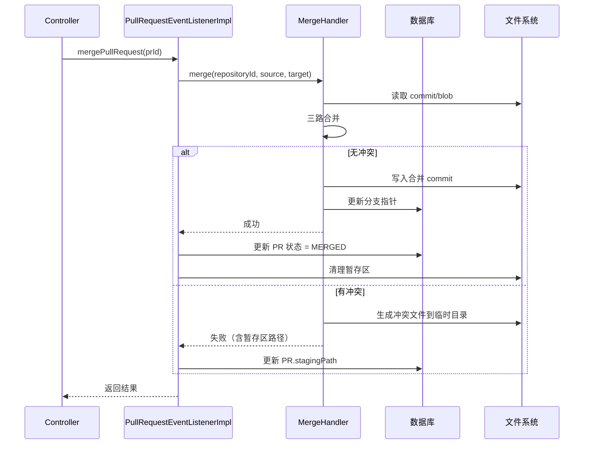
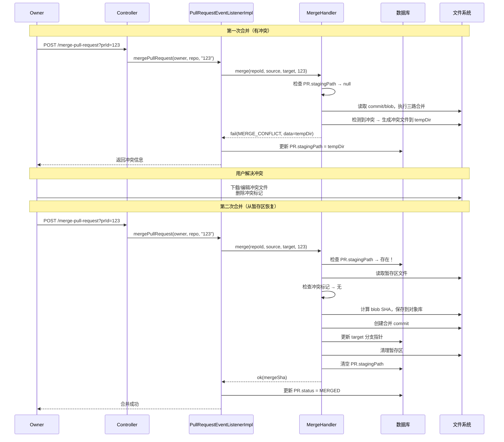

# gitlethub 设计文档

| | |
| --- | --- |
| 状态 | draft |
| Owner | 花火 |
| Reviewer | 待指派 |
| 最后更新 | 2026-09-30 |
| 接口冻结 | 未冻结（`docs/openapi.yaml` 定稿后填日期） |
| 取代 | `gitlethub 设计文档.md`（无状态草稿，保留作参考） |

> 2026-09-29 增补：新增 Web 前端 `gitlethub-frontend`，并补齐其所需的只读接口（见 §6、§13）。
> 这两项推翻了 §2 原来的两条非目标（「不做 Web UI」「不做 PR」），相关条目已就地更新。
> 本次改动**不含 `gitlet_core`**（见 §13.4）。
>
> 2026-09-30 增补：修复「PR 作者显示成 owner、协作者能合并自己的 PR」——
> 根因是 `remote-gitlet` **原先没有任何调用者身份概念**，所有写路径都把 URL 上的 `owner` 当操作者。
> 现新增 `JwtAuthFilter` 注入调用者身份、建 PR 记录真实创建者、合并仅限仓库 OWNER（见 §6「调用者身份」、D35–D37）。
> 本次同样**不含 `gitlet_core`**，也**未改动 `docs/openapi.yaml`**。

---

## 1. 背景

gitlet 是一个类 Git 版本控制系统的子集（CMU-61B 风格），当前形态是单进程 CLI：

- 仓库状态全部落在工作目录下的 `.gitlet/` 目录，磁盘是唯一的跨命令状态载体。
- 执行模型是**一条命令一个 JVM 进程**（`java gitlet.Main <command>`）。进程内的对象随进程结束消失。
- 因此「当前操作哪个仓库」由**进程的工作目录**决定，而不是由参数决定。

现在要把它扩展成云端代码托管平台：一个服务进程同时服务多个用户、多个仓库，并提供 AI 辅助能力。

核心已做过一轮改造（M0），把「仓库」从进程级全局变成可多实例：

| 类 | 行数 | 职责 |
| --- | --- | --- |
| `repository/Repository.java` | 92 | 门面：`repoId` / `paths` / `objects` / 懒加载的 `stage` |
| `repository/RepositoryPaths.java` | 43 | 由 `(repoId, cwd)` 算出的 7 个磁盘路径 |
| `repository/ObjectStore.java` | 178 | object 读写、SHA-1 补全、commit 持久化 |
| `handler/CommandHandler.java` | 337 | init/add/commit/rm/log/global-log/find/checkout*/reset |
| `handler/MergeHandler.java` | 311 | merge / LCA / 三路合并 / 冲突生成 |
| `handler/StatusHandler.java` | 207 | status 及各类派生查询 |
| `handler/BranchManager.java` | 114 | 分支增删查 + HEAD 指针 |
| `Main.java` | 173 | CLI 入口，组装对象图 |
| `commit/Commit.java` | 45 | 纯数据对象（Lombok `@Data`） |
| `stag/Staging.java` | 52 | 暂存区：`stagingMap` + `removeSet` |
| `utils/Utils.java` | 231 | 序列化 / SHA-1 / 文件读写 |

服务端复用核心的入口就是这四个构造：

```java
Repository     repo     = new Repository(String repoId, File cwd);
RepositoryPaths paths   = repo.getPaths();     // getCwd/getGitletDir/getObject/getBranchDir/getHeadFile/getCommits/getStagingFile
ObjectStore    objects  = repo.getObjects();
CommandHandler commands = new CommandHandler(repo);   // 四个 Handler 均只依赖 Repository
```

`repoId` 目前**只作标识/诊断用，不参与路径计算**，路径一律由调用方传入的 `cwd` 决定。

---

## 2. 目标 / 非目标

`(临时)` 以下都是初稿建议。**同意的留着，不同意的直接删。** → D1

### 目标

- 一个仓库 = 一个独立实例，同一进程内多个仓库互不干扰。**（已完成）**
- 用户可以把本地 gitlet 仓库推送到云端、从云端拉取。
- 提供 AI 辅助：生成提交信息 / 代码审查 / 解释代码。
- **提供 Web 前端**：浏览仓库文件 / 提交 / 分支，管理 PR 与协作者。**（2026-09-29 新增，见 §13）**

### 非目标

- 不实现 Git 线协议（smart HTTP / packfile），不追求与真 git 互通。
- ~~不做 Web UI，交互一律走 CLI。~~ **2026-09-29 取消**：改为「Web 只读浏览 + PR/协作者管理」，
  写操作（push/pull/clone/冲突解决）仍走 CLI（见 §13.4）。
- 不做分布式部署，先单机单盘。
- 不做细粒度权限模型，先只区分 owner / 非 owner。
- 不做断点续传、增量打包等传输优化。
- ~~不做仓库可视化、issue、PR、CI 等，只做托管 + AI。~~ **2026-09-29 部分取消**：
  仓库可视化（文件/提交/分支）与 PR 已实现；issue、CI 仍不做。
- **Web 端不做冲突解决可视化编辑器**（合并冲突仅在 UI 提示，解决走 CLI）。

> 非目标比目标重要：它是防止范围蔓延的唯一手段。

---

## 3. 规模与约束

`(临时)` 数字全部是初稿建议，见 → D2、D3、D4。

| 约束 | 取值 `(临时)` | 超出时怎么办 |
| --- | --- | --- |
| 单仓库体积上限 | 100 MB | push 返回 413 |
| 单文件体积上限 | 10 MB | push 返回 413 |
| 单次 push 体积 / 超时 | 50 MB / 30 s | 返回 413 / 客户端分批 |
| 目标用户数 | 100 | — |
| 目标仓库数 | 1000 | — |
| 仓库落盘路径 | `$REPOS_ROOT/<owner>/<repo>` | → D3 |
| 部署形态 | 单机，非容器 | → D2 |

已定的技术约束：

- Java 17（`gitlet_core` 用 `maven.compiler.release=17`）。
- 父 pom `spring-boot-starter-parent:3.3.0`，依赖版本统一由它的 BOM 管理。
- `gitlet_core` 是**纯库**：除 Lombok（`provided`）外无任何依赖，不依赖 Spring。
- 目录命名 `(临时)`：现在是 `gitlet_core`（下划线），但同级的 `gateway-service` / `remote-gitlet` 都是连字符，Maven 惯例也是连字符。改名要动父 pom 的 `<modules>` 和 IDE 配置。→ D4

---

## 4. 架构

```
gitlethub (parent, packaging=pom)
├── gitlet_core/       纯库，无 Spring。CLI 与 remote-gitlet 依赖它
├── gateway-service/   Spring Cloud Gateway：路由 + 鉴权过滤 + 限流
├── user-service/      用户注册 / 登录 / 用户信息（端口 8081）
├── common-service/    共享 po / dto / vo / bo / enums / jwt / exception
└── remote-gitlet/     实现 /api/repos/**，依赖 gitlet_core（端口 8080）

gitlethub-frontend      Vue3 + Vite Web 前端，独立工程，在 D:\Job_project\gitlethub-frontend
gitlet_ai_helper        AI 服务，独立 project，不在本仓库 → D15
```

远程存储：

```tex
远程存储结构：

.gitlet/
└── {owner}/
    └── {repo}/
        ├── Objects/
        │   ├── commits/          ← type=COMMIT 的写这里
        │   │   ├── abc123...
        │   │   └── def456...
        │   ├── sha_a1            ← type=BLOB 的写这里
        │   └── sha_b2
```

**职责与依赖方向（单向，不可逆）**

| 模块 | 职责 | 依赖 `gitlet_core` |
| --- | --- | --- |
| `gitlet_core` | 仓库操作核心 + CLI（含 `api/GitletClient` 远程客户端） | — |
| `gateway-service` | 唯一入口。路由、鉴权、限流、日志过滤，**不含业务接口** | ❌ 不得依赖 |
| `remote-gitlet` | 仓库与对象传输的服务端实现 | ✅ |
| `gitlet_ai_helper` | AI 三类接口。独立 project，契约跟着那个项目走（1.历史代码讲述，可以根据提交历史对代码设计原因进行讲述2.语义化代码搜索3.代码知识图谱（可选）） | ❌ |

`gateway-service` 是**策略层不是业务层**：它不该出现任何 `/api/repos/**` 的 controller。
把业务 spec 生成到 gateway 是错的——生成目标是 `remote-gitlet`。

### 当前落地状态

| 模块 | 磁盘 | 已加入父 pom `<modules>` | 状态 |
| --- | --- | --- | --- |
| `gitlet_core` | ✅ | ✅ | 1802 行，21 个集成测试全绿 |
| `common-service` | ✅ | ✅ | 共享 po/dto/vo/bo/enums/jwt/exception |
| `gateway-service` | ✅ | ✅ | 4 个文件，`application.yaml` 无路由，**尚不可用**（见 §10） |
| `user-service` | ✅ | ✅ | 端口 8081，注册/登录/用户信息可用 |
| `remote-gitlet` | ✅ | ✅ | 端口 8080，push/pull/clone + PR + 只读接口（见 §6、§13）+ 自验签的 `JwtAuthFilter`（只注入身份、不拦截，见 §6「调用者身份」） |
| `gitlethub-frontend` | ✅ | —（独立工程，非 Maven 模块） | Vue3 + Vite，见 §13 |

父 pom `<modules>` 已注册 `gitlet_core`、`gateway-service`、`remote-gitlet`、`user-service`、`common-service` 五个模块
（§10 阻塞级 4 已解决）；`gateway-service` 虽已注册但内容仍是空壳。

### 进程与并发模型

- **CLI 路径**：一个进程服务一个仓库，`cwd` 即仓库位置。**（已完成）**
- **服务端路径**：一个进程服务多个仓库，需要处理：
  - `Repository` 把 `Staging` 缓存在内存里（懒加载），这只在「一仓库一实例 + 单线程」下正确。→ D12
  - 同一仓库被并发操作时，按 `repoId` 加锁还是每请求新建实例。→ D12
  - 服务端是否缓存 `Repository` 实例。→ D13

---

## 5. 核心契约（头号阻塞点）

当前 `gitlet_core` 的仓库操作和 CLI 输出是**同一套代码**：

- `Main.java` 里有 4 处 `System.exit(0)`：空命令、空提交信息、`checkout` 格式错误、`.gitlet` 不存在。
- 输出全部直接写 `System.out.println`，集中在 `Repository.outputCommitLog()`、`StatusHandler.printSection()`、`CommandHandler.find()`。
- 错误信息通过 `Utils.message()` 打印，不抛异常、不返回状态。

**后果**：这套代码无法在服务进程里运行——一个 `System.exit` 就会杀掉整个服务。

建议的改造形状 `(临时)`：

```java
// 核心只返回结果对象，不打印、不退出；stdout 渲染属于 CLI 层
interface GitletApi {
    CommitResult commit(String repoId, String message);
    StatusView   status(String repoId);
    MergeResult  merge(String repoId, String branch);
}

// 渲染层：CLI 实现打到 stdout，服务端实现转成 DTO
interface Renderer {
    void commitLog(Commit c, String sha1);
    void message(String text);
}
```

服务端侧不实现 `Renderer`：`remote-gitlet` 的 controller 把结果对象包成 §6 的
`{code, message, data}` 信封，CLI 侧用 `Renderer` 打 stdout。**核心对两种渲染都不感知。**

| 决策 | ID |
| --- | --- |
| 错误表达方式：异常 vs `Result` 对象 | → D6 |
| `System.exit` 归谁（建议：只留在 `Main`） | → D7 |
| 渲染：接口注入 vs 直接返回字符串 | → D8 |

---

## 6. 接口

**契约正文在 [`docs/openapi.yaml`](openapi.yaml)，本节只做索引用。** 改接口改那个文件。

这份 spec 只描述 **`remote-gitlet`** 实现的 `/api/repos/**`。校验和生成：

```bash
npx @redocly/cli lint docs/openapi.yaml
openapi-generator generate -i docs/openapi.yaml -g spring -o remote-gitlet
```

**user-service:**

| 方法 | 路径                     | 用途                                 |
| ---- | ------------------------ | ------------------------------------ |
| POST | `/user/registration`     | 用户注册（BCrypt）                   |
| GET  | `/user/{user_id}`        | 获取用户详细信息                     |
| POST | `/user/login`            | 用户登录                             |
| PUT  | `/user`                  | 修改用户信息（邮箱、头像等）(待实现) |
| POST | `/user/logout`           | 用户登出（Token 加入黑名单）         |
| GET  | `/user/search?username=` | 搜索用户（添加协作者时需要）         |
| PUT  | `/user/password`         | 修改密码(可选)                       |
| POST | `/user/avatar`           | 上传/更换头像(可选)                  |


**spec 覆盖的（实现方 `remote-gitlet`）**

注：owenr为用户名，repo为仓库名

| 方法 | 路径 | 用途 |
| --- | --- | --- |
| POST | `/api/repos/{owner}/{repo}/refs/{branch}` | push 第一步：更新分支（乐观锁） |
| POST | `/api/repos/{owner}/{repo}/refs/{branch}/force` | push 第一步（特殊）：强制更新分支（乐观锁） |
| POST | `/api/repos/{owner}/{repo}/objects` | push 第二步：上传对象 |
| GET | `/api/repos/{owner}/{repo}/objects?since=` | pull 拉取对象 |
| GET | `/api/repos/{owner}/{repo}/refs/{branch}` | 读取分支指向 |
| POST | `/api/repos` | 创建仓库（**不在 `openapi.yaml` 里，是手写端点** `RepositoryController`；owner/repo 走 body 的 `RepositoryCreateDTO`。建仓的唯一入口 → D27） |
| GET | `/api/repos/{owner}/{repo}/clone` | clone 拉取对象 |
| POST | `/api/repos/{owner}/{repo}/pull-request` | 手动创建PR。**作者 = 调用者身份**（无身份时回退 owner）→ D35 |
| POST | `/api/repos/{owner}/{repo}/pull-request/{pullRequestId}` | 合并进入 target 分支。**仅仓库 OWNER 可合并**，否则 `code 20002` → D37 |
| PUT | `/api/repos/collaborator?auto_create_pr=` | 更新用户开启自动PR功能 |

**前端只读接口（2026-09-29 新增，同样由 `remote-gitlet` 实现）**

前端需要读取仓库内容来渲染页面。实现时统一返回 `Result<T>`，
`owner/repo` 由路径传入，`repositoryId` 用 `remoteUserMapper.getUserId(owner)` +
`remoteRepositoryMapper.getRepositoryId(ownerId, repo)` 解析。

| 方法 | 路径 | 返回 | 说明 |
| --- | --- | --- | --- |
| GET | `/api/repos/{owner}/{repo}` | `RepositoryVO` | 按 owner/repo 取仓库信息 |
| GET | `/api/repos/{owner}/{repo}/branches` | `List<BranchPointer>` | 分支列表（复用 PO） |
| GET | `/api/repos/{owner}/{repo}/commits?branch=&page=&size=` | `List<CommitVO>` | 提交历史（父链遍历，内存分页） |
| GET | `/api/repos/{owner}/{repo}/commits/{sha}` | `CommitVO` | 含 `trackedFiles` / `mergeFiles` |
| GET | `/api/repos/{owner}/{repo}/commits/{sha}/diff` | `List<FileChangeVO>` | 与第一父提交比 |
| GET | `/api/repos/{owner}/{repo}/tree?ref=` | `List<FileEntryVO>` | `trackedFiles` 是**扁平** `path→blobSha` |
| GET | `/api/repos/{owner}/{repo}/blob?ref=&path=` | `BlobVO` | 按字节读；`isBinary` 按是否含 `\0` 判断 |
| GET | `/api/repos/{owner}/{repo}/pull-requests?status=&page=&size=` | `List<PullRequestVO>` | status：0 open / 1 closed / 2 merged，空=全部 |
| GET | `/api/repos/{owner}/{repo}/pull-request/{id}` | `PullRequestVO` | 单个 PR 详情 |
| POST | `/api/repos/{owner}/{repo}/pull-request/{id}/close` | `String` | 关闭 PR（status=CLOSED） |
| GET | `/api/repos/{owner}/{repo}/collaborators` | `List<CollaboratorVO>` | join 用户名 |
| POST | `/api/repos/{owner}/{repo}/collaborators` | `String` | body `CollaboratorCreateDTO{username,level}`，仅 owner |
| DELETE | `/api/repos/{owner}/{repo}/collaborators/{userId}` | `String` | 逻辑删除 |

约定（前端依赖，改动前请同步前端）：

- **枚举序列化成枚举名**（`"OPEN"` / `"OWNER"`），不是数字；但**请求参数用数字码**（status 0/1/2，level 2/1/0）。
- `BlobVO.isBinary` 的 JSON 键就是 `isBinary`（Lombok 对 `Boolean` 字段生成 `getIsBinary()`）。
- 提交历史**以 commit 对象的 `parent`/`secondParent` 为准**遍历，不依赖 `commit_parent` 表
  （`pushWrite` 每次推送只写一条边，批量推送的中间提交没有记录，DB 不可靠）。
- 作者信息多数为 `null`（`submission_record` 通常只有 tip 有记录），前端按 null 优雅降级。

**不在 spec 里的**

| 方法 | 路径 | 实现方 | 契约在哪 |
| --- | --- | --- | --- |
| POST | `/api/ai/generate-commit-msg` | `gitlet_ai_helper` | 那个 project 自己维护 |
| POST | `/api/ai/code-review` | `gitlet_ai_helper` | 同上 |
| POST | `/api/ai/explain-code` | `gitlet_ai_helper` | 同上 |
| GET | `/health` | `gateway-service` | 不需要契约文件 |

**统一响应结构**：所有响应（含错误）都是 `{code, message, data}`。`code` 是**业务码段**，
与 HTTP 状态码解耦；HTTP 状态码仍保留语义给网关和通用中间件用，但**客户端判断分支只看 `code`**。

码段划分（完整注册表在 `openapi.yaml` 的 `ApiResponse`）：

| 段 | 范围 | 用途 |
| --- | --- | --- |
| — | `0` | 成功 |
| 请求与内容 | `1xxxx` | 格式非法、内容校验失败、超限、限流 |
| 认证授权 | `2xxxx` | 未认证、无权限 |
| 仓库与分支 | `3xxxx` | 提交的文件不能为空、分支不存在 |
| 并发冲突 | `5xxxx` | 乐观锁失败 |
| 系统 | `9xxxx` | 服务端错误 |

错误详情放 `data`：`50001` 带 `currentSha`，`10003` 带 `missingSha`。

**gateway 承担的策略**（不在 spec 里，因为不产生业务 controller）：

| 策略 | 行为 | 现状 |
| --- | --- | --- |
| 鉴权过滤 | 校验 Bearer JWT，失败直接返回 `401` + `code 20001`，不透传到后端 | **未实现**（gateway 仍是空壳，见 §10-8） |
| 限流 | 超阈值返回 `429` + `code 10005` | 未实现 |
| 日志过滤 | 记录 method / path / 耗时 / 状态码 | 未实现 |

### 调用者身份（2026-09-30 新增）

**背景**：`remote-gitlet` 原先**没有任何调用者身份概念**——controller 不读 `Authorization`，
所有写路径（建 PR / 合并 / 建协作者）一律把 URL 上的 `owner` 当成操作者。于是出现了
「协作者 huahuo 提的 PR 显示作者为 owner alice，且他能合并自己的 PR」这个 bug。

**现状（gateway 未就绪期间，`remote-gitlet` 自行验签）**：

- `org.openapitools.filter.JwtAuthFilter`（`OncePerRequestFilter`）解析 `Authorization: Bearer <JWT>`：
  签名校验 → 过期校验 → Redis 黑名单（`jwt:blacklist:<token>`，user-service 登出时写入），
  然后把 `request.setAttribute("userId", <Long>)`。密钥对复用 `common-service` 的 `jwt.KeyPairManager`
  （RSA256，公私钥存共享 Redis）。
- **只注入身份、不拦截**：无 token / 非法 / 过期 / 已登出 / Redis 异常一律**匿名放行**，
  由 service 层按需判权。这样公开读接口和 CLI 的无 token push/clone 不受影响；
  代价是**无效 token 返回 200 而非 401**（与 `openapi.yaml` 里「由 gateway 拦截」的注释不一致，见 §10-14）。
- controller 用 `@RequestAttribute(name = "userId", required = false) Long actorId` 读身份，作为参数传给 service。
- 行为：**建 PR 作者 = actorId**（无身份回退 owner）；**合并 = 仅 `level=OWNER` 的协作者**，否则 `20002`。
- 这是 **§6「gateway 承担的策略」的临时替代**：等 gateway 修好、统一验签落地后，
  `remote-gitlet` 的这套过滤应退回为「信任网关透传的身份」，或按 D36 的取舍保留。

| 约定 | 值 |
| --- | --- |
| 身份载体 | `HttpServletRequest` attribute（**不用 ThreadLocal**：线程池复用会拿到脏数据、且有内存泄漏风险）→ D36 |
| attribute key | `userId` |
| 类型 | `Long`（claim 里可能是 Integer，过滤器内做转换） |
| 缺失身份 | 匿名（`actorId == null`），由 service 决定是回退还是拒绝 |

| 决策 | ID |
| --- | --- |
| 鉴权：JWT 怎么签发、密钥放哪 | → D9 |
| 限流阈值与维度（按 IP / 按用户 / 按仓库） | → D19 |
| AI 服务：独立进程 vs 同进程；是否流式；喂 diff 还是整份文件 | → D15 |
| PR 作者归属、身份接缝、合并权限 | → D35、D36、D37 |

---

## 7. 数据模型

`(临时)` 见 → D10、D11。

| 数据 | 存放位置 `(临时)` | 说明 |
| --- | --- | --- |
| object 内容（blob + commit） | 磁盘 `.gitlet/Objects/` | 本地与远端一致；远端根路径 → D3 |
| 分支引用（refs）/ HEAD | 数据库（可变对象；磁盘只存不变对象） | → D10，已定 |
| 用户 / 仓库名 / owner | 数据库（r2dbc） | → D11 |
| 权限 | 数据库 | → D11 |
| 每个 remote 的同步进度 | 数据库 | push 增量计算依赖它 |
| AI 调用记录 / 配额 | 暂不落库 | → D11 |

> `Commit` 是 Java 序列化对象（`serialVersionUID = 1L`），不是文本。服务端**必须原样落盘**，不能反序列化再重新序列化，否则 SHA-1 会变、所有引用失效。

> **序列化兼容（2026-09-29 修正）**：CLI 把 commit 序列化成 `gitlet.commit.Commit`（Java 原生序列化），
> 而 `remote-gitlet` 原来用重复类 `org.openapitools.model.Commit` 反序列化 → `ClassNotFoundException`，
> 导致提交历史 / 文件浏览 / 合并路径在真实数据上都跑不通。修法：把服务端的重复类**移到与 CLI 相同的包名**
> （`remote-gitlet/src/main/java/gitlet/commit/Commit.java`）。必须同名同包（而非「读时重映射」），
> 因为**写**方向也得输出 `gitlet.commit.Commit` 类名，否则服务端合并产生的 commit 客户端读不了。
> 同时给 `Utils.readObject` 加了 JEP-290 `ObjectInputFilter` 白名单——`pushObject` 落盘的是客户端原始字节，
> 只读接口会去反序列化它们，这是新引入的攻击面。

#### 数据库表设计

| 表名                          | 字段                                                         | 备注                                                         |
| ----------------------------- | ------------------------------------------------------------ | ------------------------------------------------------------ |
| 用户信息表（user）            | id, username, password, email, create_time, update_time, is_deleted(逻辑删除) | 用户密码使用`BCrypt`加密存储                                 |
| 仓库列表（repository_list）   | id, owner_id(属于哪个用户), name, visibility(可见性，0私有, 1公开),  description(仓库信息), create_time, update_time, default_branch(默认分支), is_deleted(逻辑删除) | 这里的 `user_id` 其实是 `owner_id`（仓库拥有者）             |
| 分支指针（branch_pointer）    | id, branch_name, commit_sha(分支指针指向的commit的SHA1值), repository_id(属于哪个仓库), is_protected(是否为保护分支), version(版本号用于乐观锁), update_time, is_deleted(逻辑删除) |                                                              |
| 协作者权限（collaborator）    | id, level(权限等级), user_id(协作者的用户id), repository_id(属于哪个仓库), create_time, is_deleted(逻辑删除), allow_auto_pr |                                                              |
| 提交记录（submission_record） | id, submit_time, commit_sha1(关联对象存储中真实的 SHA-1), user_id(提交的用户id), repository_id(仓库id), branch_name(提交到了哪个分支) | 在 Git 的世界里，没有 `branch_id` 这个概念，用branch_name更合理 |
| 提交图谱索引(commit_parent)   | id, repository_id, commit_sha, parent_sha                    | 记录 commit 之间的父子关系。**注意：目前不可靠**——`pushWrite` 每次推送只写一条边（parent 指向推送前的分支 tip），批量推送的中间提交没有记录。遍历历史一律以 commit 对象内的 `parent`/`secondParent` 为准 |
| 标签（tag）                   | id, repository_id, tag_name, commit_sha, user_id, create_time, is_deleted | 标签功能                                                     |
| PR机制表（pull_request）      | id, repository_id, title, description, source_branch, target_branch, status, author_id, create_time, update_time, is_deleted, allow_auto_pr(自动生成PR) | PR 机制（合并请求）                                          |


## 8. 关键流程

PR:








### 客户端 CLI 远程命令

`gitlet_core/Main.java` 的 switch 现在只有 13 个命令，全是本地操作：
`init` / `add` / `commit` / `rm` / `log` / `global-log` / `find` / `status` /
`checkout` / `branch` / `rm-branch` / `reset` / `merge`/`remote add`。
按 D5，其中只有下面 3 个走远程，其余全部本地；

| 命令 | 参数语法 | 对应接口 | 本地状态 |
| --- | --- | --- | --- |
| `push` | → D23 | `POST /refs/{branch}` → `POST /objects` | → D24 |
| `pull` | → D23 | `GET /refs/{branch}` → `GET /objects?since=` | → D24 |
| `clone` | → D23 | `GET /clone` | → D24 |

- 本地 remote 地址、上次同步的 sha 记在哪（push 第 1 步要用）→ D24
- CLI 调 HTTP 的 client 放哪：`gitlet_core` 是纯库、除 Lombok 无依赖（§3）→ D25
- 失败与 `50001` 冲突在 CLI 侧怎么表现（退出码、是否自动 pull 重试）→ D26

### push

```
1. 客户端对比 remote 记录的 sha 与本地 refs，算出服务端缺失的 object 集合
2. POST /refs/{branch}      → 带 expectedOldSha 做乐观锁；分支不存在则新建
3. POST /objects            → 幂等；把对象写入磁盘
```

- 顺序是**先更新分支引用、再把对象落盘**（与 `remote-gitlet` 的实现一致；§6 的接口表也是 refs 排在前）。
- `POST /objects` 要求仓库已存在，否则返回 `30001`。**没有自动建仓**：
  仓库只能由用户手动调 `POST /api/repos` 建立，push 的两步都不建仓、失败也不补建 → D27，已定
- 第 2 步成功、第 3 步失败的处理 → D14
- 建仓的滥用风险（任何认证用户都能无限建仓）→ D21
- 建仓要**同时写数据库（仓库元数据）和磁盘目录**，中间失败会留半状态 → D22

### pull / clone

```
1. GET /refs/{branch}                 → 拿到远端最新 sha
2. GET /objects?since=<本地最新 sha>   → 拉缺失的 object，落盘
3. 更新本地 remote 记录，checkout
```

### 并发

| 场景 | 处理方式 | ID |
| --- | --- | --- |
| 两个客户端同时 push 同一分支 | 乐观锁（`expectedOldSha`），`50001` 后 pull 重试 | — |
| 同一仓库的并发读写 | 按 `repoId` 加锁，省掉反复合并仓库的开销 | → D12，已定 |
| 服务端 `Repository` 实例是否复用 | 可缓存，但**只缓存磁盘对象访问能力**，不缓存分支 sha 状态 | → D13，已定 |

---

## 9. 被否决的方案

| 方案 | 否决理由 |
| --- | --- |
| 用 JGit / libgit2 取代自研核心 | 能直接白嫖 Git 协议和生态，但项目的核心价值就是「自己实现一个 git」，换掉等于没有作品。而且 JGit 是标准 Git 格式，和这里自研的 `.gitlet` 格式不兼容，等于换掉整个数据层。 |
| objects 打包成 packfile 上传 | 能把 push 的往返次数从 N 降到 1，但需要实现增量压缩和索引，复杂度远超当前规模所能受益。等单仓库真的到 GB 级再说。 |
| objects 存对象存储（S3 / MinIO） | 更易扩容、天然多副本，但本地调试要先起 MinIO，且 `ObjectStore` 现在全是本地文件 API，抽象一层要动整个核心。单机磁盘够用。 |
| 把 refs 也放进数据库 | 查询方便，但会让远端和本地的存储结构分叉，同一个核心代码要维护两种 refs 读取路径。放磁盘能直接复用 `BranchManager`。 |
| 用 REST 之外的自定义二进制协议 | 省流量，但丢掉 OpenAPI 带来的代码生成、文档、调试（curl / Postman）全部便利。 |
| 用户服务用 HS256 | 密钥的对称性，如果泄露会被伪造 |
| 远程仓库的HEAD放入磁盘 | HEAD是可变的，磁盘放入不变的对象，基于“读写与数据生米周期”进行判断。详细见D13附 |
| 创建仓库的时候生成一份init空提交，保证分支存在至少一份存在 | 如果远程创建的时候存在init commit在本地push的时候会出现冲突，需要先pull下来marge在合并，体验会差 |
| 检验提交不能为空时，任意一方为空则为空仓库 | 可能有commit但是没有blob（创建commit的时候会init一个空提交），但是不可能有blob但是没有commit，Blob是只增不删 |
| 服务间用 OpenFeign 访问 | 改用JDK11+的HttpClient访问，CLI不应该被Spring容器管理，保证服务启动的速度 |
| 存储远程链接信息的话我是序列化一个hashMap对象好还是用远程别名命名文件好？ | 选用别名命名文件。序列化 HashMap：实现简单二进制不可读、难调试、Java 专用、结构变更会兼容性问题。别名命名文件（文本）：可读、易调试、符合 Git 惯例、可手动编辑，稍微多写几行解析代码 |
| push两步，先更新分支再先上传对象，因为更新分支是数据库操作可以回滚性能开销比回滚IO开销小 | 「DB 优先 IO 优先」原则适用于单个事务内部，不适用于跨 HTTP 请求。应该先 IO 后 DB，对象文件在磁盘上，但是孤立的无害，如果说相同文件再推送只会跳过这些文件新建立commit，而不同文件推送也只是新的SHA值之前的不影响，但是如果说先DB再IO如果说就会出现远程 master 指向一个不存在的 commit |
| 为什么不用Seata做回滚保证事务一致性？ | 不用 Seata，理由：<br/>失败后果可接受：推送失败最多产生几个孤立对象文件，像 Git 的 dangling object，下次 GC 清理就行<br/>Git 本身也不保证原子性：真实 Git 推送时也是先传对象再更新引用，中间失败会留下孤立对象<br/>复杂度不值得：Seata 的基础设施成本远高于这个场景的需求<br/>如果将来业务变复杂（比如推送要计费、要触发 CI/CD 流水线），再考虑 Seata 不迟。而且 Seata 不知道怎么回滚文件写入。你需要自己实现 TCC 模式（Try-Confirm-Cancel） |
| JSON使用Jackson转化 | 采用手写Jackson的形式，对象中不存在转义，选择手写 JSON 字符串，保证轻量纯库 |
| 校验是网关做还是服务做？ | 优先放在网关层做验签；业务服务只做兜底校验，或者业务层不做校验。详见附录 |
| PR两版处理方法：无条件自动建 PR, 纯手动建 PR | 第一版<br/>无条件自动建 PR<br/>用户没控制权<br/>第二版<br/>纯手动建 PR<br/>多一步操作<br/>第三版（你的）<br/>可配置的自动建 PR<br/>兼顾便利和控制 |
| PR 合并采用哪种策略？1.直接改远程仓库中的文件，2.生成暂存区拷贝文件，3.暂存区只存对应的冲突文件。4.暂存区只存对应的冲突文件，以及允许合并的文件 | 暂存区只存对应的冲突文件，以及允许合并的文件。直接改仓库中的文件会污染远程仓库，生成暂存区拷贝文件IO开销+储存消耗过大。所以采用只在暂存区存对应的冲突文件，但是如果只存冲突文件会导致之前通过并且允许合并的文件遗失，所以一并存入暂存区 |
| 新建的Commit由于和客服端序列化不同，采用读取时重定向 | Java 原生序列化有一个死板的规则：**它只认“包名 + 类名”这个字符串。只要字符串完全一样，它才不管这个类具体是什么内容，就能反序列化。**在远程服务建立一个相同的包即可 |
| LCA的检查用数据库的commit_parent表 | 应该解析对象库中的Commit对象。commit_parent 表不可信，因为它只在服务端事件发生时写"投影边"，而对象库里才是完整 DAG |

> 这一节比「做什么」更值得维护：半年后你不会记得为什么当时没选 JGit。

---

## 10. 风险 / 未决问题

### 阻塞级（不解决就做不下去）

| # | 问题 | 影响 |
| --- | --- | --- |
| 1 | `gitlet_core` 用 `System.exit` + `System.out` 渲染，无法跑在服务端 | 服务端无法复用核心，只能重写逻辑。见 §5 |
| 2 | `gateway-service` 同时引入 `spring-boot-starter-web`（Servlet）和 `spring-cloud-starter-gateway`（WebFlux） | 二者互斥，Spring Cloud Gateway 要求 classpath 上没有 Spring MVC，启动即失败 |
| 3 | `gateway-service` 的两个 spring-cloud 依赖没有 BOM 管版本 | 父 pom 只继承了 `spring-boot-starter-parent`，缺 `spring-cloud-dependencies` 和 Alibaba 的 BOM，依赖无法解析 |
| 4 | ~~`gateway-service` / `remote-gitlet` 未注册进父 pom `<modules>`~~ | **已解决**：父 pom 现已注册五个模块（见 §4 落地状态） |

> 2 和 3 怎么解 → D16

### 待解决

| # | 问题 | 影响 |
| --- | --- | --- |
| 5 | `HealthController.healthCheck()` 没有方法级 `@RequestMapping`，且用 `@Controller` 返回 String（会被当视图名）；`import javax.xml.transform.Result` 是误导入 | 健康检查打不通 |
| 6 | `gateway-service` 的 `application.yaml` 空的，一条路由都没配 | 所有请求无处转发 |
| 7 | `gateway-service` 用包名 `com.hanabi`，与父 groupId `com.huahuo` 不一致 | 坐标混乱 |
| 8 | gateway 的鉴权 / 限流 / 日志过滤都还没实现 | 安全 → D9、D19。**期间 `remote-gitlet` 用 `JwtAuthFilter` 自行验签兜底**（只注入身份、不拦截，见 §6「调用者身份」） |
| 9 | 建仓是显式接口（手动建仓，push 不建仓 → D27），但任何认证用户仍能无限建仓，配额 / 频率限制没定 | 滥用风险 → D21 |
| 10 | ~~`remote-gitlet` 只有 pom，`/api/repos/**` 一个接口都没实现~~ | **已解决**：push/pull/clone + PR + 只读接口见 §6 |
| 11 | `Repository` 的 `Staging` 内存缓存只在单线程下成立 | 并发正确性 → D12，已定（按 `repoId` 加锁后该缓存受锁保护） |
| 12 | 模块命名 `gitlet_core` vs `gitlet-core` 未统一 | 可读性 → D4 |
| 13 | `gitlet/dump/`（`DumpObj`、`Dumpable`）疑似死代码 | 待确认后删除 |
| 14 | `remote-gitlet` 自行验签是 gateway 未就绪期的临时方案，与 §6「gateway 承担的策略」的最终形态（网关统一验签）不一致；且无效 token 走**匿名放行**（返回 `200` 而非 `401`），与 `openapi.yaml` 中 `Unauthorized` 的「由 gateway 拦截」注释矛盾 | 待 gateway 修好后收敛 → D36 |
| 15 | `closePullRequest` 仍**无权限校验**（任何人可关任意 PR）；push 仍把操作者记成 `owner`（`submission_record` 的作者归属） | 越权关闭 / 作者归属错误 → D35 |

---

## 11. 里程碑与验收标准

| 阶段 | 内容 | 状态 |
| --- | --- | --- |
| M0 | 核心静态 → 实例化，一个仓库一个实例 | **已完成** |
| M1 | 核心去 `System.out` / `System.exit`，暴露 §5 的契约 | 部分（服务端已能复用核心，见 §13.4） |
| M2 | 修好 `gateway-service`（依赖 + 路由 + 鉴权/限流），按 spec 生成 `remote-gitlet` 骨架并跑通 `/health` 和第一个真实接口 | `remote-gitlet` 已可用；gateway 仍未修 |
| M3 | push / pull 全链路 | **已完成**（CLI 侧 push/pull/clone 均已跑通） |
| M4 | AI 服务接入（独立 project） | 未开始 |
| M5 | **Web 前端**：登录/注册/个人中心、仓库详情（文件/提交/分支）、PR 全流程、协作者/设置 | **已完成**（见 §13） |

> M3 验收标准里「两个客户端同 expectedOldSha 先后 push」的并发用例尚未端到端跑过
> （依赖 `192.168.12.168` 上的 Nacos/MySQL/Redis，见 §12）。

### M1 验收标准

- **Given** 一个已初始化的仓库，**When** 依次执行 `init` / `add` / `commit` / `rm` / `log` / `global-log` / `find` / `status` / `checkout` / `branch` / `rm-branch` / `reset` / `merge`，**Then** stdout 与改造前逐字节一致，且 `make check` 21/21 全绿。
- **Given** 服务端调用同一套核心，**When** 执行任意命令，**Then** 进程不退出（无 `System.exit`）。

### M2 验收标准

- **Given** `gateway-service` 启动（依赖修好、路由配好），**When** `GET /health`，**Then** 返回 `200`。
- **Given** 经 gateway 访问 `POST /api/repos/{owner}/{repo}/objects` 传空 `objects` 数组，
  **Then** 返回 `200 {code:0, message:"ok", data:{received:[], missing:[]}}` 而不是 500。
- **Given** 请求不带 token，**When** 打 `/api/repos/**`，**Then** gateway 直接返回 `401` / `code 20001`，且后端日志里看不到这次请求。
- **Given** 请求带合法 token 但访问别人的仓库，**Then** `403` 且 `code` 为 `20002`（由 remote-gitlet 判定）。
- **Given** 一个已认证用户，**When** `POST /api/repos` 建仓，**Then** 返回 `200`，数据库里有仓库 / `master` 分支指针 / owner 协作者三条记录，磁盘上有仓库目录。
- **Given** 一个不存在的 owner/repo，**When** 直接 `POST /objects`，**Then** `code 30001`，且**不会**顺手把仓库建出来（无自动建仓 → D27）。

### M3 验收标准

- **Given** 两个客户端持有同一分支的同一 `expectedOldSha`，**When** 先后 push，
  **Then** 第一个 `200`，第二个 `409` 且响应体是 `{code:50001, data:{currentSha:"..."}}`。
- **Given** 一个本地仓库，**When** push 到远端再 clone 到空目录，**Then** 两次 `log` 输出一致。

---

## 12. 验证基线

每个里程碑都必须保持（**已完成**）：

```bash
cd gitlet_core/src/test/gitlet_test
make compile     # 编译核心
make check       # 21/21 必须全绿
```

改动 Makefile 时不要破坏这两条环境依赖：

1. Windows 上 javac 的 `-cp` 分隔符是 `;`，且 classpath 必须用 Windows 形式路径（`cygpath -w`）。用 `:` 或 POSIX 路径会让 Lombok 静默失效，报出一堆 `找不到符号 getXxx()`，看起来像源码 bug。
2. `PYTHON = python3 -X utf8`。`.in` 测试文件是 UTF-8，但 Python 在这个中文 locale 下默认用 cp936 读，不加 `-X utf8` 会全部报 `FAILED (gbk)`。

服务端侧：

| 层次 | 方式 | 状态 |
| --- | --- | --- |
| 契约 | `npx @redocly/cli lint docs/openapi.yaml`（改接口后必跑） | — |
| 骨架 | `openapi-generator ... -o remote-gitlet`，生成物只当接口签名用，实现手写 | — |
| 单元/集成测试 | `remote-gitlet` 侧 Spring Boot Test + Mockito `@MockBean` + `@TempDir` 真实对象文件 | **已建**（见下） |
| 策略 | 鉴权 filter / 限流单独测：无 token、过期 token、超阈值 | gateway 侧**未开始**（未修）；`remote-gitlet` 侧 `JwtAuthFilterTest` 已覆盖鉴权 |
| 端到端 | 起 gateway + remote-gitlet，用真实 CLI 跑 init → push → clone → pull | **阻塞**：依赖 `192.168.12.168` 的 Nacos/MySQL/Redis |
| 并发 | 按 M3 的验收标准做双客户端冲突用例 | 未开始 |
| 前端 | `npm run dev` 浏览器走通「注册→登录→建仓→浏览→建 PR→合并→改设置」 | 构建/dev server 已验证；**真实数据交互未验证** |

### 后端测试工具链（2026-09-29 补充）

Windows 中文 locale 下必须显式指定 JDK 与 locale，否则 javac 用 GBK、测试输出乱码：

```bash
JAVA_HOME="/c/Program Files/Eclipse Adoptium/jdk-17.0.19.10-hotspot" \
mvn -B -Duser.language=en -Duser.country=US -pl common-service,remote-gitlet -am test
```

> 注意：`./mvnw` 在 Git Bash 下不可用；系统 Maven 默认 Java 11。必须用上面的 `JAVA_HOME`。

本次新增的测试类（`remote-gitlet/src/test/java/org/openapitools/`）：

| 测试类 | 类型 | 覆盖 |
| --- | --- | --- |
| `CommitSerializationCompatTest` | 单元 | commit 序列化往返、类名为 `gitlet.commit.Commit`、白名单拒绝非法类 |
| `CommitReadApiTest` | 单元（mock mapper） | 合并 DAG 历史遍历、分页、tree/blob、diff |
| `RepositoryReadApiTest` | 单元（mock mapper） | owner/repo 查仓、协作者增删改、权限校验 |
| `PullRequestReadApiTest` | 单元（mock mapper） | PR 详情/列表/关闭、跨仓拒绝；**作者=创建者、合并仅 OWNER、无身份/已移除 owner 被拒** |
| `ReadEndpointsMockMvcTest` | 集成（`@SpringBootTest @AutoConfigureMockMvc`） | HTTP 路径映射、参数绑定、Result 外层、前端依赖的 JSON 字段名；**携带 owner/协作者真实 JWT 的合并链路（`verifiesToken` mock + hutool 真实签出）** |
| `JwtAuthFilterTest` | 单元（mock `KeyPairManager` / `StringRedisTemplate`） | 有效 token 注入、Integer claim 转 Long、缺失/非 Bearer 头匿名、签名失败不查 Redis、过期、黑名单、Redis 故障不断链 |

`remote-gitlet` 全部 **72** 个用例，其中 **62 绿**。其余 **6 失败 + 4 错误**（`FirstStepPushTest` 4F、
`PushForceUpdateBranchTest` 1F/1E、`PushObjectTest` 3E、`RemoteFlowIntegrationTest` 1F）经 `git worktree`
对照确认是**本次改动前就存在**的，且失败集合前后逐字节一致、需真实 Nacos/MySQL/Redis，**非回归**。

> 鉴权过滤的测试现在**落在 `remote-gitlet`**（`JwtAuthFilterTest` + `ReadEndpointsMockMvcTest` 的 E2E），
> 而非 §12 表格「策略」行原设想的 gateway——因为 gateway 尚未可用，验签实际在 `remote-gitlet` 内完成（见 §6「调用者身份」）。

---

## 13. Web 前端（2026-09-29 新增）

### 13.1 定位

一个 Vue3 + Vite 的**独立前端工程**，位于 `D:\Job_project\gitlethub-frontend`
（**不在 `gitlethub` 仓库内**，前后端分离开发）。

技术栈：Vue 3 + Vite + Vue Router 4 + Pinia + axios + Element Plus（全量引入）。

### 13.2 与后端如何连

- **零改动接入**：开发期用 Vite dev proxy 转发（页面与后端同源 → 无 CORS）。
  `gateway-service` 目前不可用，所以**不经网关，直连两个服务**：

  | 前端路径前缀 | 目标 | 对应服务 |
  | --- | --- | --- |
  | `/api` | `http://localhost:8080` | `remote-gitlet` |
  | `/user` | `http://localhost:8081` | `user-service` |

  目标地址可用 `.env.development` 的 `VITE_API_TARGET` / `VITE_USER_TARGET` 覆盖。
- axios 拦截器统一注入 `Authorization: Bearer <token>`，并解包 `Result`（`code === 0` → 返回 `data`）。
- `remote-gitlet` 的 `JwtAuthFilter` 现在会**解析这个 Bearer 头并注入调用者身份**（只注入、不拦截，见 §6「调用者身份」）：
  建 PR 作者、合并权限都据此判定。无 token / 无效 token 仍走匿名（后端按需降级或拒绝）。

### 13.3 目录结构

```
gitlethub-frontend/
├── vite.config.js        # 两个 proxy + build.commonjsOptions.exclude 修复（见下）
├── .env.development      # VITE_API_TARGET / VITE_USER_TARGET
├── index.html  package.json
└── src/
    ├── main.js  App.vue  styles.css
    ├── router/index.js   # 路由 + 登录守卫
    ├── stores/auth.js    # Pinia：token/userId/username，localStorage 持久化
    ├── api/{http.js,user.js,repo.js,pr.js,collab.js}
    ├── utils/dict.js     # 枚举名/数字码双向归一（PR 状态、协作者等级）
    ├── views/            # Login/Register/Profile/RepoList/RepoDetail/CommitDetail/PRList/PRCreate/PRDetail
    └── components/       # RepoHeader/FileBrowser/CommitList/BranchList/PRList/CollaboratorPanel/RepoSettings
```

> `vite.config.js` 的 `build.commonjsOptions.exclude: [/node_modules[\\/]@vueuse[\\/]/]` 是**必需**的：
> `@vueuse/*` 是纯 ESM（`type: module`，只是文件名用了 `.js`），但 commonjs 插件仍逐文件解析它，
> 在 Node 24 + rollup 4.63 上会 `Maximum call stack size exceeded`。排除后按 ESM 原生处理。

### 13.4 边界（明确不做）

- **不依赖、不修改 `gitlet_core`**：为保持本地 CLI 轻量，本次所有兼容性 / 只读接口工作
  **自包含在 `remote-gitlet`**（见 §7 的序列化兼容说明）。
- **不做冲突解决可视化编辑器**：合并冲突仅在 UI 提示，解决走 CLI。
- 不做标签、AI 三接口（`gitlet_ai_helper` 尚不存在）、网关改造。

### 13.5 验证状态

- ✅ 前端 `npm run build` 通过；Vite dev server 返回 HTTP 200；关键模块 transform 无错。
- ✅ 后端新测试全绿（`remote-gitlet` 72 个用例 / 62 绿，非绿项均为改动前既有、需真实中间件）。
- ✅ PR 合并入口前端已按身份收敛：`PRDetailView.vue` 仅当 `repoInfo.ownerId === auth.userId` 时才渲染「合并」按钮，
  非 owner 显示「只有仓库所有者可以合并该 PR」（**服务端仍做最终裁定**，前端只是不给出无效入口）。
- ❌ **未做真实端到端**：`192.168.12.168` 上的 Nacos/MySQL/Redis 不可达（TCP 超时），后端无法真正启动；
  且无浏览器自动化，**未验证任何真实数据下的 UI 交互**。修好环境后需按 §12 的「前端」行补跑。

---

## 附录 A：待决策清单

**这是全文唯一需要你填的地方。** 右边一列写你的决定；同意建议就写「同建议」，不同意的写清楚选择。每行前面的 ID 在正文里被引用。

| ID | 待决策 | 建议 `(临时)` | 你的决定 |
| --- | --- | --- | --- |
| D1 | 非目标清单是否就这 6 条 | 见 §2，删改随意 | 暂时这样 |
| D2 | 规模数字（仓库/文件/超时/用户数/部署形态） | 见 §3 表格 | 暂时这样 |
| D3 | 服务端仓库落盘路径 | `$REPOS_ROOT/<owner>/<repo>` | 同建议 |
| D4 | 模块命名：`gitlet_core` 还是 `gitlet-core` | 改成 `gitlet-core`，与同级一致 | 同建议 |
| D5 | 哪些命令走远程（`push`/`pull`/`clone`/`remote add`？） | 就这四个，其余全本地 | 目前仅有这些后续可能新增 |
| D6 | 核心的错误表达：抛异常还是返回 `Result` | 抛异常，`GitletException` 已存在 | 部分走异常部分走Result |
| D7 | `System.exit` 归谁 | 只留在 `Main`，核心一律不调 | 删除exit |
| D8 | 渲染方式：接口注入还是返回字符串 | 返回结果对象，字符串由 CLI 拼 | 同建议 |
| D9 | 鉴权：token 怎么签发和校验 | Bearer JWT，先硬编码一个走通链路 | 采用RSA256，公私钥存储到Redis中，保证数据一致性 |
| D10 | refs 存磁盘还是数据库 | 磁盘，复用 `BranchManager` | HAND存入数据库中，可变对象，磁盘只存不变对象 |
| D11 | 用户 / 权限 / 同步进度存哪 | r2dbc 数据库 | 暂时先用同步数据库，后续接入AI服务可优化为异步数据库 |
| D12 | 同一仓库并发：加锁还是每请求新建 | 每请求新建 `Repository`，不加锁 | 加锁，可以大幅度减少合并仓库带来的性能开销 |
| D13 | 服务端是否缓存 `Repository` 实例 | 不缓存 | Repository 实例**可以缓存，但只能缓存磁盘对象访问能力，不能缓存分支 sha 状态**。 |
| D14 | push 先更新 refs、后落对象，中途失败（refs 已更新、对象没落盘，refs 指向服务端没有的 commit）怎么恢复 | 无害，重试即可，objects 上传幂等 | 同建议 |
| D15 | AI 服务形态：进程模型；流式 / 非流式；喂 diff / 整份文件 | 独立 project `gitlet_ai_helper`（**已定**）；其余建议同进程外的独立服务、非流式、先喂 diff | 后续再议 |
| D16 | `gateway-service` 的依赖冲突怎么解 | 去掉 `spring-boot-starter-web`，补 spring-cloud BOM | 同建议 |
| D17 | `remote-gitlet` 负责什么 | 实现 `/api/repos/**`，服务端仓库存储 + 对象传输（**已定**） | 同建议 |
| D18 | `code` 的取值语义 | 业务码段（**已定**）：`0` 成功，`1xxxx` 请求内容，`2xxxx` 认证授权，`3xxxx` 仓库分支，`5xxxx` 并发冲突，`9xxxx` 系统 | 同建议 |
| D19 | 限流阈值与维度 | 先按 token 维度，60 req/min；超了 `10005` | 后续再议 |
| D20 | `/health` 是否也包统一信封 | 不包，探针只需要 `200`；业务接口一律包 | 同建议 |
| D21 | 建仓接口的配额 / 频率限制 | 先按 owner 限 50 个仓库，超了走 `20002` 或另开 `30003` | 同建议 |
| D22 | 建仓时数据库与磁盘的一致性 | 先建目录后写库，库里没记录就当仓库不存在 | 同建议 |
| D23 | 四个远程命令的参数语法（是否省略 remote 名、`clone` 的目标目录怎么给） | | |
| D24 | 本地在哪记 remote 地址与上次同步的 sha（`.gitlet/` 下的哪个文件） | | |
| D25 | CLI 调 HTTP 的 client 放哪个模块、依赖怎么进 | | |
| D26 | push / pull 失败与 `50001` 冲突在 CLI 侧的表现（退出码 / 是否自动 pull 重试） | | |
| D27 | 顺序改成 refs 在先之后，「自动建仓」挂在哪一步（refs 步自动建，还是保留 `POST /repo` 单独开仓） | 保留 `POST /repo` 单独建仓 | 不做自动建仓：仓库只能手动建，push 两步都不建仓（否则任何认证用户 push 任意 owner/repo 就能凭空开仓） |
| D28 | gitlet pull应该拉取哪个仓库？多个绑定呢？ |  | 一个本地分支同一时间只能选其中一个作为上游。 |
| D29 | 循环生成合并冲突文件问题：如果说生成了暂存区的合并冲突文件的话，修改改这个文件，假设把远程仓库的文件内容删了，这个时候文件内容和未生成合并冲突时候提交的文件内容一样，再提交的时候依然生成冲突文件 | | 加一个校验，如果当前文件在暂存区中有优先采用暂存区中的文件，并对暂存区中的文件进行冲突检查即 |
| D30 | 是否做 Web 前端（推翻 §2「不做 Web UI」的非目标） | 做 | 做：Vue3 + Vite 独立工程 `gitlethub-frontend`，前后端分离，前端不放进 `gitlethub` 仓库 |
| D31 | Web 端做什么、不做什么 | 只读浏览 + PR/协作者管理 | 登录/注册/个人中心、仓库详情（文件/提交/分支）、PR 全流程、协作者/仓库设置；**不做**冲突解决可视化编辑器 |
| D32 | 为解决序列化兼容，是否允许改 `gitlet_core` | 不改 | **不允许**：为保持本地 CLI 轻量，兼容性工作全部自包含在 `remote-gitlet`（把重复类移到 `gitlet.commit` 包） |
| D33 | `remote-gitlet` 端口 | 修正为 8080（`user-service` 保持 8081） | 同建议，已在 `bootstrap.yaml` 修正 |
| D34 | 前端在 gateway 不可用时怎么连后端 | Vite dev proxy 直连两个服务 | 同建议（`/api`→8080，`/user`→8081），后端零改动 |
| D35 | PR 表的作者应该是谁：创建者还是仓库 owner（推而广之：写路径的操作者怎么归属） | 创建者（调用者身份） | **创建者**：建 PR 记录 `actorId`，无身份时回退 owner。push 路径的作者归属仍待修（§10-15） |
| D36 | 调用者身份怎么在过滤器与业务层之间传递 | request attribute（key `userId`，`Long`） | **用 request attribute**：显式否掉 ThreadLocal（线程池复用会拿到脏数据、且有内存泄漏风险）。gateway 未就绪期由 `remote-gitlet` 的 `JwtAuthFilter` 自验签并注入；待 gateway 统一验签后按此收敛 |
| D37 | 谁可以合并 PR | 仅仓库 OWNER | **仅 `level=OWNER` 的协作者**；其余（含 PR 作者本人）返回 `code 20002` |

### D12附：

方案 1：加锁（最像真实 Git 服务器，简单常用）

> 同一仓库一把锁。

- 规则：只要有一个请求正在操作这个仓库（push、写 refs、写对象），**锁住这个仓库**；其他针对同一个仓库的请求进来：要么等待，要么返回「仓库忙，请稍后重试」。
- 粒度：**按仓库锁**（仓库 A 上锁，不影响仓库 B）
- 优点：
  - 实现简单，不会出现同时写 refs / 对象导致仓库数据损坏
  - 冲突直观：同一仓库不能并行写
- 缺点：
  - 长耗时请求会把仓库卡住，后面请求排队
  - 读请求如果也拿锁，读多的时候容易堵（可以读写分离：读不加锁，写加排他锁）

真实 Git 服务（GitLab/Gitea）底层就是**仓库级锁**，防止并发 push 把仓库 refs 搞坏。

方案 2：每请求新建副本（快照 / 拷贝仓库，类似 MVCC）

> 每次收到请求，**先复制一份当前仓库数据给这个请求单独使用**，请求在自己这份副本上做修改，做完尝试把修改合并回主仓库。

- 规则：所有请求并行跑，互不阻塞；提交修改阶段才检查冲突。
- 优点：请求之间不互相阻塞，高并发体验好
- 缺点：
  - 开销巨大：复制仓库（对象、refs）很耗 IO / 内存，仓库大的时候完全不可行
  - 合并逻辑复杂：多个副本同时改完，要判断谁覆盖谁，处理写冲突
  - Git 对象库本身不适合这种写法

> 这里 “每请求新建” 不是新建一个完整仓库文件夹，广义指**每个请求基于独立数据快照操作，而不是共享同一份可变仓库状态**。数据库 MVCC 就是这个思路，但套在简易 Git 仓库上成本很高。

### D13附：

#### 如果说是HEAD文件存储在磁盘的话：

方案 A：缓存 Repository 实例（复用，单实例 / 池化）

> 服务端维护一个 Map：`repoName → Repository 实例`，第一次访问仓库时 new 一次，之后所有请求**共用这同一个对象**。

特点

1. 内存里一直放着这个实例，不用每次请求重新加载对象、扫描 refs、打开文件。性能更好。
2. **最大坑：Repository 内部有可变状态的话，多线程并发请求会炸**。
   - 如果 Repository 里面存了临时状态、打开的文件句柄、非线程安全集合；多个 HTTP 线程同时调用，就会出现竞态 bug（refs 读脏、数据错乱）。
3. 搭配方案：**仓库级锁** 同一个仓库共用一个 Repository 实例 + 同一仓库一把锁。 锁保证同一时刻只有一个线程操作这个 Repository 实例，规避多线程并发修改问题。

> 适合：仓库数量不多、简化项目，就是咱们这个 61B Gitlethub 场景。

方案 B：**不缓存，每请求新建 Repository**

> 每次 HTTP 请求过来，根据仓库名字，**new 一个全新 Repository 实例**，用完请求结束就丢弃。

特点

1. 每个请求的 Repository 互相独立，对象之间完全不共享可变状态。天然线程安全，**不用锁对象本身**。

2. 代价：每次请求都要重新从磁盘加载 refs、读取配置，IO 开销更大。

3. 但**磁盘文件依然会并发竞争**！

   > 就算每次 new 新对象，两个请求同时写磁盘上的`refs/main`文件，照样文件覆盖、数据损坏。 👉 所以：**对象不共享 ≠ 磁盘数据安全**。你依然要做并发控制：要么文件锁，要么 CAS。

同一仓库并发：加锁还是每请求新建？

- 缓存 Repository 实例 → 复用对象，靠**锁**串行操作
- 不缓存、每请求 new Repository 实例 → 对象隔离，但磁盘层仍然要处理并发写 refs

#### 如果说是HEAD文件存储在数据库的话：

对【是否缓存 Repository 实例】的影响

Repository 里面一般会包含两类东西：

1. 访问磁盘对象库（读 commit/blob/tree）的工具
2. 当前仓库的引用状态（HEAD、分支 refs）

因为**refs/HEAD 不在磁盘，在 DB**：

- Repository 实例**本地内存里的 refs/HEAD 只是瞬时查询出来的快照，不是权威源；权威源永远是数据库** 👉 **Repository 实例可以安全缓存（复用），但绝对不能信任实例内存里缓存的分支 sha！** 每次业务操作（push、pull）**必须重新查数据库拿最新 refs**，不能拿 Repository 对象里缓存的旧 sha。

> 两种可选方案： 
>
> 方案 1：缓存 Repository 实例（只复用磁盘对象访问层，对象库路径、读取工具），refs 每次实时查 DB。推荐。
>
> - 好处：不用每次请求重新初始化对象库、打开目录；减少 IO 初始化开销。
> - 约束：实例里**不缓存 refs/HEAD 的值**，内存里不存可变引用状态。
>
> 方案 2：不缓存，每请求新建 Repository
>
> - 更简单，不会误使用过期内存快照；代价是每次请求初始化对象库。

对【并发：加锁还是每请求新建】的影响

因为可变状态迁移到数据库，**并发保护可以交给数据库能力，而不是自己写文件锁**。 两个主流路线：

1. **数据库乐观锁（CAS）** push 更新分支 refs 时： `update ref_table set sha = new_sha where repo_id=? and branch=? and sha = old_sha`

- 先读当前分支 sha（old_sha）
- 执行 update，只有数据库里当前 sha 等于 old_sha 才更新成功
- 返回 0 行 = 已经被别人抢先修改 → push 冲突，返回客户端拒绝

> 不需要在服务端对 Repository 加仓库锁！多个请求可以并行跑对象上传（blob/commit 是不可变，写磁盘互不冲突），只在最后一步更新 refs 做 CAS 校验。

1. **数据库悲观锁** 事务 `select ... for update` 锁住这条分支记录，同一仓库分支串行更新。 实现简单，但吞吐低。

> 重点： blob/commit/tree 写入磁盘**完全不需要锁**！ 因为不可变 + sha 命名：就算并发两个请求写同一个 blob，只是写同一个文件，内容完全一样，覆盖也无害。

### 附录：

#### 方案 1：网关统一验签（推荐，主流微服务架构）

网关：Spring Cloud Gateway / Nginx + lua / APISIX / Kong 流程：

1. 客户端请求头带上 `sign`、`timestamp`、`nonce`
2. **网关拿到公钥，直接 RSA-SHA256 验签**
3. 验签失败：网关直接返回 401/403，请求不转发到后端业务服务
4. 验签成功：网关把原始请求透传，或者把验签结果放入请求头传给业务服务

✅ 优点

- **防护前置**：非法请求、伪造签名在入口就拦截，保护后端服务，减少业务服务 CPU 开销（RSA 验签 CPU 消耗很高）
- 统一规范：所有后端服务不需要重复写验签代码，一套逻辑统一维护公钥、防重放（nonce/timestamp）
- 公钥统一管理：公钥配置放在网关，不用每个业务服务都维护公钥配置
- 便于审计：网关统一记录签名校验日志

❌ 缺点

- 网关压力变大：高并发场景大量验签会消耗网关 CPU，需要评估网关算力，可做本地缓存公钥优化
- 网关升级变更影响全部业务：验签逻辑改动需要发布网关
- 网关故障 / 漏洞：一旦网关验签逻辑被绕过，所有后端直接裸奔

> 适合：对外 API、多后端微服务、大量接口统一签名体系，开放平台 API。

#### 方案 2：业务服务自身验签

网关只做路由转发，**不碰签名**，每个业务服务拿到请求后自己用公钥验签。

✅ 优点

- 网关轻量化，网关不承担验签计算压力
- 业务之间隔离：某个服务验签逻辑出问题，不会影响其他服务
- 适合不同服务使用不同公钥 / 不同签名规则

❌ 缺点

- 大量重复代码：每个微服务都要实现 RSA-SHA256 验签、时间戳、nonce 防重放，容易写错，出现安全漏洞
- 资源浪费：每个服务实例都要做验签，全集群 CPU 消耗放大
- 公钥分散管理：多个服务维护公钥，公钥轮换时所有服务都要发布
- 攻击流量全部打到业务服务：伪造签名请求依然会到达后端，占用连接、线程

> 适合：单体应用、少数独立接口、不同业务独立密钥体系，网关能力弱无法扩展自定义插件。
