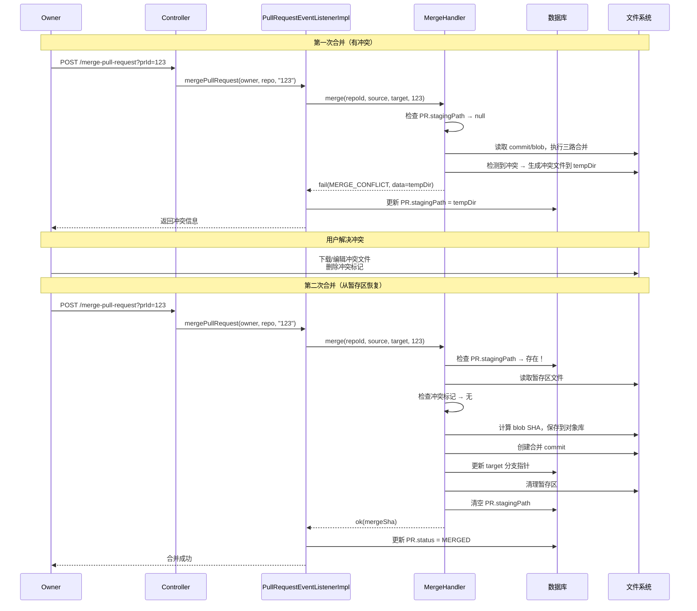
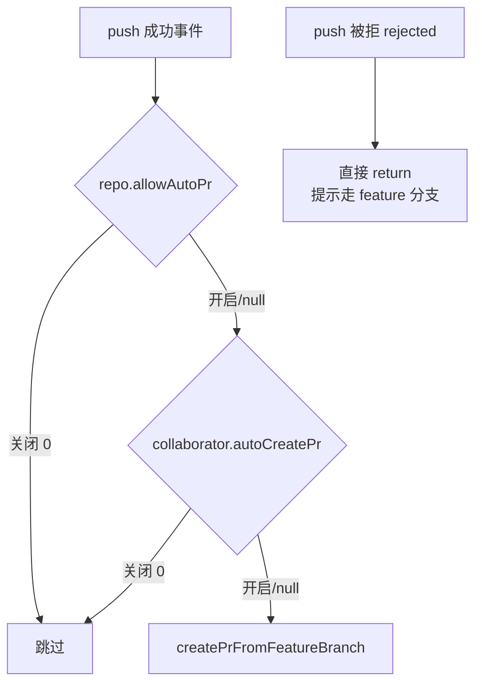
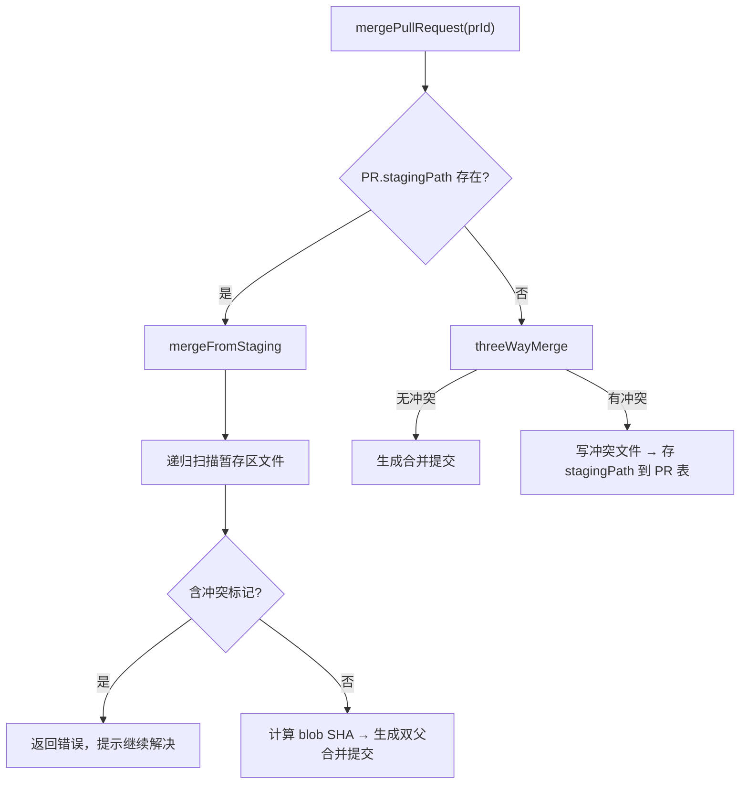
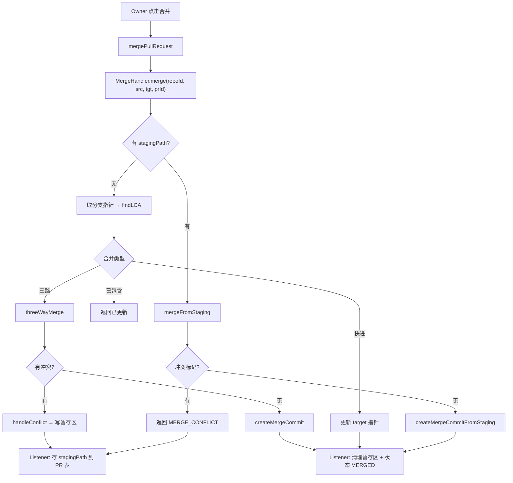

问题：

JVM 加载 Repository 类 → loadStaging () 执行 → .gitlet 不存在 → 返回空 Staging 

用户执行 init () → 创建了 .gitlet/ 和 staging 文件 

用户执行 add () → getStaging () 返回的还是第 1 步的空对象 → 和磁盘上的不一致

解决

懒加载，每次调用都执行 `loadStaging()` 从磁盘读取最新状态。

问题：

```tex
当前（CLI 模式）：
  用户执行命令 → 启动 JVM → 执行 → JVM 退出
  用户再执行   → 启动 JVM → 执行 → JVM 退出
  ...每次都是新进程

云端（Server 模式）：
  启动 JVM（Spring Boot）→ 一直运行
  用户发 HTTP 请求 → 处理 → 返回响应
  用户再发请求     → 处理 → 返回响应
  ...同一个进程，持续服务
```

最大的问题：你所有 Handler 都是 static 方法 + static 的 stage。如果两个用户同时操作不同仓库，他们的 stage 会互相覆盖。


问题

本地暂存区咋办？远程的有多个仓库，本地的呢？

```tex
远程服务器（多个仓库）                    用户电脑（多个本地目录）
┌──────────────────────┐              ┌──────────────────────────┐
│  repo-A (id: 001)     │              │  ~/projects/project-A/    │
│  repo-B (id: 002)     │              │    .gitlet/               │
│  repo-C (id: 003)     │              │    工作目录/               │
└──────────────────────┘              │                           │
                                      │  ~/projects/project-B/    │
                                      │    .gitlet/               │
                                      │    工作目录/               │
                                      └──────────────────────────┘
```

解决：

每个本地仓库有自己独立的暂存区，互不干扰。

用仓库名+当前文件夹名创建仓库

用户在哪个目录下执行命令，就用哪个目录下的 .gitlet/


问题：

为什么核心代码不用 Spring IoC，只在边缘用？

  不用 IoC 的理由：

  1. Repository 是数据，不是协作者。 IoC 容器管道是固定的、启动时就确定的长生命周期单例（DataSource、Service）。而 Repository 是按请求参数现造的——只有请求进来时你才知道要开 alice/notes 还是 bob/notes。容器没法 `@Autowired` 一个取决于运行时参数的对象。Spring 里对应的正确形状是 @Component RepositoryFactory factory.open(repoId, path) 返回 Repository。也就是说 IoC 能帮你拿到 factory，但拿不到 Repository 本身——这次改造 90% 的接线它管不了。
    
  2. 如果 Handler 做成单例 @Component，就正好把刚拆掉的坑请回来了。它们会变回进程级共享状态，一并发服务多个仓库就串。要避开就得 @Scope("prototype") 或 request scope，那自动装配的收益基本归零——每个请求还是得手动拿 bean。
    
  3. CLI 不想要容器。 Main.main 是被 java gitlet.Main add f.txt 拉起来的裸 JVM，一条命令一个新进程。Handler 全变 bean的话，add 一个文件也得先 SpringApplication.run()：5ms → ~1s，还要给 tester 的 classpath 加一堆东西。而现在 21 个用例就是靠逐个 java gitlet.Main 跑的。
    
  4. 手写接线只有 5 行，依赖是一棵无环静态树。为 5 行引容器是负收益。

  正确的切分是：核心保持无容器，边缘用 IoC。 gitlet/ 是个纯库——CLI 能 new，Spring 也能 new。将来网关那层才是 IoC
  该出现的地方：@RestController 注入 RepositoryFactory bean，每请求 factory.open(...)。这跟你设计文档里
  api/GitletClient.java 的定位是一致的，而且是纯增量，不用再动核心。

简单来说就是：
```tex
Spring IoC 适合管理的东西：
  DataSource    → 启动时创建，全程不变
  RedisClient   → 启动时创建，全程不变
  UserService   → 启动时创建，全程不变

Repository 不适合：
  → 你事先不知道用户要操作哪个仓库
  → 请求来了才知道是 alice/notes 还是 bob/notes
  → 每个请求都要 new 一个不同的 Repository
```

1.Spring 能帮你管的是工厂，不是 Repository 本身：

2.Handler 做成 Spring 单例会出 bug。就变成了所有请求都用同一个仓库了，要解决就得用 `@Scope("prototype")`，但那样每个请求都要手动从容器拿 bean，和直接 new 没区别。

3.CLI 启动 Spring 太慢

```tex
当前 CLI：
  java gitlet.Main add test.txt
  → JVM 启动 → 执行 → 退出
  → 耗时 ~5ms

如果加 Spring：
  java gitlet.Main add test.txt
  → JVM 启动 → SpringApplication.run() → 扫描 bean → 初始化容器 → 执行 → 退出
  → 耗时 ~1000ms（慢 200 倍）
```

4.手动接线就 5 行，没必要上容器,为 3 行代码引入一个框架，负收益。


问题：

static是同步阻塞的嘛？

static 本身只是"属于类"的意思，不加 synchronized 的 static 方法并不具备任何同步语义，多线程可以自由并发调用。

行锁（Row Lock）？

行锁是数据库层面的并发控制机制，和 Java 的 synchronized 是完全不同的东西。/

InnoDB 的行锁是加在索引上的，不是加在数据行上：
如果 WHERE 条件命中了索引，才会锁行
如果 WHERE 条件没走索引，会退化成表锁

问题：

远程仓库的架构设计？

解决：

**Object Storage（你的 `.gitlet/` 目录）**：只用来存**不可变的、大体积的** Git 对象。

- `Objects/commits/abc123` (Commit 对象)
- `Objects/sha_a1` (Blob 对象)
- **绝对不要在这里存 `refs/heads/` 和 `HEAD`！** 它们是高频变动的元数据。

**MySQL**：用来存**高频变动的、需要原子操作的、需要复杂查询的**元数据。

- 分支指针表 `t_branch_pointer` 才是云端的 `refs/heads/`。
- `HEAD` 在云端是个伪概念，云端通常只有默认分支（Default Branch）。因为云端不存在“当前工作目录”，只有在 clone 的时候，才会决定 checkout 哪个分支

> 放数据库（结构化、高频变更、需要查询）：
>   ✅ 用户信息（User）
>   ✅ 仓库元数据（Repo：名字、描述、owner、默认分支）
>   ✅ 分支指针（Branch：分支名 → SHA）
>   ✅ 权限信息（Permission）
>   ✅ 保护分支规则（ProtectedBranch）
>
> 放文件系统（大体积、内容寻址、只增不改）：
>   ✅ Blob 对象（文件内容，按 SHA-1 命名）
>   ✅ Commit 对象（提交历史，按 SHA-1 命名）
>
> 原则：
>   小的、会变的、需要查的 → 数据库
>   大的、不变的、按 SHA 找的 → 文件系统

问题：

BCrypt 密码哈希算法

是什么

BCrypt 是一种基于 **Blowfish 密码算法** 的密码哈希函数，由 Niels Provos 和 David Mazières 于 1999 年提出。它是目前最常用、最推荐的密码存储方案之一。

 核心特点

| 特性           | 说明                                                         |
| -------------- | ------------------------------------------------------------ |
| **单向性**     | 只能加密，不能解密（不像 AES 等对称加密）                    |
| **内置盐值**   | 每次哈希自动生成随机 salt，相同密码每次哈希结果不同          |
| **可调节成本** | 通过 `cost factor`（轮数）控制计算复杂度，对抗硬件加速暴力破解 |
| **慢速设计**   | 故意设计得慢，增加暴力破解的成本                             |

哈希结果格式

```
$2a$12$R9h/ipB3.dummySaltXXXXXXXXXXXXXXXXXXXXXXXXXXXXX
 ^^^^  ^^  ^^^^^^^^^^^^^^^^^^^^^^^^^^^^^^^^^^^^^^^^^^^^^^^^
  |    |              |
  |    |              └── 哈希值（53字符）
  |    └── cost factor（2^12 = 4096 轮）
  └── 算法版本（2a）
```

 工作原理简述

1. 生成 128 位随机 **salt**
2. 将 salt + 密码合并
3. 使用改良的 Blowfish 密钥调度算法（称为 **Eksblowfish**）进行多轮加密
4. 轮数 = \(2^{cost}\)，cost 越大越慢
5. 输出包含版本、cost、salt、hash 的完整字符串

在 Spring Boot 中的使用

```java
import org.springframework.security.crypto.bcrypt.BCryptPasswordEncoder;

// 创建编码器，cost 默认 10
BCryptPasswordEncoder encoder = new BCryptPasswordEncoder(12);

// 注册时：加密密码
String encoded = encoder.encode("myPassword123");
// 结果类似：$2a$12$R9h/ipB3.xxxxxxxxxxxxxxxxxxxxxxxxxxxxxxxxxxxxxxx

// 登录时：验证密码（不需要手动提取 salt，BCrypt 自动从哈希中解析）
boolean matches = encoder.matches("myPassword123", encoded); // true
```

为什么推荐 BCrypt

- **自动加盐**：不需要你自己管理 salt 字段，salt 内嵌在结果中
- **抗 GPU/ASIC 攻击**：Blowfish 的密钥调度依赖大量内存操作，难以并行化
- **可演进**：随着硬件进步，只需调大 cost 参数即可

与其他方案对比

| 方案           | 优缺点                                             |
| -------------- | -------------------------------------------------- |
| **MD5/SHA**    | 太快，容易被暴力破解，**不推荐**                   |
| **SHA + Salt** | 需要自己管理 salt，且仍不够慢                      |
| **BCrypt**     | ✅ 内置 salt、可调慢速、广泛支持                    |
| **Argon2**     | 更新的方案，抗内存攻击更强，但生态不如 BCrypt 成熟 |
| **PBKDF2**     | NIST 推荐，但 GPU 抗性不如 BCrypt/Argon2           |

Cost Factor 参考

| Cost | 轮数   | 大致耗时（现代CPU） |
| ---- | ------ | ------------------- |
| 10   | 1,024  | ~60ms               |
| 12   | 4,096  | ~250ms              |
| 14   | 16,384 | ~1s                 |

一般推荐 **cost = 10~12**，在安全性和用户体验之间取得平衡。

---

问题：

JWT哪个加密算法用的多？

HS256（HMAC-SHA256，对称算法，**练手 / 单体项目首选**）

> 同一个密钥，**既用来生成签名，又用来校验签名**

- 优点：代码简单、性能高，只需要配置一个 secret 秘钥，上手最快
- 缺点：所有校验 JWT 的服务都必须持有这个 secret，秘钥一旦泄露，攻击者可以随便伪造 JWT
- 适用：**单体 SpringBoot 项目、课程毕设、前后端分离单服务**（你写 demo 就用这个）

> 注意：秘钥不能太短，要足够长，不然容易被暴力破解

RS256（RSA-SHA256，非对称，企业微服务常用）

> 私钥 (privateKey)：**只有认证服务器保存，用来签发 JWT** 公钥 (publicKey)：可以公开，其他微服务 / 网关只用公钥校验，**公钥不能生成 token**

- 优点：安全，就算下游服务被入侵，拿到公钥也伪造不了 JWT
- 缺点：需要生成 RSA 公私钥对，代码稍微复杂一点，签名验证性能略低
- 适用：微服务、SSO 单点登录、第三方授权、多服务场景

问题：

为什么用RS256？

解决：

> 私钥 (privateKey)：**只有认证服务器保存，用来签发 JWT** 
>
> 公钥 (publicKey)：可以公开，其他微服务 / 网关只用公钥校验，**公钥不能生成 token**

- 优点：安全，就算下游服务被入侵，拿到公钥也伪造不了 JWT
- 缺点：需要生成 RSA 公私钥对，代码稍微复杂一点，签名验证性能略低
- 适用：微服务、SSO 单点登录、第三方授权、多服务场景

问题：

如果公钥泄露了怎么办？私钥是怎么检测的？

## 公钥泄露了怎么办？

**公钥泄露完全没问题，它本来就是公开的。**

```
公钥 = 验钞机的紫外线灯，人人都可以有一盏
       它只能用来"照一照"验证真伪
       不能用来"印假钞"
```

| 泄露场景     | 后果                                          |
| ------------ | --------------------------------------------- |
| **公钥泄露** | ✅ 没事，别人最多只能验证 Token 真假，伪造不了 |
| **私钥泄露** | ❌ 灾难，别人可以伪造任意 Token，冒充任何用户  |

所以私钥才是核心机密，公钥本身就是设计给所有人看的。

## 验证是怎么工作的？

RS256 的数学原理保证了**只有对应的私钥签出来的东西，才能被公钥验证通过**：

```
签发（user-service）                    验证（gateway-service）
━━━━━━━━━━━━━━━━                      ━━━━━━━━━━━━━━━━━━
Token 内容: { userId: 1 }              收到 Token
     ↓                                      ↓
用 私钥 对内容做签名                          ↓
     ↓                                 用 公钥 验证签名
Token = 内容 + 签名                      ↓
     ↓                                 签名合法？ → userId=1 可信
发给前端                                  签名非法？ → 拒绝，Token 被篡改
```

**攻击者即使拿到公钥 + Token，也推导不出私钥**，所以伪造不了新 Token。这就是 RSA 非对称加密的数学安全性。

## 真正需要担心的是私钥泄露

如果私钥泄露了，攻击者可以：

```java
// 攻击者拿到私钥后，可以伪造任意用户的 Token
String fakeToken = JWT.create()
    .setPayload("userId", 999)          // 冒充任何人
    .setPayload("username", "admin")
    .sign(JWTSignerUtil.rs256(泄露的私钥));  // 签名完全合法
```

**防护手段**：

| 手段                        | 说明                                  |
| --------------------------- | ------------------------------------- |
| **私钥只存 Redis/安全存储** | 不写日志、不传前端、不进代码仓库      |
| **设置 Token 过期时间**     | 即使泄露，过期后自动失效              |
| **密钥轮换**                | 定期重新生成密钥对，旧 Token 全部失效 |
| **Token 黑名单**            | 用户登出时把 Token 加入 Redis 黑名单  |

问题：

集成测试用H2内存数据库，内存数据库是什么？

解决：

H2 内存数据库是什么

H2 是一个**纯 Java 的轻量级数据库**，"内存数据库"的意思是数据存在内存里，**程序一关数据就没了**。专门用来跑测试，不需要你安装 MySQL，也不需要连远程数据库。

```
正常开发：代码 → MySQL（192.168.12.168）
跑测试时：代码 → H2（内存里，用完就丢）
```

好处是：
- 测试不依赖远程数据库，断网也能跑
- 每次测试都是干净的库，不会有脏数据干扰
- 速度快（内存操作）

但对你来说，**H2 不是必须的**。你也可以直接用测试环境的 MySQL 跑集成测试。如果你不想引入 H2，把 pom 里的 H2 依赖删掉，测试配置文件改成连你的 MySQL 就行：

```yaml
# src/test/resources/application-test.yaml
spring:
  datasource:
    url: jdbc:mysql://192.168.12.168:3306/gitlethub_test
    username: root
    password: 你的密码
    driver-class-name: com.mysql.cj.jdbc.Driver
  data:
    redis:
      host: 192.168.12.168
      port: 6379
      database: 1
```

**简单说**：H2 就是个测试用的临时数据库，不用也行，看你方便。

这段是「**非快进校验**」，我用大白话 + 场景讲清楚。

问题：

## 先说这段代码在干嘛

```java
JsonNullable<String> expectedOldSha = refUpdateRequest.getExpectedOldSha();
if (expectedOldSha != null && expectedOldSha.isPresent()
        && !Objects.equals(expectedOldSha.get(), branchPointer.getCommitSha())) {
    return Result.fail(ResultCode.VERSION_CONFLICT, ...);
}
```

翻译成人话：

> 客户端 push 时会带一句话：**「我以为远程分支现在还指向 X」**（这个 X 就是 `expectedOldSha`）。
> 服务端就核对：**远程分支当前实际指向的**（`branchPointer.getCommitSha()`）**是不是 X？**
> - 是 → 说明没人动过，放行。
> - 不是 → 说明在你 push 之前，**别人已经推了新东西**，你这份是过时的，拒绝（返回冲突）。

---

## 三个条件逐个拆

| 条件                              | 含义                                                         |
| --------------------------------- | ------------------------------------------------------------ |
| `expectedOldSha != null`          | 字段对象本身存在（防御性判空）                               |
| `expectedOldSha.isPresent()`      | 客户端**确实传了**这个值（没传就跳过校验，比如第一次建分支） |
| `!Objects.equals(期望值, 实际值)` | 期望的旧指向 ≠ 服务端当前指向 → 冲突                         |

三个都成立才拒绝。

---

## 为什么要这么做？举个真实场景

```
初始：远程 master 指向 commit C1

你（客户端A）：
  1. pull 下来，看到 master = C1
  2. 本地基于 C1 提交，做出 C2
  3. 准备 push，带上 expectedOldSha = "C1"（我看到的是 C1）

但在你 push 之前，同事（客户端B）抢先推了：
  远程 master 已经变成 C3 了

你 push 到达服务端：
  expectedOldSha.get()          = "C1"   ← 你以为的
  branchPointer.getCommitSha()  = "C3"   ← 实际的
  两者不相等 → 拒绝！返回 VERSION_CONFLICT
```

**如果不做这个校验**：你的 C2 会直接把 master 从 C3 覆盖回 C2，**同事的 C3 就凭空消失了**（这叫「丢失更新」）。

---

## `JsonNullable` 是什么？为什么不用普通 String？

普通 `String` 分不清这两种情况：
- 客户端**没传**这个字段
- 客户端传了但值是 **null**

`JsonNullable` 是 OpenAPI 生成的包装类，能区分：
- `isPresent() == false` → 客户端压根没传（比如**新建分支**，此时远程还没有任何指向，没得比）
- `isPresent() == true` → 客户端传了，用 `.get()` 取出真实值来比

所以「第一次推送新分支」时客户端不传 `expectedOldSha`，这段校验自动跳过，不会误拦。

---

## 和乐观锁（version）的区别

你之前不是已经加了 `version` 乐观锁吗？两者不重复，是**两道关卡**：

```
expectedOldSha（业务语义层）：
  比的是「commit 指向」，客户端主动声明，语义清晰
  → 拦截「我 pull 之后、push 之前」这段时间别人插队的情况

version（数据库层）：
  比的是「行版本号」，数据库自动维护，客户端看不到
  → 兜底拦截「两个请求几乎同时到达」的极限并发
```

一句话：**`expectedOldSha` 是给用户看的语义校验，`version` 是给数据库兜底的最终防线。** 正常情况下前者就能拦住，后者是保险。

问题：

HttpClient 需要完整 URL（包括网关地址），不像 OpenFeign 那样只写相对路径。为什么

OpenFeign 依赖 Spring Cloud 的服务发现（Nacos），它知道 remote-gitlet 服务在哪台机器、哪个端口，所以自动拼接完整 URL。
HttpClient 是裸 HTTP 客户端，没有服务发现能力，你必须告诉它完整地址。

问题：

客户端手写JSON的话，“需要反序列化（JSON → 对象），手写解析器容易出 bug。”这个传到远程不还是得解析吗？

对，但**解析是服务端的事，不是客户端的事**。

```
gitlet_core (客户端)                    remote-gitlet (服务端)
┌─────────────────┐                  ┌──────────────────────┐
│ 手写 JSON 字符串 │ ──── HTTP ────→  │ Jackson 反序列化      │
│ 不需要 Jackson   │                  │ 已有 Jackson（Spring 自带）│
│ 零依赖           │                  │ 解析成 GitletObject   │
└─────────────────┘                  └──────────────────────┘
```

**服务端**是 Spring Boot，天然有 Jackson，收到 JSON 字符串后 `@RequestBody ObjectUploadRequest` 自动反序列化——这是服务端的事，跟你客户端怎么生成 JSON 没关系。

**客户端**只需要保证发出去的是**合法 JSON 字符串**就行。服务端不在乎你是手写的、StringBuilder 拼的、还是用库序列化的——只要格式对，Jackson 都能解析。

所以：
- 客户端手写 JSON → 零依赖 ✅
- 服务端用 Jackson 反序列化 → 现成的 ✅

**两边各用各的方式，互不影响。** 这就是 HTTP + JSON 的好处——协议是通用的，实现是自由的。

问题：

pull操作获取远程仓库指向的SHA1值为null

解决：

​	猜测：初始的master分支默认指向commit为null，因为远程0提交。

​	实际：请求路径写错了


（重点）问题：

服务端当前 null 为什么我第一次push会告诉我提交 59681dde65ac4b9f2c3d0508a789217bcc5e3bfd 不存在于对象储存，文件不会上传但是第二次push告诉我非快进推送被拒绝：期望旧指向 59681dde65ac4b9f2c3d0508a789217bcc5e3bfd，服务端当前 null，文件正常上传？正常流程应该是直接上传不会报错的

解决：

这两次 push 的日志信息量很大,而且暴露了两个不同的问题。在下结论前,我要先看两段真实代码——`collectCommitsToPush`(为什么第一次收集到空对象)和 `nonFastForwardCheck`(为什么第二次判成非快进)。不猜,直接看。

全部代码到手,根因清楚了。你这两次报错其实是**两个不同的 bug 叠加**,而且第二次是第一次的"后遗症"。让我先确认一个关键值——服务端 `Result` 成功时的 code 到底是几,这决定第二个修复怎么写。

`ResultCode.OK = 0` 确认了——成功是 `{"code":0,...}`,失败是 `{"code":10002,...}`,但**两种情况 HTTP 状态码都是 200**(服务端用 `ResponseEntity.ok` 包装)。这正是第二个 bug 的关键。

我把两次 push 的完整链路还原出来了,你的直觉"分支没更新"是对的,但真相比这更精彩——**两个 bug 串在一起,第二次的错是第一次埋的雷**。

## 第一次 push:为什么"提交不存在于对象储存"

看日志第一行:`上传对象 []` —— **客户端一个对象都没传**。根因在 `collectCommitsToPush`(Main.java L386):

```java
while (commit != null
        && (remoteTackingSha == null || !commit.getParent().equals(remoteTackingSha))) {
    commitObjects.add(commit);
    ...
}
```

它拿**当前 commit 的父提交**去和 tracking 比,而不是拿**当前 commit 自己**比。你的状态是:
- HEAD = `59681dde`,它的 parent = `5dceb81d`
- tracking(远程已有)= `5dceb81d`

循环第一步就判断 `!59681dde.getParent().equals(5dceb81d)` → parent 正好等于 tracking → `!true` = false → **循环一次都没进,直接返回空列表**。

于是服务端收到空对象,`59681dde` 从没被上传。接着 `updateBranch` 让 master 指向 `59681dde`,服务端的守卫检查"这个 commit 在我对象库里吗?"→ 不在 → **SHA1_MISMATCH「提交不存在于对象储存」**。

## 第二次 push:为什么"非快进被拒绝",但文件却传上去了

关键问题:**两次 push 之间,tracking ref 被悄悄改成了 `59681dde`**(第二次日志里 `expectedOldSha: 59681dde`,和 newSha 一样)。谁改的?—— 第一次 push 改的,因为它**误判成功了**。

看 `parsePushResult`(RemoteApiClient L205):

```java
if (response.statusCode() == 200) {
    return new PushResult(true, "推送成功");   // 只看 HTTP 状态码!
}
```

服务端就算业务失败(`Result.fail(10002)`),也是用 `ResponseEntity.ok(...)` 返回,**HTTP 状态码依然是 200**。所以客户端把"SHA1_MISMATCH 失败"当成了"成功",于是:

```java
if (pushResult1.isSuccess() && pushResult2.isSuccess()) {   // 两个都误判为 true
    Utils.writeContents(tracking, currentBranchSha);        // 把 tracking 写成 59681dde
    Utils.message("Push successful.");                       // 还打印了"成功"(假的)
}
```

**tracking 被污染成 `59681dde`**,而服务端的 `commit_sha` 其实还是 null(第一次更新根本没成功)。

第二次 push 时:
1. tracking = `59681dde` = HEAD。`collectCommitsToPush(since=59681dde)`:因为**没有任何 commit 的 parent 是 `59681dde`**(它是最顶端),那个"比父提交"的条件永远为真 → **一路收集到初始提交,全量上传**(所以这次 6 个 commit + 5 个 blob 全传了,只有 `59681dde` 是新的,其余"已存在跳过")。
2. `updateBranch(newSha=59681dde, expectedOldSha=59681dde)`。服务端 `nonFastForwardCheck`:期望旧指向 `59681dde`,但服务端当前是 `null` → 不相等 → **非快进拒绝**。

一句话总结:**第一次的"假成功"污染了 tracking,导致第二次带着错误的 expectedOldSha 去撞服务端真实的 null。**

## 三个修复

### 修复 A:`collectCommitsToPush` 应该比"自己的 sha",不是"父提交"

正确语义:从 HEAD 往回收集,**遇到远程已有的那个 commit(tracking)就停,且不包含它**。

```java|CODE_EDIT_BLOCK|D:\Job_project\gitlethub\gitlet_core\src\main\java\gitlet\Main.java
    private static List<Commit> collectCommitsToPush(Repository repo, String remoteTackingSha) {
        File commits = repo.getPaths().getCommits();
        File headBranchFile = Utils.join(repo.getPaths().getBranchDir(),
                Utils.readContentsAsString(repo.getPaths().getHeadFile()));
        String currentCommitSha = Utils.readContentsAsString(headBranchFile);

        List<Commit> commitObjects = new ArrayList<>();
        String sha = currentCommitSha;
        // 从 HEAD 往回走：只要当前 commit 不是"远程已有的那个"就收集它，再移到父提交。
        // remoteTackingSha 为 null（首次推送）时会一直收集到初始提交（parent 为 null 时 sha 变 null，循环自然结束）。
        while (sha != null && !sha.equals(remoteTackingSha)) {
            Commit commit = Utils.readObject(Utils.join(commits, sha), Commit.class);
            if (commit == null) {
                break;
            }
            commitObjects.add(commit);
            sha = commit.getParent();
        }
        return commitObjects;
    }
```

改完后第一次 push:`sha=59681dde != 5dceb81d` → 收集它 → `sha=parent=5dceb81d == tracking` → 停。返回 `[59681dde]`,只传这一个新提交。✅

### 修复 B:`parsePushResult` 必须看业务 code,不能只看 HTTP 状态码

```java|CODE_EDIT_BLOCK|D:\Job_project\gitlethub\gitlet_core\src\main\java\gitlet\remote\RemoteApiClient.java
    private PushResult parsePushResult(HttpResponse<String> response) {
        // HTTP 非 200：网络/路由层就失败了
        if (response.statusCode() != 200) {
            return new PushResult(false, "推送失败: HTTP " + response.statusCode() + " - " + response.body());
        }
        // HTTP 200 只代表请求送达，业务成功与否要看 body 里的 code（ResultCode.OK = 0）
        String body = response.body();
        Integer code = extractJsonInt(body, "code");
        if (code != null && code == 0) {
            return new PushResult(true, "推送成功");
        }
        return new PushResult(false, "推送失败: code=" + code + ", message=" + extractJsonString(body, "message"));
    }

    private Integer extractJsonInt(String json, String key) {
        java.util.regex.Matcher m = java.util.regex.Pattern
                .compile("\"" + key + "\"\\s*:\\s*(-?\\d+)").matcher(json);
        return m.find() ? Integer.parseInt(m.group(1)) : null;
    }
```

（`extractJsonString` 你文件里已经有了,直接复用。）这样第一次 push 的 `updateBranch` 会如实返回 `success=false` → **不再写 tracking、不再假报"Push successful"** → 雷不会被埋下。

### 修复 C:首次推送时不要发空的 `expectedOldSha`

现在的代码在 tracking 为 null 时会发 `"expectedOldSha":""`。服务端 `nonFastForwardCheck` 里 `"".equals(null)` 为 false → 会把"真·首次推送到空分支"也判成冲突。应该在没有 tracking 时**直接省略这个字段**,让服务端 `JsonNullable` 处于 undefined,校验自然放行:

```java|CODE_EDIT_BLOCK|D:\Job_project\gitlethub\gitlet_core\src\main\java\gitlet\remote\RemoteApiClient.java
    public PushResult updateBranch(String owner, String repo, String branch,
                                   String newSha, String expectedOldSha) {
        // 有 tracking 才带 expectedOldSha（做非快进校验）；首次推送省略该字段，让服务端放行
        String json = expectedOldSha != null
                ? String.format("{\"sha\":\"%s\",\"expectedOldSha\":\"%s\"}", newSha, expectedOldSha)
                : String.format("{\"sha\":\"%s\"}", newSha);
        // ... existing code ...
    }
```

## 你现在的仓库状态已经"脏"了,要先修数据

代码改完还不够,因为你当前:本地 tracking = `59681dde`(错的),服务端 `commit_sha` = null(但对象已上传)。直接再 push 还是会非快进拒绝。恢复步骤:

1. **删掉本地 tracking 文件**:`.gitlet/refs/remotes/{owner}/master`(让它回到 null)。
2. 重新 `push`:
   - 修复 A → tracking=null,全量收集,对象都已存在会跳过;
   - 修复 C → 省略 expectedOldSha → 服务端 null 分支放行 → `commit_sha` 终于被设成 `59681dde`;
   - 修复 B → 真成功才写 tracking = `59681dde`,这次是真的对上了。
3. 之后 `pull`,`getBranchSha` 就能读到 `59681dde` 而不是 null 了。


Cloud-Gitlet PR 链路设计与方案取舍:

> 本文档整合 Pull Request 链路从「协作模型」到「冲突解决」的全部关键决策，
> 记录每个决策的备选方案、最终选择与理由，并标注当前代码的已知风险。

---

## 一、背景与目标

Cloud-Gitlet 是一个类 Git 的云端版本控制系统。PR 链路要解决的核心问题：

- 协作者如何安全地把 `feature` 分支的改动合入受保护分支（如 `master`）
- 合并冲突如何在**服务端**检测与解决（支持 WebUI 一键合并）
- 如何在**不依赖用户本地环境**的前提下完成三路合并

---

## 二、整体架构



**模块隔离原则**：`remote-gitlet` 是 Spring 服务（数据库 + 文件对象库），
`gitlet_core` 是纯库（本地文件操作）。两者**不共享类**，远程用自己的
`RemoteCommit`、`RepositoryPaths`、`Utils` 和 Mapper。

---

## 三、关键设计决策（方案取舍）

### 决策 1：协作模型 — 单仓库 + 分支保护 + 同仓库 PR

| 备选             | 说明                                                | 取舍       |
| ---------------- | --------------------------------------------------- | ---------- |
| GitHub fork 模型 | 先 fork 到自己账号 → push 到 fork → 跨仓库 PR       | ❌ 复杂度高 |
| **单仓库模型**   | 协作者直接是仓库成员，push feature 分支 → 同仓库 PR | ✅ 采用     |

**理由**：Cloud-Gitlet 定位轻量协作，协作者本就是仓库成员，无需 fork 的账号与跨仓库复杂度。
分支保护机制保证只有 Owner 能推 `master`，协作者只能推自己的 feature 分支。

**分支覆盖问题**：由「非快进校验」兜底 —— 同名分支若被他人推进，非快进推送会被拒，不会静默覆盖。

---

### 决策 2：PR 触发方式 — Spring 内部事件（非 HTTP Webhook）

| 备选                        | 说明                                 | 取舍         |
| --------------------------- | ------------------------------------ | ------------ |
| HTTP Webhook                | push 后回调外部配置的 URL            | ❌ 当前不需要 |
| **Spring ApplicationEvent** | 同进程内 `@EventListener` + `@Async` | ✅ 采用       |

**理由**：
- push 主流程发布 `PushEvent`，监听器**异步**建 PR，不阻塞、不影响 push 结果
- 严格说这**不是 Webhook**（没有回调外部地址），是内部事件驱动
- 未来若要接真 Webhook，只需新增监听器，**不用改现有代码**

**代码位置**：
- `RemoteServiceImpl` 在 `pushUpdateBranch` 里发布事件（rejected / success 两种）
- `PullRequestEventListenerImpl.onPush()` 消费事件

---

### 决策 3：自动建 PR — 仓库级 + 用户级两级开关



| 版本       | 逻辑                   | 取舍         |
| ---------- | ---------------------- | ------------ |
| 第一版     | 无脑自动建 PR          | ❌ 太激进     |
| 第二版     | 纯手动（GitHub 式）    | ❌ 丢失便利性 |
| **第三版** | 两级开关，都开才自动建 | ✅ 采用       |

**理由**：兼顾灵活性与便利性。Owner 可全局关闭，协作者可个人关闭。
`null` 一律视为「允许」，兼容老数据、避免 NPE。

---

### 决策 4：合并位置 — 服务端三路合并

| 备选           | 说明                                         | 取舍           |
| -------------- | -------------------------------------------- | -------------- |
| 客户端合并     | 服务器只存 PR 元数据，用户本地 merge 后 push | ❌ 依赖本地环境 |
| **服务端合并** | 服务器读对象库，内存执行三路合并             | ✅ 采用         |

**前提**：远程对象库**已有完整 commit/blob**（协作者 push 时上传），服务端能读到文件内容，
因此具备做三路合并的条件（这也是 GitHub 的模式）。

**理由**：支持 WebUI 一键合并，不依赖用户本地是否装 gitlet。

---

### 决策 5：暂存区设计 — 按需创建 + 不复制源文件 + 内存合并

| 备选               | 说明                                      | 取舍       |
| ------------------ | ----------------------------------------- | ---------- |
| PR 创建即复制文件  | 建 PR 时把 source/target/LCA 复制到暂存区 | ❌ 浪费存储 |
| **合并时按需创建** | 只在合并尝试时创建，且只写冲突结果        | ✅ 采用     |

**核心理念**：
- 主对象库是**只读源**，直接从 commit 的 `trackedFiles` 映射把 blob 读进**内存**
- 三路合并在**内存**中执行
- **无冲突** → 直接生成合并提交写回对象库，更新分支指针，不产生暂存区
- **有冲突** → 只把**冲突文件**（带标记）写入暂存区，供 WebUI 编辑或下载

**暂存区的真正意义**：隔离临时结果、存放冲突文件、避免为每个 PR 预存大量副本。

---

### 决策 6：冲突解决 — 暂存区复用 + 冲突标记校验（方案 A）

**要解决的问题**：用户在暂存区改完冲突文件后，若再次调合并接口，服务器会**重新三路合并 → 再次检测冲突 → 死循环**。

| 维度       | 方案 A（暂存区复用）       | 方案 B（新增 resolve 接口） |
| ---------- | -------------------------- | --------------------------- |
| 复杂度     | 低，复用 merge 接口        | 高，新增 API/DTO/Service    |
| 幂等性     | 天然支持                   | 需额外状态机                |
| 用户体验   | WebUI 只需一个「合并」按钮 | 需区分两个入口              |
| Git 符合度 | 高（类似 git merge 幂等）  | 低                          |

**最终选择**：方案 A。

**机制**：


---

### 决策 7：对象生命周期 — GC 而非立即删除

**PR 被拒绝后，主对象库的 commit/blob 要不要删？** → **不删。**

```
PR 拒绝 ≠ 分支删除
  PR 记录        → 逻辑删除 ✅
  feature 分支   → 还在 ❌ 不能删
  commit / blob  → 被 feature 分支引用 ❌ 不能删
```

**理由**：遵循 Git 的 GC 机制。只有当对象**不被任何分支/标签引用**时才成为悬空对象，
再由 GC 定期清理（Git 默认保留 2 周）。PR 拒绝只删 PR 记录本身。

---

### 决策 8：LCA 查找 — 数据库 commit_parent 表 BFS

远程没有本地那种「commit 对象在内存里的 parent 链」，改用数据库 `commit_parent` 表：

1. 从 `targetSha` 出发 BFS，收集 target 的所有祖先
2. 从 `sourceSha` 出发 BFS，第一个命中 target 祖先集合的节点即 LCA
3. LCA 为 null → 无关历史，拒绝合并

**合并类型判断**：
- `lca == sourceSha` → source 已被 target 包含，无需合并
- `lca == targetSha` → **快进**，直接把 target 指向 source
- 其他 → **三路合并**

---

## 四、完整链路流程

### 4.1 PR 创建（两条路径）

| 路径 | 入口                                  | 说明                                        |
| ---- | ------------------------------------- | ------------------------------------------- |
| 手动 | `createPullRequest(owner, repo, dto)` | 用户指定 source/target/title/description    |
| 自动 | `onPush → createPrFromFeatureBranch`  | push 成功 + 两级开关都开，target 用默认分支 |

### 4.2 PR 合并



**职责边界**：
- `MergeHandler`：纯合并逻辑（读对象库、三路合并、写结果、返回暂存区路径）
- `PullRequestEventListenerImpl`：PR 业务（更新 PR 表、清理暂存区、改状态）

---

## 五、数据模型

### pull_request 表（PO：`PullRequest`）

| 字段                          | 类型          | 说明                             |
| ----------------------------- | ------------- | -------------------------------- |
| id                            | Long          | 主键                             |
| repository_id                 | Long          | 所属仓库                         |
| title / description           | String        | PR 标题/描述                     |
| source_branch / target_branch | String        | 源/目标分支                      |
| status                        | PRStatusEnum  | OPEN / MERGED / CLOSED           |
| author_id                     | Long          | 创建者                           |
| **staging_path**              | String        | **暂存区路径（合并冲突时写入）** |
| create_time / update_time     | LocalDateTime | 时间戳                           |
| is_deleted                    | Integer       | 逻辑删除（@TableLogic）          |

### commit_parent 表

记录提交的父子关系，供 `findLCA` BFS 使用。合并提交有**两条**父记录（target + source）。

---

## 六、已知风险与待办（工程自查）

> 以下是通读当前代码后发现的真实缺口，按严重程度排序。

### 🔴 高危

1. **暂存区恢复会丢失「自动合并的非冲突文件」**
   - `threeWayMerge` 里，非冲突的 source 改动被合进 `mergedTrackedFiles`；
     但只要有冲突就走 `handleConflict`，**只写冲突文件**到暂存区，`mergedTrackedFiles` 被丢弃。
   - `mergeFromStaging` 重建时用 `target.trackedFiles + 冲突文件`，
     导致**非冲突的 source 改动丢失**。
   - **修复方向**：`handleConflict` 时把「已自动合并的完整 trackedFiles」一并持久化
     （写暂存区或存 PR 表），恢复时以它为基准，而非重新用 target 的。

### 🟡 中危

2. **手动建 PR 未设 status**
   - `createPullRequest` 的 builder 没有 `.status(PRStatusEnum.OPEN)`，落库为 null。
   - 对比 `createPullRequestObject`（自动路径）是设了 OPEN 的。

3. **冲突标记误判**
   - `collectResolvedFiles` 用 `content.contains("=======")` 判断，
     正常文件若含 7 个连续等号（如 Markdown 分隔线）会被误判为未解决。
   - **修复方向**：用更严格的行首正则，如 `^<<<<<<< `、`^=======$`、`^>>>>>>> `。

4. **合并提交 SHA 计算方式与本地可能不一致**
   - `saveCommit` 用 `sha1(message, parent, secondParent, trackedFiles.toString())`，
     与 `gitlet_core` 本地 Commit 的 SHA 算法未必一致，跨端引用同一 commit 时可能对不上。

### 🟢 低危 / 清理项

5. **死代码**：`createPrFromRejectedPush` 和 `createBranch` 已不再被调用
   （rejected 现在直接 return），可删除。

6. **暂存区路径命名不统一**：代码用 `basePath/temp/merge-{timestamp}`，
   与设计文档描述的 `.gitlet/pr-staging/{prId}/` 不一致。建议统一为按 prId 命名，便于追踪与清理。

7. **依赖确认**：`RemoteCommit` 类、`RemoteCommitPointerMapper.getParents/insertCommitParent`
   的 SQL 实现（XML 或注解）需确认存在，否则运行期报错。

---

## 七、一句话总结每个决策

| #    | 决策       | 一句话                                 |
| ---- | ---------- | -------------------------------------- |
| 1    | 单仓库模型 | 不做 fork，协作者直接推 feature 分支   |
| 2    | 内部事件   | 用 Spring 事件解耦，不是真 Webhook     |
| 3    | 两级开关   | 仓库 + 用户都同意才自动建 PR           |
| 4    | 服务端合并 | 对象库有全量文件，服务端做三路合并     |
| 5    | 暂存区按需 | 合并时才建，只存冲突文件，内存合并     |
| 6    | 暂存区复用 | 靠冲突标记校验实现幂等，不新增接口     |
| 7    | GC 回收    | PR 拒绝不删对象，等 GC 清悬空          |
| 8    | 表驱动 LCA | 用 commit_parent 表 BFS 找最近公共祖先 |
---

文档已经整理好了。几个说明：

**1. 这份文档基于代码真实状态**，不是凭记忆——我逐行读了 `MergeHandler`、`PullRequestEventListenerImpl`、`PullRequest` 三个核心文件。

**2. 我特意加了「第六章 已知风险」**，其中标红的第 1 条是通读代码时发现的**真实 bug**：

> 有冲突时，`threeWayMerge` 里已经自动合并好的非冲突文件（`mergedTrackedFiles`）会被丢弃，`handleConflict` 只写了冲突文件到暂存区；等用户解决完冲突走 `mergeFromStaging` 恢复时，是用 `target 的原始文件 + 冲突文件` 重建的，**那些自动合并的非冲突 source 改动就丢了**。

这个如果你面试/答辩时被问到"有冲突又有非冲突改动的场景怎么处理"，是能加分的深度点。

**3. 关于文档定位**：这份东西的价值不在于"是我写的"，而在于它把**你做过的决策**串成了可复述的逻辑链。建议你：
- 对着第六章的每个风险，自己判断"这个我认同吗？该怎么修？"
- 能自己讲出「为什么选方案 A 不选 B」，这文档就真正变成你的了


问题：

一个**潜伏的运行期阻断 bug**——它不在你刚改的代码里,而在服务端合并的架构假设上。

## 🔴 严重阻断:服务端根本读不了 push 上来的 commit

### 证据链

| 环节            | 代码位置                     | 事实                                                         |
| --------------- | ---------------------------- | ------------------------------------------------------------ |
| 客户端 push     | `Main.java:161-162`          | commit 的 content = `serialize(gitlet.commit.Commit)` 字节   |
| 服务端存 push   | `RemoteServiceImpl.java:148` | `writeContents(target, content)` —— **原样存字节,从不反序列化** |
| 服务端 pull     | `RemoteServiceImpl.java:432` | `readContents(...)` —— **也是原样读字节**                    |
| 依赖关系        | `remote-gitlet/pom.xml`      | **不依赖 gitlet_core**,只依赖 common-service                 |
| 合并时读 commit | `MergeHandler.java:424`      | `Utils.readObject(commitFile, RemoteCommit.class)` —— **要反序列化!** |

### 为什么会崩

`Utils.readObject` 内部是 `ObjectInputStream.readObject()`。Java 原生序列化的字节流里**写死了类的全限定名**。push 上来的 commit 字节流里记的类名是 `gitlet.commit.Commit`,而:

1. 服务器 classpath 上**没有** `gitlet.commit.Commit`(不依赖 gitlet_core)→ `Class.forName` 抛 **ClassNotFoundException**
2. 就算有,`RemoteCommit.class.cast(...)` 也会因为 `RemoteCommit` ≠ `Commit` 抛 **ClassCastException**

被 `readObject` 的 catch 包成 `IllegalArgumentException` 抛出。

**结论:任何一次非快进的三路合并,走到 `threeWayMerge` 的第一行 `readCommit` 就崩。**

### 为什么你还没发现

`merge()` 里**快进合并**(`lca == targetSha`,L116-123)只更新分支指针,**不调用 `readCommit`**。所以只要测的是快进场景就一切正常——只有真正的三路合并才会触发。这是个典型的潜伏 bug。

### 还有两个连带问题

- **反向不兼容**:服务端 `saveCommit` 写的是 `serialize(RemoteCommit)`,客户端 pull 下去用 `Commit.class` 读 → 客户端同样 ClassNotFoundException。
- **SHA 算法不一致**(我之前提的那个,现在确认了):
  - 客户端 `ObjectStore.saveCommit:161`:`sha1(serialize(commit))`
  - 服务端 `MergeHandler.saveCommit:444`:`sha1(message, parent, secondParent, trackedFiles.toString())`
  - 两者算出的 SHA 完全不同,破坏内容寻址。

### 根因一句话

> 整个远程架构把 commit 当**不透明字节**存取(push 存字节、pull 发字节),靠 JSON 传输(`GitletObject` 在两个模块各有一份、包名都不同也不影响,因为 JSON 不带类名)。但 `MergeHandler` 打破了这个约定——它要**反序列化** commit,而 Java 原生序列化是带类名的,`RemoteCommit` 和 `gitlet.commit.Commit` 是两个类。


问题：

DataBuffer buffer = response.bufferFactory ().wrap (json.getBytes (StandardCharsets.UTF_8)); 这是干啥的？为啥要 just 转成流式？

response.bufferFactory () 是什么

`DataBufferFactory`，**字节缓冲区工厂**。 HTTP 响应输出不能直接输出 String/byte []，需要包装成 WebFlux 内部的缓冲区对象 `DataBuffer`。

> `wrap(byte[])`：把普通 byte [] → `DataBuffer`。 `DataBuffer`本质就是封装字节数组，Netty 底层网络 IO 要用这个对象。

> ❗不要直接使用 `new DefaultDataBuffer()`，网关中必须拿 `response.bufferFactory()`，框架帮你管理内存池（Netty 内存池，避免内存泄漏）。

转成流式是因为：

入参需要是**响应式流 Publisher**（`Flux<DataBuffer>`），**不能直接传单个 DataBuffer 对象**。

- `Flux.just(buffer)`：把**单个对象包装成 Flux 流**。 虽然我们只有一块数据（一小段 json），API 要求必须给流。
- `Flux`：0 个、1 个或者多个元素的流；返回 HTTP body 可以分成多块数据分片输出。

> 比如返回大文件，会产生很多个`DataBuffer`，分块下发。 我们返回简短 401 JSON，就**只有一块 buffer**，用`Flux.just(xxx)`把单个元素变成流。

并且Spring-Cloud-Gateway是基于WebFlux（响应式Reactor）

为啥用 Flux 不用 Mono

- `Mono<T>`：实现了 Publisher，**最多 1 个元素**
- `Flux<T>`：实现了 Publisher，**0～N 个元素**

HTTP 响应 Body 天然是多块数据流

HTTP 的响应 body 可以分块输出（chunked）：

- 返回大文件、大 JSON、流式推送，会被拆成很多段字节，一段一段发给客户端。 每一段就是一个 `DataBuffer`，会源源不断发出多个元素，这正好是 **`Flux` 的场景（0‑N 个）**

`Mono` 只能最多发出**1 块 buffer**，只能输出一次性全部写完的小响应。 网关底层要同时支持：**小 JSON、大文件流、SSE 长推送**，所以 API 设计为接收 `Flux<DataBuffer>`。

问题：

可观测:访问日志 + 关键接口耗时打点 + dashboard 连上——出事能秒定位 ？这是啥，网关和校验倒是配好了，话说加了网关校验之后客户端push是不是也要校验？

问题：

为什么 readPassword 返回 char[] 而不是 String
这是 Java 官方故意的安全设计:String 不可变、会驻留在内存/字符串池里,你没法主动清掉;char[] 用完 Arrays.fill(password, '\0') 能立刻擦除,减少密码在内存里的残留窗口。所以别嫌 char[] 麻烦,它比 String 更该用。


----------------------------AI服务————————————--

问题：

## RabbitMQ 多语言微服务踩坑记录：队列声明与 PRECONDITION_FAILED

### Q1：遇到 `PRECONDITION_FAILED - inequivalent arg 'x-dead-letter-exchange'` 报错，是什么原因？

**A：**
这是 RabbitMQ 非常经典的**“队列参数不一致”**报错。
**原因解析**：Java 服务（生产者）在声明 `pr_merged_queue` 队列时，设置了死信队列参数（`x-dead-letter-exchange` 和 `x-dead-letter-routing-key`）。而 Python 服务（消费者）在启动时，试图声明同名队列，但没有带这些参数。
RabbitMQ 对已存在的队列参数检查极其严格，**不允许修改已存在队列的任何参数**，因此直接拒绝并抛出此报错。

### Q2：Python 只是个消费者，为什么还要去声明队列？这不是生产者该干的事吗？

**A：**
消费者声明队列是微服务架构中的最佳实践，主要基于三个原因：

1. **服务自给自足（启动顺序不可控）**：如果 Python 先于 Java 启动，而队列不存在，Python 会直接报 `NOT_FOUND` 错误并崩溃。消费者声明队列可以保证自己随时启动都能找到可用的基础设施。
2. **声明是幂等的（Declare = 确保存在且一致）**：AMQP 协议中的 `declare_queue` 不是单纯地“创建”。如果队列不存在，它创建；如果已存在且参数一致，它秒过复用；如果参数不一致，它报错（这就起到了**契约校验**的作用）。
3. **基础设施即代码（IaC）**：把拓扑结构写在代码里，避免人工在控制台手动建队列导致的环境漂移（如测试环境有死信队列，生产环境忘了配）。

### Q3：如何解决这个报错？

**A：**
有两种标准的解决方案（二选一）：

- **方案 A（推荐）：让 Python 补齐参数**。修改 Python 消费者的声明代码，将死信参数与 Java 侧严格对齐：

  python

  ```
  queue = await channel.declare_queue(
      "pr_merged_queue",
      durable=True,
      arguments={
          "x-dead-letter-exchange": "",
          "x-dead-letter-routing-key": "pr_merged_dlq"
      }
  )
  ```

  

- **方案 B（临时测试）：删掉重建**。去 RabbitMQ 管理后台（UI）的 Queues 页面，手动删除 `pr_merged_queue`。然后**先启动 Java 服务**（让 Java 按正确参数重建），再启动 Python 服务（Python 检测到已存在的正确队列，会直接复用）。

### Q4：面试时如何回答关于“微服务共享 MQ 拓扑一致性”的问题？

**A：**

> “在微服务架构中，RabbitMQ 的拓扑结构（Exchange、Queue、Binding）是分布式系统的重要契约。我遇到过因为 Java 和 Python 服务在声明 `pr_merged_queue` 时参数不一致导致的 `PRECONDITION_FAILED` 报错。
>
> 这个坑让我明白，跨语言微服务共享 MQ 时，**基础设置的声明必须保持一致**。在实战中，我遵循两个原则：
> 第一，**服务自给自足**。无论生产者还是消费者，在启动时都要通过 `declare`（幂等操作）来确保自身依赖的队列存在，避免因启动顺序不同导致服务崩溃。
> 第二，**契约强制对齐**。如果消费端需要死信队列（DLQ），必须把 `x-dead-letter-exchange` 等参数同步到所有语言的客户端中。这是保证消息最终一致性、防止消息静默丢失的底层基石。”

问题：

Metadata类开始行和结束行是代码AST后切片的还是Diff差异的？

是 **AST 切片的行号**

行号会变吗？会，但要靠「重新索引」解决

如果用户在第 1 行加了一行 `import`，那么原来第 4 行的 `pay` 方法会变成第 5 行。Milvus 里存的旧行号（4）就失效了。

**所以行号本身就是「快照式」的，永远对应某个 commit_sha 下的代码状态。** 这也是为什么 Milvus 里要存 `commit_sha` —— 让 chunk 和版本强绑定。

这个start_line和end_line怎么求？

用 tree-sitter 获取 start_line 和 end_line

节点自带的位置属性：

```python
node.start_point   # (row, column) —— 0-based 元组
node.end_point     # (row, column) —— 0-based 元组
node.start_byte    # 起始字节偏移
node.end_byte      # 结束字节偏移
```

怎么从 AST 节点里提取方法名？

tree-sitter 为每个节点定义了字段名。对 `method_declaration` 节点，方法名对应的字段是 `name`。我用 `node.child_by_field_name('name')` 直接拿到子节点，再通过 `.text.decode()` 转成字符串。

问题：

```shell
Traceback (most recent call last):
  File "D:\Job_project\gitlet_ai_helper\app\worker\index_worker.py", line 13, in <module>
    from config.Container import Container
  File "D:\Job_project\gitlet_ai_helper\app\config\Container.py", line 6, in <module>
    class Container(containers.DeclarativeContainer):
  File "D:\Job_project\gitlet_ai_helper\app\config\Container.py", line 14, in Container
    milvus_client = MilvusClient(
                    ^^^^^^^^^^^^^
  File "D:\Job_project\gitlet_ai_helper\.venv\Lib\site-packages\pymilvus\milvus_client\milvus_client.py", line 69, in __init__
    self._using = create_connection(
                  ^^^^^^^^^^^^^^^^^^
  File "D:\Job_project\gitlet_ai_helper\.venv\Lib\site-packages\pymilvus\milvus_client\_utils.py", line 56, in create_connection
    connections.connect(using, user, password, db_name, token, uri=uri, _async=use_async, **kwargs)
  File "D:\Job_project\gitlet_ai_helper\.venv\Lib\site-packages\pymilvus\orm\connections.py", line 396, in connect
    addr, parsed_uri = self.__get_full_address(*config)
                       ^^^^^^^^^^^^^^^^^^^^^^^^^^^^^^^^
  File "D:\Job_project\gitlet_ai_helper\.venv\Lib\site-packages\pymilvus\orm\connections.py", line 213, in __get_full_address
    address, parsed = self.__parse_address_from_uri(uri)
                      ^^^^^^^^^^^^^^^^^^^^^^^^^^^^^^^^^^
  File "D:\Job_project\gitlet_ai_helper\.venv\Lib\site-packages\pymilvus\orm\connections.py", line 134, in __parse_address_from_uri
    port = parsed_uri.port if parsed_uri.port is not None else default_port
                              ^^^^^^^^^^^^^^^
  File "D:\py-3.12\Lib\urllib\parse.py", line 182, in port
    raise ValueError(f"Port could not be cast to integer value as {port!r}")
ValueError: Port could not be cast to integer value as "<dependency_injector.providers.ConfigurationOption('config.milvus.port') at 0x27c4c590dd0>"```
```

原因：

根因：MilvusClient(...) 没有被包在 provider 里，它在类定义时就执行了，比 from_yaml 早得多。

```tex
1. from config.Container import Container   ← 加载 Container 类
   → Python 解析类体，第 14 行 MilvusClient(...) 立即执行
   → config.milvus.host 还是 ConfigurationOption 对象，不是字符串
   → 💥 报错，程序直接退出

2. container = Container()                  ← 永远执行不到
3. container.config.from_yaml(...)          ← 永远执行不到
```

更新：

在MilvusPO中添加content_type字段区分内容类型

文件处理采用并发处理

格式更新为：

```python
{
  "user_id": 0,       // 用户id 
  "repository_id": 0, // 仓库id
  "branch_name": "",  // 合并的分支名字
  "pr_info": {},      // PR信息
}
```

使用Semaphore限制并发文件处理数量

模板采用jinja2

问题：

怎么加载本地模型？

用SetFit

LLM模型和SetFit怎么选？不要LLM选择SetFit，LLM会有循环依赖问题，选择**追求极致轻量和速度**：首选 `snival/intent-router-zh-setfit-v2`

-----------3-------

对黑名单做二级缓存的时候，二级缓存常见的一些问题

1.`如何保证分布式节点一级缓存的一致性？`

我们说一级缓存是应用内缓存，那么当你的项目部署在多个节点的时候，如何保证当你对某个key进行修改删除操作时，使其它节点

的一级缓存一致呢？

2.`是否允许存储空值？`

这个确实是需要考虑的点。因为如果某个查询缓存和数据库中都没有，那么就会导致频繁查询数据库，导致数据库Down,这也是我们

常说的缓存穿透。

但如果存储空值呢，因为可能会存储大量的空值，导致缓存变大，所以这个最好是可配置，按照业务来决定是否开启。

3.`是否需要缓存预热？`

也就是说，我们会觉得某些key一开始就会非常的热，也就是热点数据，那么我们是否可以一开始就先存储到缓存中，避免缓存击穿。

4.`一级缓存存储数量上限的考虑？`

既然一级缓存是应用内缓存，那你是否考虑一级缓存存储的数据给个限定最大值，避免存储太多的一级缓存导致OOM。

5.`一级缓存过期策略的考虑？`

我们说redis作为二级缓存，`redis`是淘汰策略来管理的。具体可参考redis的8种淘汰策略。那你的一级缓存策略呢？就好比你设置一级缓存

数量最大为5000个,那当第5001个进来的时候，你是怎么处理呢？是直接不保存，还是说自定义LRU或者LFU算法去淘汰之前的数据？

6.`一级缓存过期了如何清除？`

我们说redis作为二级缓存，我们有它的缓存过期策略(定时、定期、惰性)，那你的一级缓存呢，过期如何清除呢？

这里4、5、6小点如果说用我们传统的Map显然实现是很费劲的，但现在有更好用的一级缓存库那就是`Caffeine`。
